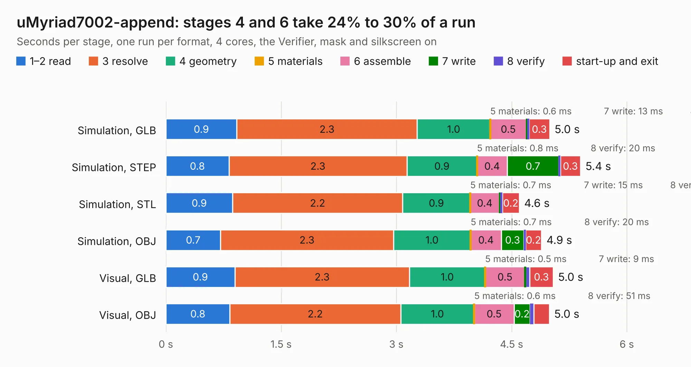

# 1723. uMyriad7002-append

Board 1,723 of the 3,123 of [Corpus Testing](../Corpus-Testing.md), on [Corpus Page 16](../CorpusTestingPages/Corpus-Testing-16.md#1723-umyriad7002-append).

| Mode and format | 1–2 read | 3 resolve | 4 geometry | 5 materials | 6 assemble | 7 write | 8 verify | start-up and exit | Total |
|---|---:|---:|---:|---:|---:|---:|---:|---:|---:|
| Simulation, GLB | 0.9 | 2.3 | 1.0 | 0.6&nbsp;ms | 0.5 | 13&nbsp;ms | 23&nbsp;ms | 0.3 | 5.0 |
| Simulation, STEP | 0.8 | 2.3 | 0.9 | 0.8&nbsp;ms | 0.4 | 0.7 | 20&nbsp;ms | 0.3 | 5.4 |
| Simulation, STL | 0.9 | 2.2 | 0.9 | 0.7&nbsp;ms | 0.4 | 15&nbsp;ms | 24&nbsp;ms | 0.2 | 4.6 |
| Simulation, OBJ | 0.7 | 2.3 | 1.0 | 0.7&nbsp;ms | 0.4 | 0.3 | 20&nbsp;ms | 0.2 | 4.9 |
| Visual, GLB | 0.9 | 2.3 | 1.0 | 0.5&nbsp;ms | 0.5 | 9&nbsp;ms | 54&nbsp;ms | 0.3 | 5.0 |
| Visual, OBJ | 0.8 | 2.2 | 1.0 | 0.6&nbsp;ms | 0.5 | 0.2 | 51&nbsp;ms | 0.2 | 5.0 |

<table align="center"><tr><td valign="top">

| Board | Repo: [myriadrf/reference-development-kit](https://github.com/myriadrf/reference-development-kit) Board: `uMyriad7002-append.kicad_pcb` |
|---|---|
| Folder | umyriadrf-7002 / v2 / KiCAD |
| Complexity | 333&nbsp;/&nbsp;1000 (size&nbsp;298, features&nbsp;35) |
| KESE&nbsp;features | through vias, filled zones |
| Tested | 9th November 2026 |
| Copper&nbsp;layers | 8 |
| File&nbsp;format | KiCad 3 (3) |
| Parts,&nbsp;tracks,&nbsp;vias | 272, 3,360, 701 |
| Triangles,&nbsp;simulation | 55,824 in 16 parts |
| Verifier | PASS in all six runs |

</td><td valign="top">

<table>
<tr><th>File type</th><th>File size</th><th>Peak memory used</th></tr>
<tr><th colspan="3" align="left">Simulation</th></tr>
<tr><td>GLB</td><td align="right">1.6&nbsp;MB</td><td align="right">223&nbsp;MB</td></tr>
<tr><td>STEP</td><td align="right">6.6&nbsp;MB</td><td align="right">227&nbsp;MB</td></tr>
<tr><td>STL</td><td align="right">2.8&nbsp;MB</td><td align="right">224&nbsp;MB</td></tr>
<tr><td>OBJ</td><td align="right">5.5&nbsp;MB</td><td align="right">230&nbsp;MB</td></tr>
<tr><th colspan="3" align="left">Visual</th></tr>
<tr><td>GLB</td><td align="right">1.4&nbsp;MB</td><td align="right">230&nbsp;MB</td></tr>
<tr><td>OBJ</td><td align="right">4.5&nbsp;MB</td><td align="right">225&nbsp;MB</td></tr>
</table>

</td></tr></table>

| Previous | Next |
|:---|---:|
| [1722. uMyriad6002](b1722b_reference-development-kit_uMyriad6002.md) | [1724. uMyriad7002](b1724b_reference-development-kit_uMyriad7002.md) |
