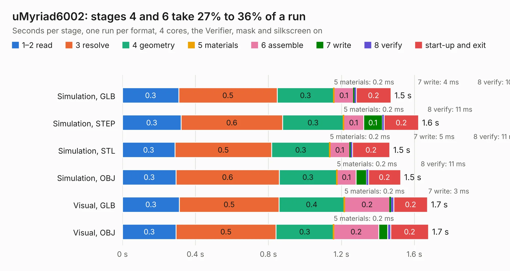

# 1726. uMyriad6002

Board 1,726 of the 3,130 of [Corpus Testing](../Corpus-Testing.md), on [Corpus Page 16](../CorpusTestingPages/Corpus-Testing-16.md#1726-umyriad6002).

| Mode and format | 1–2 read | 3 resolve | 4 geometry | 5 materials | 6 assemble | 7 write | 8 verify | start-up and exit | Total |
|---|---:|---:|---:|---:|---:|---:|---:|---:|---:|
| Simulation, GLB | 0.3 | 0.5 | 0.3 | 0.2&nbsp;ms | 0.1 | 4&nbsp;ms | 10&nbsp;ms | 0.2 | 1.5 |
| Simulation, STEP | 0.3 | 0.6 | 0.3 | 0.2&nbsp;ms | 0.1 | 0.1 | 11&nbsp;ms | 0.2 | 1.6 |
| Simulation, STL | 0.3 | 0.5 | 0.3 | 0.2&nbsp;ms | 0.1 | 5&nbsp;ms | 11&nbsp;ms | 0.2 | 1.5 |
| Simulation, OBJ | 0.3 | 0.6 | 0.3 | 0.2&nbsp;ms | 0.1 | 57&nbsp;ms | 11&nbsp;ms | 0.2 | 1.5 |
| Visual, GLB | 0.3 | 0.5 | 0.4 | 0.2&nbsp;ms | 0.2 | 3&nbsp;ms | 19&nbsp;ms | 0.2 | 1.7 |
| Visual, OBJ | 0.3 | 0.5 | 0.3 | 0.2&nbsp;ms | 0.2 | 49&nbsp;ms | 18&nbsp;ms | 0.2 | 1.7 |

<table align="center"><tr><td valign="top">

| Board | Repo: [myriadrf/reference-development-kit](https://github.com/myriadrf/reference-development-kit) Board: `uMyriad6002.kicad_pcb` |
|---|---|
| Folder | umyriadrf-6002 / v2 / KiCAD |
| Complexity | 301&nbsp;/&nbsp;1000 (size&nbsp;266, features&nbsp;35) |
| KESE&nbsp;features | through vias, filled zones |
| Tested | 9th November 2026 |
| Copper&nbsp;layers | 8 |
| File&nbsp;format | KiCad 3 (3) |
| Parts,&nbsp;tracks,&nbsp;vias | 102, 1,365, 264 |
| Triangles,&nbsp;simulation | 14,060 in 15 parts |
| Verifier | PASS in all six runs |

</td><td valign="top">

<table>
<tr><th>File type</th><th>File size</th><th>Peak memory used</th></tr>
<tr><th colspan="3" align="left">Simulation</th></tr>
<tr><td>GLB</td><td align="right">414&nbsp;kB</td><td align="right">88&nbsp;MB</td></tr>
<tr><td>STEP</td><td align="right">1.8&nbsp;MB</td><td align="right">88&nbsp;MB</td></tr>
<tr><td>STL</td><td align="right">704&nbsp;kB</td><td align="right">88&nbsp;MB</td></tr>
<tr><td>OBJ</td><td align="right">1.4&nbsp;MB</td><td align="right">87&nbsp;MB</td></tr>
<tr><th colspan="3" align="left">Visual</th></tr>
<tr><td>GLB</td><td align="right">390&nbsp;kB</td><td align="right">93&nbsp;MB</td></tr>
<tr><td>OBJ</td><td align="right">1.1&nbsp;MB</td><td align="right">91&nbsp;MB</td></tr>
</table>

</td></tr></table>

| Previous | Next |
|:---|---:|
| [1725. LMS8001_Companion](b1725b_reference-development-kit_LMS8001-Companion.md) | [1727. uMyriad7002-append](b1727b_reference-development-kit_uMyriad7002-append.md) |
