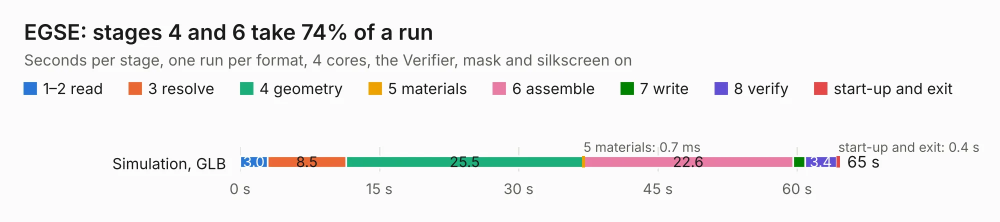

# 1727. EGSE

Board 1,727 of the 3,112 of [Corpus Testing](../Corpus-Testing.md), on [Corpus Page 16](../CorpusTestingPages/Corpus-Testing-16.md#1727-egse).

| Mode and format | 1–2 read | 3 resolve | 4 geometry | 5 materials | 6 assemble | 7 write | 8 verify | start-up and exit | Total |
|---|---:|---:|---:|---:|---:|---:|---:|---:|---:|
| Simulation, GLB | 3.0 | 8.5 | 25.5 | 0.7&nbsp;ms | 22.6 | 1.3 | 3.4 | 0.4 | 64.6 |
| Simulation, STEP | 2.9 | 8.9 | 26.0 | 0.8&nbsp;ms | 22.7 | 14.8 | 3.2 | 0.4 | 78.9 |
| Simulation, STL | 3.0 | 8.7 | 25.2 | 1&nbsp;ms | 21.7 | 2.1 | 2.9 | 0.4 | 64.1 |
| Simulation, OBJ | 2.8 | 8.4 | 24.7 | 1&nbsp;ms | 21.8 | 38.5 | 3.0 | 0.3 | 99.6 |
| Visual, GLB | 2.9 | 8.5 | 24.3 | 1&nbsp;ms | 43.4 | 0.6 | 4.5 | 0.3 | 84.6 |
| Visual, OBJ | 3.1 | 8.4 | 24.7 | 2&nbsp;ms | 45.0 | 19.6 | 5.0 | 0.3 | 106.1 |

<table align="center"><tr><td valign="top">

| Board | Repo: [nanosatlab/pocat-hw](https://github.com/nanosatlab/pocat-hw) Board: `EGSE.kicad_pcb` |
|---|---|
| Folder | pq_egse |
| Complexity | 323&nbsp;/&nbsp;1000 (size&nbsp;223, features&nbsp;100) |
| KESE&nbsp;features | through vias, rounded, trapezoid or chamfered pads, filled zones, curved board outline, TrueType text, stack-up, dielectric εr and tanδ |
| Tested | 9th November 2026 |
| Copper&nbsp;layers | 6 |
| File&nbsp;format | KiCad 7 (20221018) |
| Parts,&nbsp;tracks,&nbsp;vias | 104, 2,243, 172 |
| Triangles,&nbsp;simulation | 7,126,428 in 99 parts |
| Verifier | PASS in all six runs |

</td><td valign="top">

<table>
<tr><th>File type</th><th>File size</th><th>Peak memory used</th></tr>
<tr><th colspan="3" align="left">Simulation</th></tr>
<tr><td>GLB</td><td align="right">241&nbsp;MB</td><td align="right">1.9&nbsp;GB</td></tr>
<tr><td>STEP</td><td align="right">746&nbsp;MB</td><td align="right">2.4&nbsp;GB</td></tr>
<tr><td>STL</td><td align="right">356&nbsp;MB</td><td align="right">1.9&nbsp;GB</td></tr>
<tr><td>OBJ</td><td align="right">760&nbsp;MB</td><td align="right">4.6&nbsp;GB</td></tr>
<tr><th colspan="3" align="left">Visual</th></tr>
<tr><td>GLB</td><td align="right">123&nbsp;MB</td><td align="right">2.0&nbsp;GB</td></tr>
<tr><td>OBJ</td><td align="right">386&nbsp;MB</td><td align="right">2.5&nbsp;GB</td></tr>
</table>

</td></tr></table>

| Previous | Next |
|:---|---:|
| [1726. PQ_Botnotsobot](b1726b_pocat-hw_PQ-Botnotsobot.md) | [1728. PQ_EPS](b1728b_pocat-hw_PQ-EPS.md) |
