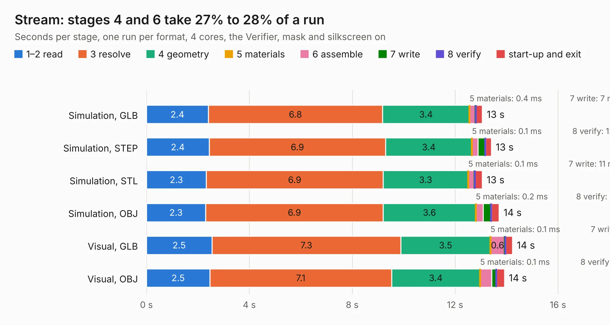

# 1728. Stream

Board 1,728 of the 3,126 of [Corpus Testing](../Corpus-Testing.md), on [Corpus Page 16](../CorpusTestingPages/Corpus-Testing-16.md#1728-stream).

| Mode and format | 1–2 read | 3 resolve | 4 geometry | 5 materials | 6 assemble | 7 write | 8 verify | start-up and exit | Total |
|---|---:|---:|---:|---:|---:|---:|---:|---:|---:|
| Simulation, GLB | 2.4 | 6.8 | 3.4 | 0.4&nbsp;ms | 0.2 | 7&nbsp;ms | 13&nbsp;ms | 0.3 | 13.1 |
| Simulation, STEP | 2.4 | 6.9 | 3.4 | 0.1&nbsp;ms | 0.2 | 0.3 | 12&nbsp;ms | 0.2 | 13.4 |
| Simulation, STL | 2.3 | 6.9 | 3.3 | 0.1&nbsp;ms | 0.2 | 11&nbsp;ms | 13&nbsp;ms | 0.3 | 13.1 |
| Simulation, OBJ | 2.3 | 6.9 | 3.6 | 0.2&nbsp;ms | 0.3 | 0.3 | 18&nbsp;ms | 0.3 | 13.7 |
| Visual, GLB | 2.5 | 7.3 | 3.5 | 0.1&nbsp;ms | 0.6 | 8&nbsp;ms | 33&nbsp;ms | 0.3 | 14.2 |
| Visual, OBJ | 2.5 | 7.1 | 3.4 | 0.1&nbsp;ms | 0.5 | 0.2 | 27&nbsp;ms | 0.3 | 13.9 |

<table align="center"><tr><td valign="top">

| Board | Repo: [myriadrf/STREAM](https://github.com/myriadrf/STREAM) Board: `Stream.kicad_pcb` |
|---|---|
| Folder | hardware / STREAM / v2 / v2r1 / KiCAD |
| Complexity | 402&nbsp;/&nbsp;1000 (size&nbsp;357, features&nbsp;45) |
| KESE&nbsp;features | through vias, slotted holes, filled zones |
| Tested | 9th November 2026 |
| Copper&nbsp;layers | 12 |
| File&nbsp;format | KiCad 3 (3) |
| Parts,&nbsp;tracks,&nbsp;vias | 695, 10,937, 1,470 |
| Triangles,&nbsp;simulation | 41,954 in 20 parts |
| Verifier | PASS in all six runs |

</td><td valign="top">

<table>
<tr><th>File type</th><th>File size</th><th>Peak memory used</th></tr>
<tr><th colspan="3" align="left">Simulation</th></tr>
<tr><td>GLB</td><td align="right">1.2&nbsp;MB</td><td align="right">416&nbsp;MB</td></tr>
<tr><td>STEP</td><td align="right">3.4&nbsp;MB</td><td align="right">414&nbsp;MB</td></tr>
<tr><td>STL</td><td align="right">2.1&nbsp;MB</td><td align="right">419&nbsp;MB</td></tr>
<tr><td>OBJ</td><td align="right">4.2&nbsp;MB</td><td align="right">421&nbsp;MB</td></tr>
<tr><th colspan="3" align="left">Visual</th></tr>
<tr><td>GLB</td><td align="right">931&nbsp;kB</td><td align="right">417&nbsp;MB</td></tr>
<tr><td>OBJ</td><td align="right">3.2&nbsp;MB</td><td align="right">414&nbsp;MB</td></tr>
</table>

</td></tr></table>

| Previous | Next |
|:---|---:|
| [1727. Zipper](b1727b_reference-development-kit_Zipper.md) | [1729. uSTREAM](b1729b_STREAM_uSTREAM.md) |
