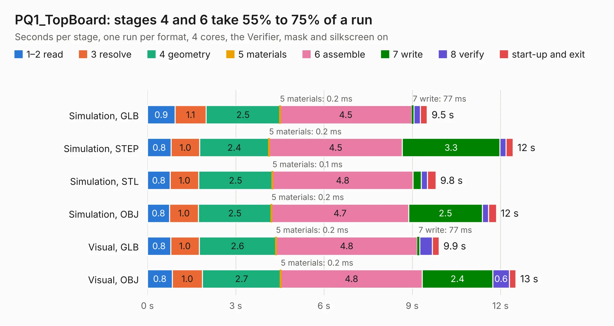

# 1728. PQ1_TopBoard

Board 1,728 of the 3,105 of [Corpus Testing](../Corpus-Testing.md), on [Corpus Page 16](../CorpusTestingPages/Corpus-Testing-16.md#1728-pq1_topboard).

| Mode and format | 1–2 read | 3 resolve | 4 geometry | 5 materials | 6 assemble | 7 write | 8 verify | start-up and exit | Total |
|---|---:|---:|---:|---:|---:|---:|---:|---:|---:|
| Simulation, GLB | 0.9 | 1.1 | 2.5 | 0.2&nbsp;ms | 4.5 | 77&nbsp;ms | 0.2 | 0.2 | 9.5 |
| Simulation, STEP | 0.8 | 1.0 | 2.4 | 0.2&nbsp;ms | 4.5 | 3.3 | 0.2 | 0.2 | 12.4 |
| Simulation, STL | 0.8 | 1.0 | 2.5 | 0.1&nbsp;ms | 4.8 | 0.3 | 0.2 | 0.3 | 9.8 |
| Simulation, OBJ | 0.8 | 1.0 | 2.5 | 0.2&nbsp;ms | 4.7 | 2.5 | 0.2 | 0.3 | 11.9 |
| Visual, GLB | 0.8 | 1.0 | 2.6 | 0.2&nbsp;ms | 4.8 | 77&nbsp;ms | 0.4 | 0.2 | 9.9 |
| Visual, OBJ | 0.8 | 1.0 | 2.7 | 0.2&nbsp;ms | 4.8 | 2.4 | 0.6 | 0.2 | 12.5 |

<table align="center"><tr><td valign="top">

| Board | Repo: [nanosatlab/pocat-hw](https://github.com/nanosatlab/pocat-hw) Board: `PQ1_TopBoard.kicad_pcb` |
|---|---|
| Folder | pq_topboard / PQ1_TopBoard |
| Complexity | 211&nbsp;/&nbsp;1000 (size&nbsp;121, features&nbsp;90) |
| KESE&nbsp;features | through vias, rounded, trapezoid or chamfered pads, filled zones, curved board outline, stack-up, dielectric εr and tanδ, mask and silkscreen colours |
| Tested | 9th November 2026 |
| Copper&nbsp;layers | 2 |
| File&nbsp;format | KiCad 7 (20221018) |
| Parts,&nbsp;tracks,&nbsp;vias | 10, 64, 17 |
| Triangles,&nbsp;simulation | 405,998 in 22 parts |
| Verifier | PASS in all six runs |

</td><td valign="top">

<table>
<tr><th>File type</th><th>File size</th><th>Peak memory used</th></tr>
<tr><th colspan="3" align="left">Simulation</th></tr>
<tr><td>GLB</td><td align="right">15&nbsp;MB</td><td align="right">390&nbsp;MB</td></tr>
<tr><td>STEP</td><td align="right">66&nbsp;MB</td><td align="right">397&nbsp;MB</td></tr>
<tr><td>STL</td><td align="right">20&nbsp;MB</td><td align="right">387&nbsp;MB</td></tr>
<tr><td>OBJ</td><td align="right">44&nbsp;MB</td><td align="right">388&nbsp;MB</td></tr>
<tr><th colspan="3" align="left">Visual</th></tr>
<tr><td>GLB</td><td align="right">14&nbsp;MB</td><td align="right">382&nbsp;MB</td></tr>
<tr><td>OBJ</td><td align="right">41&nbsp;MB</td><td align="right">408&nbsp;MB</td></tr>
</table>

</td></tr></table>

| Previous | Next |
|:---|---:|
| [1727. PQ_PL2](b1727b_pocat-hw_PQ-PL2.md) | [1729. PQ1_TopBoardV9](b1729b_pocat-hw_PQ1-TopBoardV9.md) |
