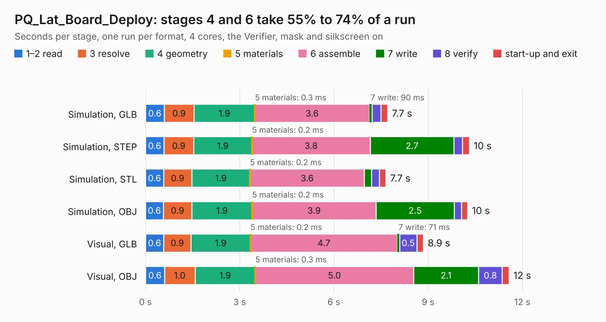

# 1730. PQ_Lat_Board_Deploy

Board 1,730 of the 3,112 of [Corpus Testing](../Corpus-Testing.md), on [Corpus Page 17](../CorpusTestingPages/Corpus-Testing-17.md#1730-pq_lat_board_deploy).

| Mode and format | 1–2 read | 3 resolve | 4 geometry | 5 materials | 6 assemble | 7 write | 8 verify | start-up and exit | Total |
|---|---:|---:|---:|---:|---:|---:|---:|---:|---:|
| Simulation, GLB | 0.6 | 0.9 | 1.9 | 0.3&nbsp;ms | 3.6 | 90&nbsp;ms | 0.3 | 0.2 | 7.7 |
| Simulation, STEP | 0.6 | 0.9 | 1.9 | 0.2&nbsp;ms | 3.8 | 2.7 | 0.3 | 0.2 | 10.3 |
| Simulation, STL | 0.6 | 0.9 | 1.9 | 0.2&nbsp;ms | 3.6 | 0.2 | 0.2 | 0.2 | 7.7 |
| Simulation, OBJ | 0.6 | 0.9 | 1.9 | 0.2&nbsp;ms | 3.9 | 2.5 | 0.2 | 0.2 | 10.3 |
| Visual, GLB | 0.6 | 0.9 | 1.9 | 0.2&nbsp;ms | 4.7 | 71&nbsp;ms | 0.5 | 0.2 | 8.9 |
| Visual, OBJ | 0.6 | 1.0 | 1.9 | 0.3&nbsp;ms | 5.0 | 2.1 | 0.8 | 0.2 | 11.6 |

<table align="center"><tr><td valign="top">

| Board | Repo: [nanosatlab/pocat-hw](https://github.com/nanosatlab/pocat-hw) Board: `PQ_Lat_Board_Deploy.kicad_pcb` |
|---|---|
| Folder | pq_latboard_deploy |
| Complexity | 271&nbsp;/&nbsp;1000 (size&nbsp;181, features&nbsp;90) |
| KESE&nbsp;features | through vias, rounded, trapezoid or chamfered pads, filled zones, curved board outline, stack-up, dielectric εr and tanδ, mask and silkscreen colours |
| Tested | 9th November 2026 |
| Copper&nbsp;layers | 6 |
| File&nbsp;format | KiCad 10 (20260206) |
| Parts,&nbsp;tracks,&nbsp;vias | 14, 675, 21 |
| Triangles,&nbsp;simulation | 593,064 in 29 parts |
| Verifier | PASS in all six runs |

</td><td valign="top">

<table>
<tr><th>File type</th><th>File size</th><th>Peak memory used</th></tr>
<tr><th colspan="3" align="left">Simulation</th></tr>
<tr><td>GLB</td><td align="right">22&nbsp;MB</td><td align="right">421&nbsp;MB</td></tr>
<tr><td>STEP</td><td align="right">84&nbsp;MB</td><td align="right">439&nbsp;MB</td></tr>
<tr><td>STL</td><td align="right">30&nbsp;MB</td><td align="right">418&nbsp;MB</td></tr>
<tr><td>OBJ</td><td align="right">64&nbsp;MB</td><td align="right">491&nbsp;MB</td></tr>
<tr><th colspan="3" align="left">Visual</th></tr>
<tr><td>GLB</td><td align="right">17&nbsp;MB</td><td align="right">418&nbsp;MB</td></tr>
<tr><td>OBJ</td><td align="right">49&nbsp;MB</td><td align="right">412&nbsp;MB</td></tr>
</table>

</td></tr></table>

| Previous | Next |
|:---|---:|
| [1729. PQ_Lat_Board](b1729b_pocat-hw_PQ-Lat-Board.md) | [1731. pq_obc_comms](b1731b_pocat-hw_pq-obc-comms.md) |
