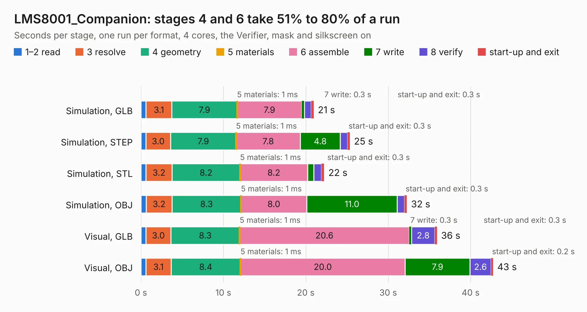

# 1731. LMS8001_Companion

Board 1,731 of the 3,138 of [Corpus Testing](../Corpus-Testing.md), on [Corpus Page 17](../CorpusTestingPages/Corpus-Testing-17.md#1731-lms8001_companion).

| Mode and format | 1–2 read | 3 resolve | 4 geometry | 5 materials | 6 assemble | 7 write | 8 verify | start-up and exit | Total |
|---|---:|---:|---:|---:|---:|---:|---:|---:|---:|
| Simulation, GLB | 0.6 | 3.1 | 7.9 | 1&nbsp;ms | 7.9 | 0.3 | 0.8 | 0.3 | 21.0 |
| Simulation, STEP | 0.6 | 3.0 | 7.9 | 1&nbsp;ms | 7.8 | 4.8 | 0.9 | 0.3 | 25.3 |
| Simulation, STL | 0.6 | 3.2 | 8.2 | 1&nbsp;ms | 8.2 | 0.8 | 0.9 | 0.3 | 22.2 |
| Simulation, OBJ | 0.6 | 3.2 | 8.3 | 1&nbsp;ms | 8.0 | 11.0 | 0.9 | 0.3 | 32.3 |
| Visual, GLB | 0.6 | 3.0 | 8.3 | 1&nbsp;ms | 20.6 | 0.3 | 2.8 | 0.3 | 35.9 |
| Visual, OBJ | 0.6 | 3.1 | 8.4 | 1&nbsp;ms | 20.0 | 7.9 | 2.6 | 0.2 | 42.7 |

<table align="center"><tr><td valign="top">

| Board | Repo: [myriadrf/reference-development-kit](https://github.com/myriadrf/reference-development-kit) Board: `LMS8001_Companion.kicad_pcb` |
|---|---|
| Folder | myriadrf-8001 / 1v0 / KiCAD |
| Complexity | 312&nbsp;/&nbsp;1000 (size&nbsp;257, features&nbsp;55) |
| KESE&nbsp;features | through vias, rounded, trapezoid or chamfered pads, filled zones, curved board outline |
| Tested | 9th November 2026 |
| Copper&nbsp;layers | 4 |
| File&nbsp;format | KiCad 3 (3) |
| Parts,&nbsp;tracks,&nbsp;vias | 282, 1,241, 165 |
| Triangles,&nbsp;simulation | 2,106,934 in 170 parts |
| Verifier | PASS in all six runs |

</td><td valign="top">

<table>
<tr><th>File type</th><th>File size</th><th>Peak memory used</th></tr>
<tr><th colspan="3" align="left">Simulation</th></tr>
<tr><td>GLB</td><td align="right">73&nbsp;MB</td><td align="right">912&nbsp;MB</td></tr>
<tr><td>STEP</td><td align="right">259&nbsp;MB</td><td align="right">1.0&nbsp;GB</td></tr>
<tr><td>STL</td><td align="right">105&nbsp;MB</td><td align="right">902&nbsp;MB</td></tr>
<tr><td>OBJ</td><td align="right">221&nbsp;MB</td><td align="right">1.4&nbsp;GB</td></tr>
<tr><th colspan="3" align="left">Visual</th></tr>
<tr><td>GLB</td><td align="right">51&nbsp;MB</td><td align="right">905&nbsp;MB</td></tr>
<tr><td>OBJ</td><td align="right">158&nbsp;MB</td><td align="right">1.1&nbsp;GB</td></tr>
</table>

</td></tr></table>

| Previous | Next |
|:---|---:|
| [1730. DigiRED](b1730b_RASDR_DigiRED.md) | [1732. uMyriad6002](b1732b_reference-development-kit_uMyriad6002.md) |
