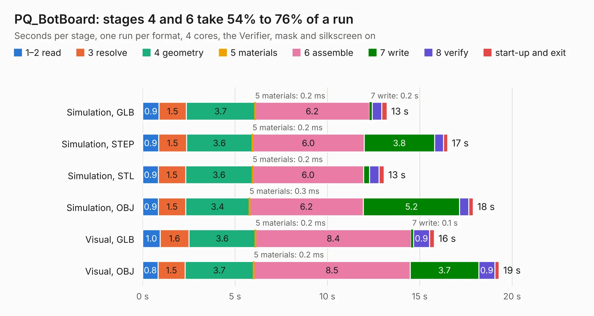

# 1733. PQ_BotBoard

Board 1,733 of the 3,120 of [Corpus Testing](../Corpus-Testing.md), on [Corpus Page 17](../CorpusTestingPages/Corpus-Testing-17.md#1733-pq_botboard).

| Mode and format | 1–2 read | 3 resolve | 4 geometry | 5 materials | 6 assemble | 7 write | 8 verify | start-up and exit | Total |
|---|---:|---:|---:|---:|---:|---:|---:|---:|---:|
| Simulation, GLB | 0.9 | 1.5 | 3.7 | 0.2&nbsp;ms | 6.2 | 0.2 | 0.5 | 0.3 | 13.2 |
| Simulation, STEP | 0.9 | 1.5 | 3.6 | 0.2&nbsp;ms | 6.0 | 3.8 | 0.5 | 0.2 | 16.5 |
| Simulation, STL | 0.9 | 1.5 | 3.6 | 0.2&nbsp;ms | 6.0 | 0.3 | 0.5 | 0.3 | 13.1 |
| Simulation, OBJ | 0.9 | 1.5 | 3.4 | 0.3&nbsp;ms | 6.2 | 5.2 | 0.5 | 0.2 | 17.9 |
| Visual, GLB | 1.0 | 1.6 | 3.6 | 0.2&nbsp;ms | 8.4 | 0.1 | 0.9 | 0.3 | 15.8 |
| Visual, OBJ | 0.8 | 1.5 | 3.7 | 0.2&nbsp;ms | 8.5 | 3.7 | 0.9 | 0.2 | 19.3 |

<table align="center"><tr><td valign="top">

| Board | Repo: [nanosatlab/pocat-hw](https://github.com/nanosatlab/pocat-hw) Board: `PQ_BotBoard.kicad_pcb` |
|---|---|
| Folder | pq_botboard / PQ_BotBoard |
| Complexity | 279&nbsp;/&nbsp;1000 (size&nbsp;189, features&nbsp;90) |
| KESE&nbsp;features | through vias, rounded, trapezoid or chamfered pads, filled zones, curved board outline, stack-up, dielectric εr and tanδ, mask and silkscreen colours |
| Tested | 9th November 2026 |
| Copper&nbsp;layers | 6 |
| File&nbsp;format | KiCad 10 (20260206) |
| Parts,&nbsp;tracks,&nbsp;vias | 21, 808, 57 |
| Triangles,&nbsp;simulation | 861,722 in 44 parts |
| Verifier | PASS in all six runs |

</td><td valign="top">

<table>
<tr><th>File type</th><th>File size</th><th>Peak memory used</th></tr>
<tr><th colspan="3" align="left">Simulation</th></tr>
<tr><td>GLB</td><td align="right">31&nbsp;MB</td><td align="right">448&nbsp;MB</td></tr>
<tr><td>STEP</td><td align="right">120&nbsp;MB</td><td align="right">514&nbsp;MB</td></tr>
<tr><td>STL</td><td align="right">43&nbsp;MB</td><td align="right">459&nbsp;MB</td></tr>
<tr><td>OBJ</td><td align="right">90&nbsp;MB</td><td align="right">661&nbsp;MB</td></tr>
<tr><th colspan="3" align="left">Visual</th></tr>
<tr><td>GLB</td><td align="right">22&nbsp;MB</td><td align="right">564&nbsp;MB</td></tr>
<tr><td>OBJ</td><td align="right">66&nbsp;MB</td><td align="right">537&nbsp;MB</td></tr>
</table>

</td></tr></table>

| Previous | Next |
|:---|---:|
| [1732. PQ_ADCS](b1732b_pocat-hw_pq-adcs-PQ-ADCS-HBridge_PQ-ADCS.md) | [1734. PQ_Botnotsobot](b1734b_pocat-hw_PQ-Botnotsobot.md) |
