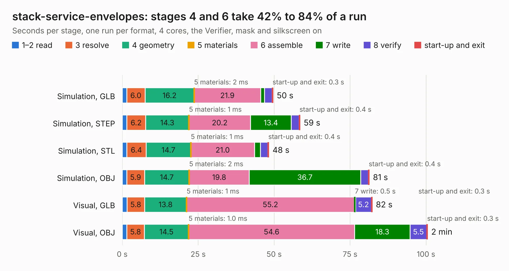

# 1735. stack-service-envelopes

Board 1,735 of the 3,103 of [Corpus Testing](../Corpus-Testing.md), on [Corpus Page 17](../CorpusTestingPages/Corpus-Testing-17.md#1735-stack-service-envelopes).

| Mode and format | 1–2 read | 3 resolve | 4 geometry | 5 materials | 6 assemble | 7 write | 8 verify | start-up and exit | Total |
|---|---:|---:|---:|---:|---:|---:|---:|---:|---:|
| Simulation, GLB | 1.5 | 6.0 | 16.2 | 2&nbsp;ms | 21.9 | 1.2 | 2.5 | 0.3 | 49.7 |
| Simulation, STEP | 1.5 | 6.2 | 14.3 | 1&nbsp;ms | 20.2 | 13.4 | 2.5 | 0.4 | 58.5 |
| Simulation, STL | 1.5 | 6.4 | 14.7 | 1&nbsp;ms | 21.0 | 1.9 | 2.4 | 0.4 | 48.3 |
| Simulation, OBJ | 1.5 | 5.9 | 14.7 | 2&nbsp;ms | 19.8 | 36.7 | 2.5 | 0.4 | 81.3 |
| Visual, GLB | 1.6 | 5.8 | 13.8 | 1&nbsp;ms | 55.2 | 0.5 | 5.2 | 0.3 | 82.3 |
| Visual, OBJ | 1.5 | 5.8 | 14.5 | 1.0&nbsp;ms | 54.6 | 18.3 | 5.5 | 0.3 | 100.5 |

<table align="center"><tr><td valign="top">

| Board | Repo: [naturalhazardscience/groundlark](https://github.com/naturalhazardscience/groundlark) Board: `stack-service-envelopes.kicad_pcb` |
|---|---|
| Folder | hw / groundlark-fpga-hat / boards / groundlark-daqhat-01 |
| Complexity | 417&nbsp;/&nbsp;1000 (size&nbsp;297, features&nbsp;120) |
| KESE&nbsp;features | through vias, custom pads, rounded, trapezoid or chamfered pads, filled zones, copper drawings, stack-up, dielectric εr and tanδ, copper finish, mask and silkscreen colours |
| Tested | 9th November 2026 |
| Copper&nbsp;layers | 6 |
| File&nbsp;format | KiCad 9 (20241229) |
| Parts,&nbsp;tracks,&nbsp;vias | 190, 12,366, 745 |
| Triangles,&nbsp;simulation | 5,819,912 in 381 parts |
| Verifier | PASS in all six runs |

</td><td valign="top">

<table>
<tr><th>File type</th><th>File size</th><th>Peak memory used</th></tr>
<tr><th colspan="3" align="left">Simulation</th></tr>
<tr><td>GLB</td><td align="right">195&nbsp;MB</td><td align="right">1.7&nbsp;GB</td></tr>
<tr><td>STEP</td><td align="right">676&nbsp;MB</td><td align="right">2.0&nbsp;GB</td></tr>
<tr><td>STL</td><td align="right">291&nbsp;MB</td><td align="right">1.6&nbsp;GB</td></tr>
<tr><td>OBJ</td><td align="right">625&nbsp;MB</td><td align="right">3.7&nbsp;GB</td></tr>
<tr><th colspan="3" align="left">Visual</th></tr>
<tr><td>GLB</td><td align="right">106&nbsp;MB</td><td align="right">2.0&nbsp;GB</td></tr>
<tr><td>OBJ</td><td align="right">343&nbsp;MB</td><td align="right">2.3&nbsp;GB</td></tr>
</table>

</td></tr></table>

| Previous | Next |
|:---|---:|
| [1734. stack-exploded](b1734b_groundlark_stack-exploded.md) | [1736. trenz-mounted](b1736b_groundlark_trenz-mounted.md) |
