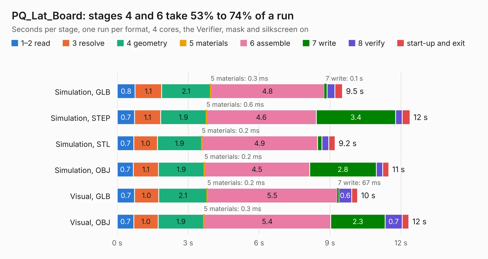

# 1735. PQ_Lat_Board

Board 1,735 of the 3,118 of [Corpus Testing](../Corpus-Testing.md), on [Corpus Page 17](../CorpusTestingPages/Corpus-Testing-17.md#1735-pq_lat_board).

| Mode and format | 1–2 read | 3 resolve | 4 geometry | 5 materials | 6 assemble | 7 write | 8 verify | start-up and exit | Total |
|---|---:|---:|---:|---:|---:|---:|---:|---:|---:|
| Simulation, GLB | 0.8 | 1.1 | 2.1 | 0.3&nbsp;ms | 4.8 | 0.1 | 0.3 | 0.3 | 9.5 |
| Simulation, STEP | 0.7 | 1.1 | 1.9 | 0.6&nbsp;ms | 4.6 | 3.4 | 0.3 | 0.3 | 12.4 |
| Simulation, STL | 0.7 | 1.0 | 1.9 | 0.2&nbsp;ms | 4.9 | 0.2 | 0.3 | 0.3 | 9.2 |
| Simulation, OBJ | 0.7 | 1.1 | 1.9 | 0.2&nbsp;ms | 4.5 | 2.8 | 0.3 | 0.3 | 11.5 |
| Visual, GLB | 0.7 | 1.0 | 2.1 | 0.2&nbsp;ms | 5.5 | 67&nbsp;ms | 0.6 | 0.2 | 10.2 |
| Visual, OBJ | 0.7 | 1.0 | 1.9 | 0.3&nbsp;ms | 5.4 | 2.3 | 0.7 | 0.3 | 12.3 |

<table align="center"><tr><td valign="top">

| Board | Repo: [nanosatlab/pocat-hw](https://github.com/nanosatlab/pocat-hw) Board: `PQ_Lat_Board.kicad_pcb` |
|---|---|
| Folder | pq_latboard / PQ_Lat_Board |
| Complexity | 260&nbsp;/&nbsp;1000 (size&nbsp;180, features&nbsp;80) |
| KESE&nbsp;features | through vias, rounded, trapezoid or chamfered pads, filled zones, stack-up, dielectric εr and tanδ, mask and silkscreen colours |
| Tested | 9th November 2026 |
| Copper&nbsp;layers | 6 |
| File&nbsp;format | KiCad 10 (20260206) |
| Parts,&nbsp;tracks,&nbsp;vias | 14, 670, 19 |
| Triangles,&nbsp;simulation | 554,510 in 30 parts |
| Verifier | PASS in all six runs |

</td><td valign="top">

<table>
<tr><th>File type</th><th>File size</th><th>Peak memory used</th></tr>
<tr><th colspan="3" align="left">Simulation</th></tr>
<tr><td>GLB</td><td align="right">20&nbsp;MB</td><td align="right">417&nbsp;MB</td></tr>
<tr><td>STEP</td><td align="right">80&nbsp;MB</td><td align="right">413&nbsp;MB</td></tr>
<tr><td>STL</td><td align="right">28&nbsp;MB</td><td align="right">417&nbsp;MB</td></tr>
<tr><td>OBJ</td><td align="right">60&nbsp;MB</td><td align="right">466&nbsp;MB</td></tr>
<tr><th colspan="3" align="left">Visual</th></tr>
<tr><td>GLB</td><td align="right">16&nbsp;MB</td><td align="right">459&nbsp;MB</td></tr>
<tr><td>OBJ</td><td align="right">47&nbsp;MB</td><td align="right">419&nbsp;MB</td></tr>
</table>

</td></tr></table>

| Previous | Next |
|:---|---:|
| [1734. PQ_EPS](b1734b_pocat-hw_PQ-EPS.md) | [1736. PQ_Lat_Board_Deploy](b1736b_pocat-hw_PQ-Lat-Board-Deploy.md) |
