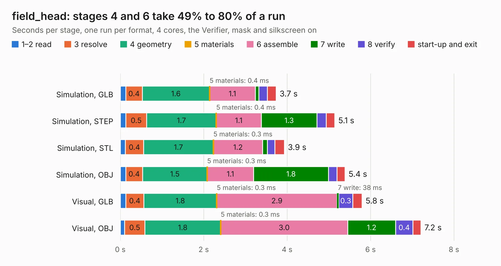

# 1736. field_head

Board 1,736 of the 3,108 of [Corpus Testing](../Corpus-Testing.md), on [Corpus Page 17](../CorpusTestingPages/Corpus-Testing-17.md#1736-field_head).

| Mode and format | 1–2 read | 3 resolve | 4 geometry | 5 materials | 6 assemble | 7 write | 8 verify | start-up and exit | Total |
|---|---:|---:|---:|---:|---:|---:|---:|---:|---:|
| Simulation, GLB | 0.1 | 0.4 | 1.6 | 0.4&nbsp;ms | 1.1 | 83&nbsp;ms | 0.2 | 0.2 | 3.7 |
| Simulation, STEP | 0.1 | 0.5 | 1.7 | 0.4&nbsp;ms | 1.1 | 1.3 | 0.2 | 0.2 | 5.1 |
| Simulation, STL | 0.1 | 0.4 | 1.7 | 0.3&nbsp;ms | 1.2 | 0.1 | 0.2 | 0.2 | 3.9 |
| Simulation, OBJ | 0.1 | 0.4 | 1.5 | 0.3&nbsp;ms | 1.1 | 1.8 | 0.2 | 0.2 | 5.4 |
| Visual, GLB | 0.1 | 0.4 | 1.8 | 0.3&nbsp;ms | 2.9 | 38&nbsp;ms | 0.3 | 0.2 | 5.8 |
| Visual, OBJ | 0.1 | 0.5 | 1.8 | 0.3&nbsp;ms | 3.0 | 1.2 | 0.4 | 0.2 | 7.2 |

<table align="center"><tr><td valign="top">

| Board | Repo: [naturalhazardscience/groundlark](https://github.com/naturalhazardscience/groundlark) Board: `field_head.kicad_pcb` |
|---|---|
| Folder | hw / burrowlark-usb / layout / field_head |
| Complexity | 165&nbsp;/&nbsp;1000 (size&nbsp;95, features&nbsp;70) |
| KESE&nbsp;features | slotted holes, rounded, trapezoid or chamfered pads, stack-up, dielectric εr and tanδ, copper finish, mask and silkscreen colours |
| Tested | 9th November 2026 |
| Copper&nbsp;layers | 2 |
| File&nbsp;format | KiCad 9 (20241229) |
| Parts,&nbsp;tracks,&nbsp;vias | 34, 0, 0 |
| Triangles,&nbsp;simulation | 398,116 in 64 parts |
| Verifier | PASS in all six runs |

</td><td valign="top">

<table>
<tr><th>File type</th><th>File size</th><th>Peak memory used</th></tr>
<tr><th colspan="3" align="left">Simulation</th></tr>
<tr><td>GLB</td><td align="right">14&nbsp;MB</td><td align="right">268&nbsp;MB</td></tr>
<tr><td>STEP</td><td align="right">56&nbsp;MB</td><td align="right">292&nbsp;MB</td></tr>
<tr><td>STL</td><td align="right">20&nbsp;MB</td><td align="right">291&nbsp;MB</td></tr>
<tr><td>OBJ</td><td align="right">41&nbsp;MB</td><td align="right">322&nbsp;MB</td></tr>
<tr><th colspan="3" align="left">Visual</th></tr>
<tr><td>GLB</td><td align="right">8.6&nbsp;MB</td><td align="right">301&nbsp;MB</td></tr>
<tr><td>OBJ</td><td align="right">25&nbsp;MB</td><td align="right">297&nbsp;MB</td></tr>
</table>

</td></tr></table>

| Previous | Next |
|:---|---:|
| [1735. groundlark-field-head](b1735b_groundlark_groundlark-field-head.md) | [1737. groundlark-daqhat-01](b1737b_groundlark_groundlark-daqhat-01.md) |
