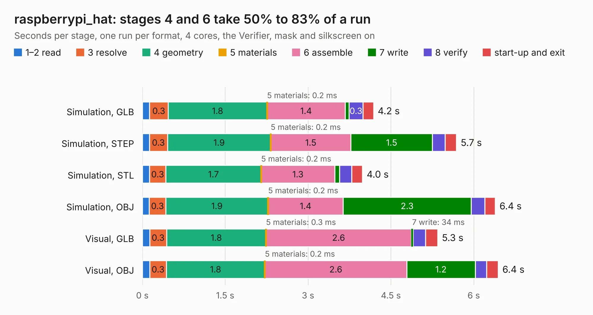

# 1736. raspberrypi_hat

Board 1,736 of the 3,101 of [Corpus Testing](../Corpus-Testing.md), on [Corpus Page 17](../CorpusTestingPages/Corpus-Testing-17.md#1736-raspberrypi_hat).

| Mode and format | 1–2 read | 3 resolve | 4 geometry | 5 materials | 6 assemble | 7 write | 8 verify | start-up and exit | Total |
|---|---:|---:|---:|---:|---:|---:|---:|---:|---:|
| Simulation, GLB | 0.1 | 0.3 | 1.8 | 0.2&nbsp;ms | 1.4 | 70&nbsp;ms | 0.3 | 0.2 | 4.2 |
| Simulation, STEP | 0.1 | 0.3 | 1.9 | 0.2&nbsp;ms | 1.5 | 1.5 | 0.2 | 0.2 | 5.7 |
| Simulation, STL | 0.1 | 0.3 | 1.7 | 0.2&nbsp;ms | 1.3 | 88&nbsp;ms | 0.2 | 0.2 | 4.0 |
| Simulation, OBJ | 0.1 | 0.3 | 1.9 | 0.2&nbsp;ms | 1.4 | 2.3 | 0.2 | 0.2 | 6.4 |
| Visual, GLB | 0.1 | 0.3 | 1.8 | 0.3&nbsp;ms | 2.6 | 34&nbsp;ms | 0.2 | 0.2 | 5.3 |
| Visual, OBJ | 0.1 | 0.3 | 1.8 | 0.2&nbsp;ms | 2.6 | 1.2 | 0.2 | 0.2 | 6.4 |

<table align="center"><tr><td valign="top">

| Board | Repo: [naturalhazardscience/groundlark](https://github.com/naturalhazardscience/groundlark) Board: `raspberrypi_hat.kicad_pcb` |
|---|---|
| Folder | hw / shared / reference |
| Complexity | 161&nbsp;/&nbsp;1000 (size&nbsp;131, features&nbsp;30) |
| KESE&nbsp;features | filled zones, curved board outline |
| Tested | 9th November 2026 |
| Copper&nbsp;layers | 4 |
| File&nbsp;format | KiCad 5 (20171130) |
| Parts,&nbsp;tracks,&nbsp;vias | 14, 63, 0 |
| Triangles,&nbsp;simulation | 438,762 in 24 parts |
| Verifier | PASS in all six runs |

</td><td valign="top">

<table>
<tr><th>File type</th><th>File size</th><th>Peak memory used</th></tr>
<tr><th colspan="3" align="left">Simulation</th></tr>
<tr><td>GLB</td><td align="right">15&nbsp;MB</td><td align="right">271&nbsp;MB</td></tr>
<tr><td>STEP</td><td align="right">62&nbsp;MB</td><td align="right">288&nbsp;MB</td></tr>
<tr><td>STL</td><td align="right">22&nbsp;MB</td><td align="right">266&nbsp;MB</td></tr>
<tr><td>OBJ</td><td align="right">44&nbsp;MB</td><td align="right">338&nbsp;MB</td></tr>
<tr><th colspan="3" align="left">Visual</th></tr>
<tr><td>GLB</td><td align="right">7.7&nbsp;MB</td><td align="right">258&nbsp;MB</td></tr>
<tr><td>OBJ</td><td align="right">22&nbsp;MB</td><td align="right">257&nbsp;MB</td></tr>
</table>

</td></tr></table>

| Previous | Next |
|:---|---:|
| [1735. trenz_hat](b1735b_groundlark_trenz-hat.md) | [1737. skylark-usb](b1737b_groundlark_skylark-usb.md) |
