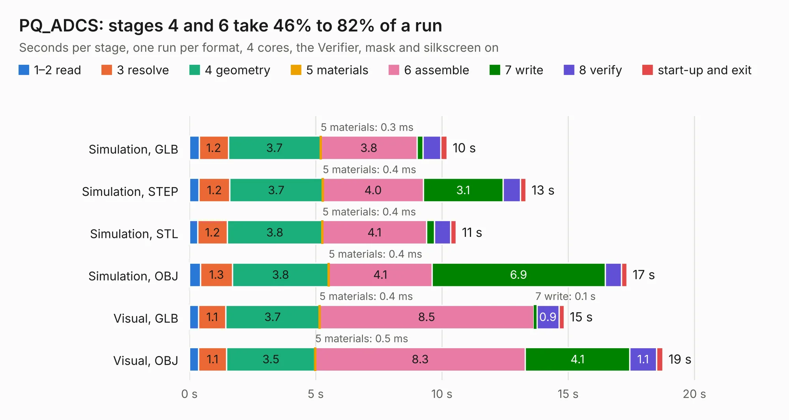

# 1736. PQ_ADCS

Board 1,736 of the 3,128 of [Corpus Testing](../Corpus-Testing.md), on [Corpus Page 17](../CorpusTestingPages/Corpus-Testing-17.md#1736-pq_adcs).

| Mode and format | 1–2 read | 3 resolve | 4 geometry | 5 materials | 6 assemble | 7 write | 8 verify | start-up and exit | Total |
|---|---:|---:|---:|---:|---:|---:|---:|---:|---:|
| Simulation, GLB | 0.4 | 1.2 | 3.7 | 0.3&nbsp;ms | 3.8 | 0.2 | 0.7 | 0.3 | 10.2 |
| Simulation, STEP | 0.4 | 1.2 | 3.7 | 0.4&nbsp;ms | 4.0 | 3.1 | 0.7 | 0.2 | 13.3 |
| Simulation, STL | 0.3 | 1.2 | 3.8 | 0.4&nbsp;ms | 4.1 | 0.3 | 0.6 | 0.2 | 10.6 |
| Simulation, OBJ | 0.4 | 1.3 | 3.8 | 0.4&nbsp;ms | 4.1 | 6.9 | 0.6 | 0.2 | 17.3 |
| Visual, GLB | 0.4 | 1.1 | 3.7 | 0.4&nbsp;ms | 8.5 | 0.1 | 0.9 | 0.2 | 14.8 |
| Visual, OBJ | 0.4 | 1.1 | 3.5 | 0.5&nbsp;ms | 8.3 | 4.1 | 1.1 | 0.3 | 18.7 |

<table align="center"><tr><td valign="top">

| Board | Repo: [nanosatlab/pocat-hw](https://github.com/nanosatlab/pocat-hw) Board: `PQ_ADCS.kicad_pcb` |
|---|---|
| Folder | pq_adcs / PQ_ADCS |
| Complexity | 296&nbsp;/&nbsp;1000 (size&nbsp;196, features&nbsp;100) |
| KESE&nbsp;features | through vias, slotted holes, rounded, trapezoid or chamfered pads, filled zones, curved board outline, stack-up, dielectric εr and tanδ, mask and silkscreen colours |
| Tested | 9th November 2026 |
| Copper&nbsp;layers | 6 |
| File&nbsp;format | KiCad 7 (20221018) |
| Parts,&nbsp;tracks,&nbsp;vias | 45, 603, 89 |
| Triangles,&nbsp;simulation | 1,290,194 in 93 parts |
| Verifier | PASS in all six runs |

</td><td valign="top">

<table>
<tr><th>File type</th><th>File size</th><th>Peak memory used</th></tr>
<tr><th colspan="3" align="left">Simulation</th></tr>
<tr><td>GLB</td><td align="right">43&nbsp;MB</td><td align="right">503&nbsp;MB</td></tr>
<tr><td>STEP</td><td align="right">171&nbsp;MB</td><td align="right">593&nbsp;MB</td></tr>
<tr><td>STL</td><td align="right">65&nbsp;MB</td><td align="right">496&nbsp;MB</td></tr>
<tr><td>OBJ</td><td align="right">132&nbsp;MB</td><td align="right">871&nbsp;MB</td></tr>
<tr><th colspan="3" align="left">Visual</th></tr>
<tr><td>GLB</td><td align="right">26&nbsp;MB</td><td align="right">638&nbsp;MB</td></tr>
<tr><td>OBJ</td><td align="right">79&nbsp;MB</td><td align="right">603&nbsp;MB</td></tr>
</table>

</td></tr></table>

| Previous | Next |
|:---|---:|
| [1735. webcam_microphone_system](b1735b_vohm_webcam-microphone-system.md) | [1737. PQ_ADCS](b1737b_pocat-hw_pq-adcs-PQ-ADCS-HBridge_PQ-ADCS.md) |
