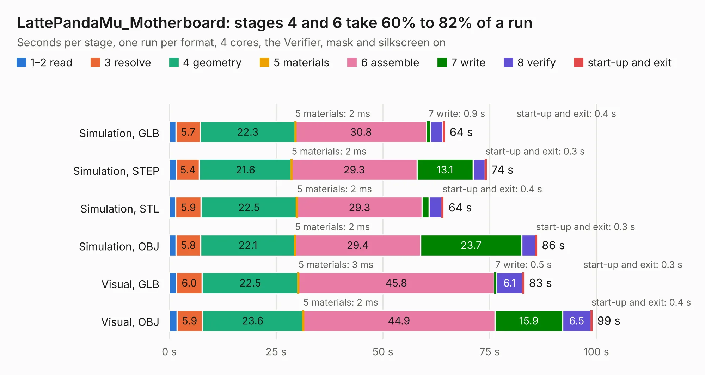

# 1736. LattePandaMu_Motherboard

Board 1,736 of the 3,131 of [Corpus Testing](../Corpus-Testing.md), on [Corpus Page 17](../CorpusTestingPages/Corpus-Testing-17.md#1736-lattepandamu_motherboard).

| Mode and format | 1–2 read | 3 resolve | 4 geometry | 5 materials | 6 assemble | 7 write | 8 verify | start-up and exit | Total |
|---|---:|---:|---:|---:|---:|---:|---:|---:|---:|
| Simulation, GLB | 1.6 | 5.7 | 22.3 | 2&nbsp;ms | 30.8 | 0.9 | 2.9 | 0.4 | 64.4 |
| Simulation, STEP | 1.7 | 5.4 | 21.6 | 2&nbsp;ms | 29.3 | 13.1 | 2.8 | 0.3 | 74.2 |
| Simulation, STL | 1.5 | 5.9 | 22.5 | 2&nbsp;ms | 29.3 | 1.7 | 2.9 | 0.4 | 64.2 |
| Simulation, OBJ | 1.6 | 5.8 | 22.1 | 2&nbsp;ms | 29.4 | 23.7 | 3.2 | 0.3 | 86.0 |
| Visual, GLB | 1.7 | 6.0 | 22.5 | 3&nbsp;ms | 45.8 | 0.5 | 6.1 | 0.3 | 83.0 |
| Visual, OBJ | 1.8 | 5.9 | 23.6 | 2&nbsp;ms | 44.9 | 15.9 | 6.5 | 0.4 | 99.0 |

<table align="center"><tr><td valign="top">

| Board | Repo: [nalgonda-tiger/vohm](https://github.com/nalgonda-tiger/vohm) Board: `LattePandaMu_Motherboard.kicad_pcb` |
|---|---|
| Folder | LattePandaMu_Motherboard-Main |
| Complexity | 413&nbsp;/&nbsp;1000 (size&nbsp;278, features&nbsp;135) |
| KESE&nbsp;features | through vias, slotted holes, custom pads, rounded, trapezoid or chamfered pads, arc tracks, filled zones, copper drawings, curved board outline, stack-up, dielectric εr and tanδ |
| Tested | 9th November 2026 |
| Copper&nbsp;layers | 4 |
| File&nbsp;format | KiCad 9 (20241229) |
| Parts,&nbsp;tracks,&nbsp;vias | 305, 4,033, 724 |
| Triangles,&nbsp;simulation | 4,431,648 in 487 parts |
| Verifier | PASS in all six runs |

</td><td valign="top">

<table>
<tr><th>File type</th><th>File size</th><th>Peak memory used</th></tr>
<tr><th colspan="3" align="left">Simulation</th></tr>
<tr><td>GLB</td><td align="right">153&nbsp;MB</td><td align="right">1.4&nbsp;GB</td></tr>
<tr><td>STEP</td><td align="right">679&nbsp;MB</td><td align="right">1.9&nbsp;GB</td></tr>
<tr><td>STL</td><td align="right">222&nbsp;MB</td><td align="right">1.5&nbsp;GB</td></tr>
<tr><td>OBJ</td><td align="right">478&nbsp;MB</td><td align="right">2.9&nbsp;GB</td></tr>
<tr><th colspan="3" align="left">Visual</th></tr>
<tr><td>GLB</td><td align="right">110&nbsp;MB</td><td align="right">1.8&nbsp;GB</td></tr>
<tr><td>OBJ</td><td align="right">350&nbsp;MB</td><td align="right">2.3&nbsp;GB</td></tr>
</table>

</td></tr></table>

| Previous | Next |
|:---|---:|
| [1735. keyboard_system](b1735b_vohm_keyboard-system.md) | [1737. NewAudio_System](b1737b_vohm_NewAudio-System.md) |
