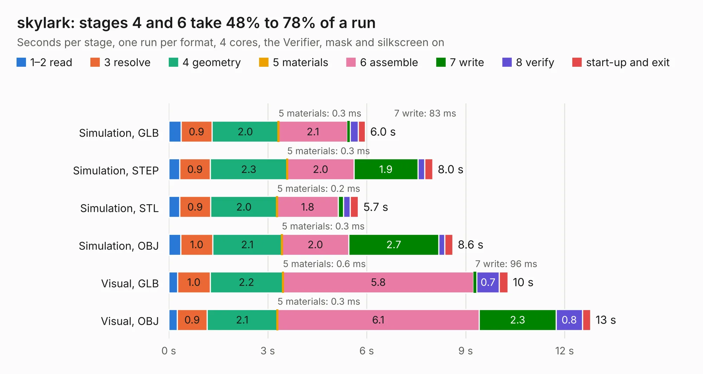

# 1738. skylark

Board 1,738 of the 3,101 of [Corpus Testing](../Corpus-Testing.md), on [Corpus Page 17](../CorpusTestingPages/Corpus-Testing-17.md#1738-skylark).

| Mode and format | 1–2 read | 3 resolve | 4 geometry | 5 materials | 6 assemble | 7 write | 8 verify | start-up and exit | Total |
|---|---:|---:|---:|---:|---:|---:|---:|---:|---:|
| Simulation, GLB | 0.4 | 0.9 | 2.0 | 0.3&nbsp;ms | 2.1 | 83&nbsp;ms | 0.2 | 0.2 | 6.0 |
| Simulation, STEP | 0.3 | 0.9 | 2.3 | 0.3&nbsp;ms | 2.0 | 1.9 | 0.2 | 0.2 | 8.0 |
| Simulation, STL | 0.3 | 0.9 | 2.0 | 0.2&nbsp;ms | 1.8 | 0.2 | 0.2 | 0.2 | 5.7 |
| Simulation, OBJ | 0.4 | 1.0 | 2.1 | 0.3&nbsp;ms | 2.0 | 2.7 | 0.2 | 0.2 | 8.6 |
| Visual, GLB | 0.3 | 1.0 | 2.2 | 0.6&nbsp;ms | 5.8 | 96&nbsp;ms | 0.7 | 0.3 | 10.3 |
| Visual, OBJ | 0.3 | 0.9 | 2.1 | 0.3&nbsp;ms | 6.1 | 2.3 | 0.8 | 0.2 | 12.8 |

<table align="center"><tr><td valign="top">

| Board | Repo: [naturalhazardscience/groundlark](https://github.com/naturalhazardscience/groundlark) Board: `skylark.kicad_pcb` |
|---|---|
| Folder | hw / skylark-usb / layout / skylark |
| Complexity | 179&nbsp;/&nbsp;1000 (size&nbsp;109, features&nbsp;70) |
| KESE&nbsp;features | slotted holes, rounded, trapezoid or chamfered pads, stack-up, dielectric εr and tanδ, copper finish, mask and silkscreen colours |
| Tested | 9th November 2026 |
| Copper&nbsp;layers | 2 |
| File&nbsp;format | KiCad 9 (20241229) |
| Parts,&nbsp;tracks,&nbsp;vias | 121, 0, 0 |
| Triangles,&nbsp;simulation | 507,884 in 104 parts |
| Note | mostly unrouted |
| Verifier | PASS in all six runs |

</td><td valign="top">

<table>
<tr><th>File type</th><th>File size</th><th>Peak memory used</th></tr>
<tr><th colspan="3" align="left">Simulation</th></tr>
<tr><td>GLB</td><td align="right">18&nbsp;MB</td><td align="right">344&nbsp;MB</td></tr>
<tr><td>STEP</td><td align="right">72&nbsp;MB</td><td align="right">413&nbsp;MB</td></tr>
<tr><td>STL</td><td align="right">25&nbsp;MB</td><td align="right">340&nbsp;MB</td></tr>
<tr><td>OBJ</td><td align="right">53&nbsp;MB</td><td align="right">410&nbsp;MB</td></tr>
<tr><th colspan="3" align="left">Visual</th></tr>
<tr><td>GLB</td><td align="right">16&nbsp;MB</td><td align="right">436&nbsp;MB</td></tr>
<tr><td>OBJ</td><td align="right">46&nbsp;MB</td><td align="right">469&nbsp;MB</td></tr>
</table>

</td></tr></table>

| Previous | Next |
|:---|---:|
| [1737. skylark-usb](b1737b_groundlark_skylark-usb.md) | [1739. C64C-250469-01-A](b1739b_Commodore64C_C64C-250469-01-A.md) |
