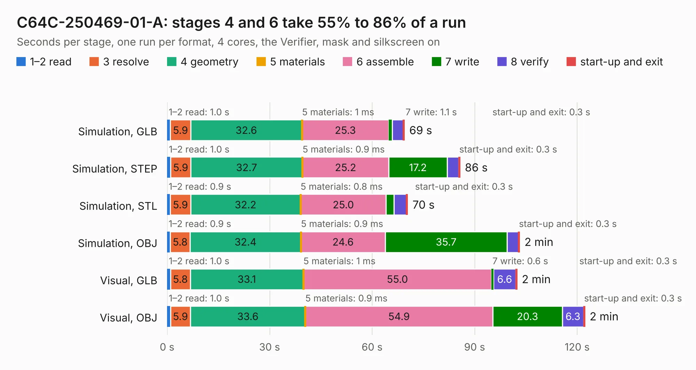

# 1739. C64C-250469-01-A

Board 1,739 of the 3,101 of [Corpus Testing](../Corpus-Testing.md), on [Corpus Page 17](../CorpusTestingPages/Corpus-Testing-17.md#1739-c64c-250469-01-a).

| Mode and format | 1–2 read | 3 resolve | 4 geometry | 5 materials | 6 assemble | 7 write | 8 verify | start-up and exit | Total |
|---|---:|---:|---:|---:|---:|---:|---:|---:|---:|
| Simulation, GLB | 1.0 | 5.9 | 32.6 | 1&nbsp;ms | 25.3 | 1.1 | 3.2 | 0.3 | 69.4 |
| Simulation, STEP | 1.0 | 5.9 | 32.7 | 0.9&nbsp;ms | 25.2 | 17.2 | 3.4 | 0.3 | 85.7 |
| Simulation, STL | 0.9 | 5.9 | 32.2 | 0.8&nbsp;ms | 25.0 | 2.3 | 3.6 | 0.3 | 70.4 |
| Simulation, OBJ | 0.9 | 5.8 | 32.4 | 0.9&nbsp;ms | 24.6 | 35.7 | 3.3 | 0.3 | 103.1 |
| Visual, GLB | 1.0 | 5.8 | 33.1 | 1&nbsp;ms | 55.0 | 0.6 | 6.6 | 0.3 | 102.4 |
| Visual, OBJ | 1.0 | 5.9 | 33.6 | 0.9&nbsp;ms | 54.9 | 20.3 | 6.3 | 0.3 | 122.2 |

<table align="center"><tr><td valign="top">

| Board | Repo: [NeedfulThings/Commodore64C](https://github.com/NeedfulThings/Commodore64C) Board: `C64C-250469-01-A.kicad_pcb` |
|---|---|
| Folder | 250469-RevA |
| Complexity | 257&nbsp;/&nbsp;1000 (size&nbsp;202, features&nbsp;55) |
| KESE&nbsp;features | through vias, slotted holes, rounded, trapezoid or chamfered pads, filled zones |
| Tested | 9th November 2026 |
| Copper&nbsp;layers | 2 |
| File&nbsp;format | KiCad 5 (20171130) |
| Parts,&nbsp;tracks,&nbsp;vias | 131, 2,533, 241 |
| Triangles,&nbsp;simulation | 6,379,874 in 215 parts |
| Verifier | PASS in all six runs |

</td><td valign="top">

<table>
<tr><th>File type</th><th>File size</th><th>Peak memory used</th></tr>
<tr><th colspan="3" align="left">Simulation</th></tr>
<tr><td>GLB</td><td align="right">218&nbsp;MB</td><td align="right">2.0&nbsp;GB</td></tr>
<tr><td>STEP</td><td align="right">1.1&nbsp;GB</td><td align="right">2.3&nbsp;GB</td></tr>
<tr><td>STL</td><td align="right">319&nbsp;MB</td><td align="right">2.0&nbsp;GB</td></tr>
<tr><td>OBJ</td><td align="right">683&nbsp;MB</td><td align="right">4.1&nbsp;GB</td></tr>
<tr><th colspan="3" align="left">Visual</th></tr>
<tr><td>GLB</td><td align="right">131&nbsp;MB</td><td align="right">2.3&nbsp;GB</td></tr>
<tr><td>OBJ</td><td align="right">415&nbsp;MB</td><td align="right">2.8&nbsp;GB</td></tr>
</table>

</td></tr></table>

| Previous | Next |
|:---|---:|
| [1738. skylark](b1738b_groundlark_skylark.md) | [1740. ethersweep](b1740b_ethersweep_electronic-design-development-ethersweep402_ethersweep.md) |
