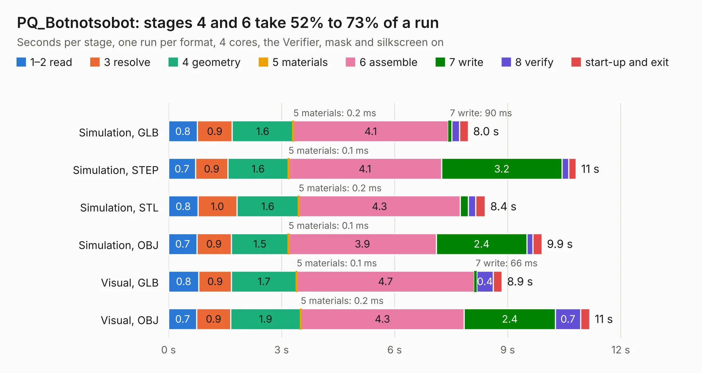

# 1740. PQ_Botnotsobot

Board 1,740 of the 3,129 of [Corpus Testing](../Corpus-Testing.md), on [Corpus Page 17](../CorpusTestingPages/Corpus-Testing-17.md#1740-pq_botnotsobot).

| Mode and format | 1–2 read | 3 resolve | 4 geometry | 5 materials | 6 assemble | 7 write | 8 verify | start-up and exit | Total |
|---|---:|---:|---:|---:|---:|---:|---:|---:|---:|
| Simulation, GLB | 0.8 | 0.9 | 1.6 | 0.2&nbsp;ms | 4.1 | 90&nbsp;ms | 0.2 | 0.2 | 8.0 |
| Simulation, STEP | 0.7 | 0.9 | 1.6 | 0.1&nbsp;ms | 4.1 | 3.2 | 0.2 | 0.2 | 10.8 |
| Simulation, STL | 0.8 | 1.0 | 1.6 | 0.2&nbsp;ms | 4.3 | 0.2 | 0.2 | 0.3 | 8.4 |
| Simulation, OBJ | 0.7 | 0.9 | 1.5 | 0.1&nbsp;ms | 3.9 | 2.4 | 0.2 | 0.2 | 9.9 |
| Visual, GLB | 0.8 | 0.9 | 1.7 | 0.1&nbsp;ms | 4.7 | 66&nbsp;ms | 0.4 | 0.2 | 8.9 |
| Visual, OBJ | 0.7 | 0.9 | 1.9 | 0.2&nbsp;ms | 4.3 | 2.4 | 0.7 | 0.2 | 11.2 |

<table align="center"><tr><td valign="top">

| Board | Repo: [nanosatlab/pocat-hw](https://github.com/nanosatlab/pocat-hw) Board: `PQ_Botnotsobot.kicad_pcb` |
|---|---|
| Folder | pq_botnotsobot / PQ_Botnotsobot |
| Complexity | 84&nbsp;/&nbsp;1000 (size&nbsp;29, features&nbsp;55) |
| KESE&nbsp;features | copper drawings, curved board outline, stack-up, dielectric εr and tanδ, mask and silkscreen colours |
| Tested | 9th November 2026 |
| Copper&nbsp;layers | 2 |
| File&nbsp;format | KiCad 10 (20260206) |
| Parts,&nbsp;tracks,&nbsp;vias | 2, 0, 0 |
| Triangles,&nbsp;simulation | 363,220 in 21 parts |
| Verifier | PASS in all six runs |

</td><td valign="top">

<table>
<tr><th>File type</th><th>File size</th><th>Peak memory used</th></tr>
<tr><th colspan="3" align="left">Simulation</th></tr>
<tr><td>GLB</td><td align="right">14&nbsp;MB</td><td align="right">366&nbsp;MB</td></tr>
<tr><td>STEP</td><td align="right">54&nbsp;MB</td><td align="right">368&nbsp;MB</td></tr>
<tr><td>STL</td><td align="right">18&nbsp;MB</td><td align="right">367&nbsp;MB</td></tr>
<tr><td>OBJ</td><td align="right">40&nbsp;MB</td><td align="right">367&nbsp;MB</td></tr>
<tr><th colspan="3" align="left">Visual</th></tr>
<tr><td>GLB</td><td align="right">13&nbsp;MB</td><td align="right">382&nbsp;MB</td></tr>
<tr><td>OBJ</td><td align="right">37&nbsp;MB</td><td align="right">338&nbsp;MB</td></tr>
</table>

</td></tr></table>

| Previous | Next |
|:---|---:|
| [1739. PQ_BotBoard](b1739b_pocat-hw_PQ-BotBoard.md) | [1741. EGSE](b1741b_pocat-hw_EGSE.md) |
