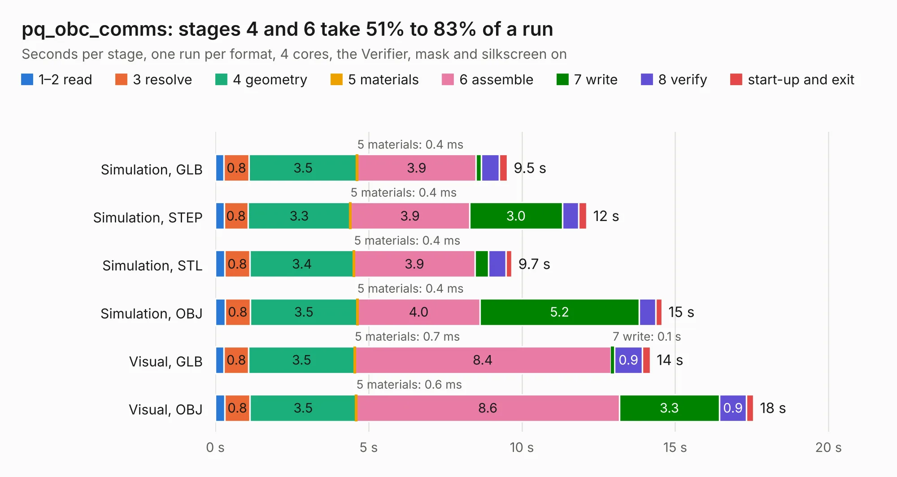

# 1743. pq_obc_comms

Board 1,743 of the 3,124 of [Corpus Testing](../Corpus-Testing.md), on [Corpus Page 17](../CorpusTestingPages/Corpus-Testing-17.md#1743-pq_obc_comms).

| Mode and format | 1–2 read | 3 resolve | 4 geometry | 5 materials | 6 assemble | 7 write | 8 verify | start-up and exit | Total |
|---|---:|---:|---:|---:|---:|---:|---:|---:|---:|
| Simulation, GLB | 0.3 | 0.8 | 3.5 | 0.4&nbsp;ms | 3.9 | 0.2 | 0.6 | 0.3 | 9.5 |
| Simulation, STEP | 0.3 | 0.8 | 3.3 | 0.4&nbsp;ms | 3.9 | 3.0 | 0.5 | 0.3 | 12.1 |
| Simulation, STL | 0.3 | 0.8 | 3.4 | 0.4&nbsp;ms | 3.9 | 0.4 | 0.6 | 0.2 | 9.7 |
| Simulation, OBJ | 0.3 | 0.8 | 3.5 | 0.4&nbsp;ms | 4.0 | 5.2 | 0.5 | 0.2 | 14.6 |
| Visual, GLB | 0.3 | 0.8 | 3.5 | 0.7&nbsp;ms | 8.4 | 0.1 | 0.9 | 0.3 | 14.2 |
| Visual, OBJ | 0.3 | 0.8 | 3.5 | 0.6&nbsp;ms | 8.6 | 3.3 | 0.9 | 0.2 | 17.6 |

<table align="center"><tr><td valign="top">

| Board | Repo: [nanosatlab/pocat-hw](https://github.com/nanosatlab/pocat-hw) Board: `pq_obc_comms.kicad_pcb` |
|---|---|
| Folder | pq_obc_comms / pq_obc_comms |
| Complexity | 346&nbsp;/&nbsp;1000 (size&nbsp;231, features&nbsp;115) |
| KESE&nbsp;features | through vias, custom pads, rounded, trapezoid or chamfered pads, filled zones, copper drawings, curved board outline, stack-up, dielectric εr and tanδ, mask and silkscreen colours |
| Tested | 9th November 2026 |
| Copper&nbsp;layers | 4 |
| File&nbsp;format | KiCad 10 (20260206) |
| Parts,&nbsp;tracks,&nbsp;vias | 68, 538, 131 |
| Triangles,&nbsp;simulation | 1,237,286 in 105 parts |
| Verifier | PASS in all six runs |

</td><td valign="top">

<table>
<tr><th>File type</th><th>File size</th><th>Peak memory used</th></tr>
<tr><th colspan="3" align="left">Simulation</th></tr>
<tr><td>GLB</td><td align="right">42&nbsp;MB</td><td align="right">526&nbsp;MB</td></tr>
<tr><td>STEP</td><td align="right">194&nbsp;MB</td><td align="right">606&nbsp;MB</td></tr>
<tr><td>STL</td><td align="right">62&nbsp;MB</td><td align="right">510&nbsp;MB</td></tr>
<tr><td>OBJ</td><td align="right">127&nbsp;MB</td><td align="right">855&nbsp;MB</td></tr>
<tr><th colspan="3" align="left">Visual</th></tr>
<tr><td>GLB</td><td align="right">28&nbsp;MB</td><td align="right">708&nbsp;MB</td></tr>
<tr><td>OBJ</td><td align="right">85&nbsp;MB</td><td align="right">738&nbsp;MB</td></tr>
</table>

</td></tr></table>

| Previous | Next |
|:---|---:|
| [1742. PQ_Lat_Board_Deploy](b1742b_pocat-hw_PQ-Lat-Board-Deploy.md) | [1744. PQ_PL1](b1744b_pocat-hw_PQ-PL1.md) |
