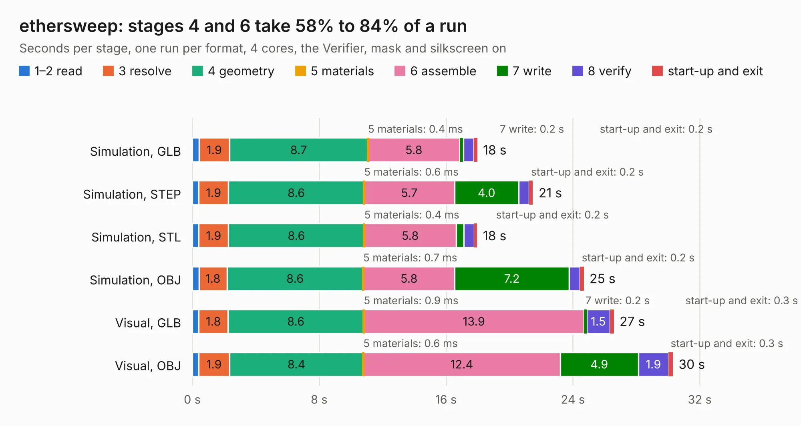

# 1744. ethersweep

Board 1,744 of the 3,102 of [Corpus Testing](../Corpus-Testing.md), on [Corpus Page 17](../CorpusTestingPages/Corpus-Testing-17.md#1744-ethersweep).

| Mode and format | 1–2 read | 3 resolve | 4 geometry | 5 materials | 6 assemble | 7 write | 8 verify | start-up and exit | Total |
|---|---:|---:|---:|---:|---:|---:|---:|---:|---:|
| Simulation, GLB | 0.4 | 1.9 | 8.7 | 0.4&nbsp;ms | 5.8 | 0.2 | 0.7 | 0.2 | 18.0 |
| Simulation, STEP | 0.4 | 1.9 | 8.6 | 0.6&nbsp;ms | 5.7 | 4.0 | 0.7 | 0.2 | 21.5 |
| Simulation, STL | 0.4 | 1.9 | 8.6 | 0.4&nbsp;ms | 5.8 | 0.5 | 0.6 | 0.2 | 18.0 |
| Simulation, OBJ | 0.4 | 1.8 | 8.6 | 0.7&nbsp;ms | 5.8 | 7.2 | 0.7 | 0.2 | 24.7 |
| Visual, GLB | 0.4 | 1.8 | 8.6 | 0.9&nbsp;ms | 13.9 | 0.2 | 1.5 | 0.3 | 26.6 |
| Visual, OBJ | 0.4 | 1.9 | 8.4 | 0.6&nbsp;ms | 12.4 | 4.9 | 1.9 | 0.3 | 30.3 |

<table align="center"><tr><td valign="top">

| Board | Repo: [Neumi/ethersweep](https://github.com/Neumi/ethersweep) Board: `ethersweep.kicad_pcb` |
|---|---|
| Folder | electronic_design / development / ethersweep_tmc2209 |
| Complexity | 334&nbsp;/&nbsp;1000 (size&nbsp;239, features&nbsp;95) |
| KESE&nbsp;features | through vias, slotted holes, rounded, trapezoid or chamfered pads, filled zones, curved board outline, stack-up, dielectric εr and tanδ |
| Tested | 9th November 2026 |
| Copper&nbsp;layers | 2 |
| File&nbsp;format | KiCad 6 (20211014) |
| Parts,&nbsp;tracks,&nbsp;vias | 105, 1,094, 319 |
| Triangles,&nbsp;simulation | 1,767,076 in 122 parts |
| Verifier | PASS in all six runs |

</td><td valign="top">

<table>
<tr><th>File type</th><th>File size</th><th>Peak memory used</th></tr>
<tr><th colspan="3" align="left">Simulation</th></tr>
<tr><td>GLB</td><td align="right">61&nbsp;MB</td><td align="right">705&nbsp;MB</td></tr>
<tr><td>STEP</td><td align="right">326&nbsp;MB</td><td align="right">809&nbsp;MB</td></tr>
<tr><td>STL</td><td align="right">88&nbsp;MB</td><td align="right">712&nbsp;MB</td></tr>
<tr><td>OBJ</td><td align="right">186&nbsp;MB</td><td align="right">1.2&nbsp;GB</td></tr>
<tr><th colspan="3" align="left">Visual</th></tr>
<tr><td>GLB</td><td align="right">42&nbsp;MB</td><td align="right">884&nbsp;MB</td></tr>
<tr><td>OBJ</td><td align="right">127&nbsp;MB</td><td align="right">947&nbsp;MB</td></tr>
</table>

</td></tr></table>

| Previous | Next |
|:---|---:|
| [1743. ethersweep](b1743b_ethersweep_electronic-design-development-ethersweep407-CAN_ethersweep.md) | [1745. ethersweep](b1745b_ethersweep_electronic-design-production-ethersweep405_ethersweep.md) |
