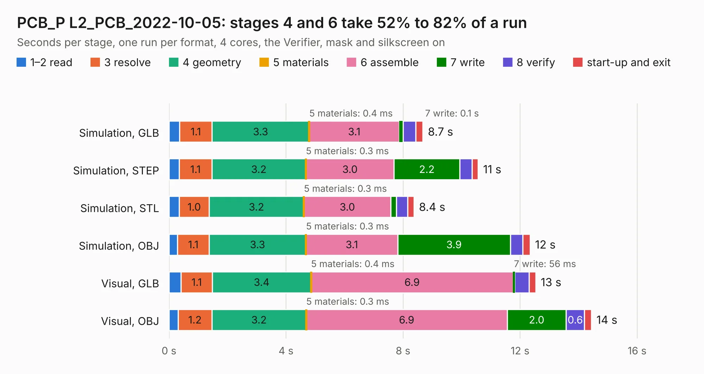

# 1744. PCB_P L2_PCB_2022-10-05

Board 1,744 of the 3,123 of [Corpus Testing](../Corpus-Testing.md), on [Corpus Page 17](../CorpusTestingPages/Corpus-Testing-17.md#1744-pcb_p-l2_pcb_2022-10-05).

| Mode and format | 1–2 read | 3 resolve | 4 geometry | 5 materials | 6 assemble | 7 write | 8 verify | start-up and exit | Total |
|---|---:|---:|---:|---:|---:|---:|---:|---:|---:|
| Simulation, GLB | 0.4 | 1.1 | 3.3 | 0.4&nbsp;ms | 3.1 | 0.1 | 0.4 | 0.2 | 8.7 |
| Simulation, STEP | 0.3 | 1.1 | 3.2 | 0.3&nbsp;ms | 3.0 | 2.2 | 0.4 | 0.2 | 10.6 |
| Simulation, STL | 0.4 | 1.0 | 3.2 | 0.3&nbsp;ms | 3.0 | 0.2 | 0.4 | 0.2 | 8.4 |
| Simulation, OBJ | 0.3 | 1.1 | 3.3 | 0.3&nbsp;ms | 3.1 | 3.9 | 0.4 | 0.2 | 12.3 |
| Visual, GLB | 0.4 | 1.1 | 3.4 | 0.4&nbsp;ms | 6.9 | 56&nbsp;ms | 0.5 | 0.2 | 12.5 |
| Visual, OBJ | 0.3 | 1.2 | 3.2 | 0.3&nbsp;ms | 6.9 | 2.0 | 0.6 | 0.2 | 14.4 |

<table align="center"><tr><td valign="top">

| Board | Repo: [nanosatlab/pocat-hw](https://github.com/nanosatlab/pocat-hw) Board: `PCB_P L2_PCB_2022-10-05.kicad_pcb` |
|---|---|
| Folder | pq_pl2 / Imports |
| Complexity | 261&nbsp;/&nbsp;1000 (size&nbsp;181, features&nbsp;80) |
| KESE&nbsp;features | through vias, slotted holes, custom pads, filled zones, copper drawings, curved board outline |
| Tested | 9th November 2026 |
| Copper&nbsp;layers | 4 |
| File&nbsp;format | KiCad 6 (20211014) |
| Parts,&nbsp;tracks,&nbsp;vias | 66, 267, 78 |
| Triangles,&nbsp;simulation | 791,228 in 117 parts |
| Verifier | PASS in all six runs |

</td><td valign="top">

<table>
<tr><th>File type</th><th>File size</th><th>Peak memory used</th></tr>
<tr><th colspan="3" align="left">Simulation</th></tr>
<tr><td>GLB</td><td align="right">27&nbsp;MB</td><td align="right">400&nbsp;MB</td></tr>
<tr><td>STEP</td><td align="right">134&nbsp;MB</td><td align="right">458&nbsp;MB</td></tr>
<tr><td>STL</td><td align="right">40&nbsp;MB</td><td align="right">393&nbsp;MB</td></tr>
<tr><td>OBJ</td><td align="right">80&nbsp;MB</td><td align="right">571&nbsp;MB</td></tr>
<tr><th colspan="3" align="left">Visual</th></tr>
<tr><td>GLB</td><td align="right">14&nbsp;MB</td><td align="right">450&nbsp;MB</td></tr>
<tr><td>OBJ</td><td align="right">42&nbsp;MB</td><td align="right">407&nbsp;MB</td></tr>
</table>

</td></tr></table>

| Previous | Next |
|:---|---:|
| [1743. PQ_PL1](b1743b_pocat-hw_PQ-PL1.md) | [1745. PQ_PL2](b1745b_pocat-hw_PQ-PL2.md) |
