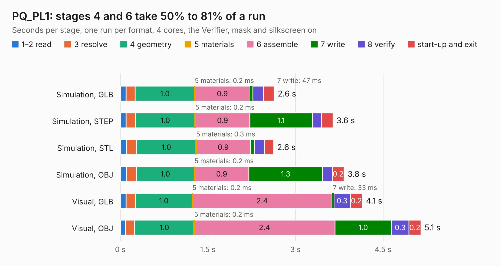

# 1745. PQ_PL1

Board 1,745 of the 3,126 of [Corpus Testing](../Corpus-Testing.md), on [Corpus Page 17](../CorpusTestingPages/Corpus-Testing-17.md#1745-pq_pl1).

| Mode and format | 1–2 read | 3 resolve | 4 geometry | 5 materials | 6 assemble | 7 write | 8 verify | start-up and exit | Total |
|---|---:|---:|---:|---:|---:|---:|---:|---:|---:|
| Simulation, GLB | 97&nbsp;ms | 0.2 | 1.0 | 0.2&nbsp;ms | 0.9 | 47&nbsp;ms | 0.2 | 0.2 | 2.6 |
| Simulation, STEP | 97&nbsp;ms | 0.2 | 1.0 | 0.2&nbsp;ms | 0.9 | 1.1 | 0.2 | 0.2 | 3.6 |
| Simulation, STL | 0.1 | 0.2 | 1.0 | 0.3&nbsp;ms | 0.9 | 70&nbsp;ms | 0.2 | 0.2 | 2.6 |
| Simulation, OBJ | 0.1 | 0.2 | 1.0 | 0.2&nbsp;ms | 0.9 | 1.3 | 0.2 | 0.2 | 3.8 |
| Visual, GLB | 97&nbsp;ms | 0.2 | 1.0 | 0.2&nbsp;ms | 2.4 | 33&nbsp;ms | 0.3 | 0.2 | 4.1 |
| Visual, OBJ | 92&nbsp;ms | 0.2 | 1.0 | 0.2&nbsp;ms | 2.4 | 1.0 | 0.3 | 0.2 | 5.1 |

<table align="center"><tr><td valign="top">

| Board | Repo: [nanosatlab/pocat-hw](https://github.com/nanosatlab/pocat-hw) Board: `PQ_PL1.kicad_pcb` |
|---|---|
| Folder | pq_pl1 / PQ_PL1 |
| Complexity | 139&nbsp;/&nbsp;1000 (size&nbsp;74, features&nbsp;65) |
| KESE&nbsp;features | filled zones, curved board outline, stack-up, dielectric εr and tanδ, mask and silkscreen colours |
| Tested | 9th November 2026 |
| Copper&nbsp;layers | 2 |
| File&nbsp;format | KiCad 7 (20221018) |
| Parts,&nbsp;tracks,&nbsp;vias | 5, 9, 0 |
| Triangles,&nbsp;simulation | 341,986 in 49 parts |
| Verifier | PASS in all six runs |

</td><td valign="top">

<table>
<tr><th>File type</th><th>File size</th><th>Peak memory used</th></tr>
<tr><th colspan="3" align="left">Simulation</th></tr>
<tr><td>GLB</td><td align="right">11&nbsp;MB</td><td align="right">255&nbsp;MB</td></tr>
<tr><td>STEP</td><td align="right">52&nbsp;MB</td><td align="right">272&nbsp;MB</td></tr>
<tr><td>STL</td><td align="right">17&nbsp;MB</td><td align="right">258&nbsp;MB</td></tr>
<tr><td>OBJ</td><td align="right">34&nbsp;MB</td><td align="right">260&nbsp;MB</td></tr>
<tr><th colspan="3" align="left">Visual</th></tr>
<tr><td>GLB</td><td align="right">8.0&nbsp;MB</td><td align="right">266&nbsp;MB</td></tr>
<tr><td>OBJ</td><td align="right">23&nbsp;MB</td><td align="right">265&nbsp;MB</td></tr>
</table>

</td></tr></table>

| Previous | Next |
|:---|---:|
| [1744. pq_obc_comms](b1744b_pocat-hw_pq-obc-comms.md) | [1746. PCB_P L2_PCB_2022-10-05](b1746b_pocat-hw_PCB-P-L2-PCB-2022-10-05.md) |
