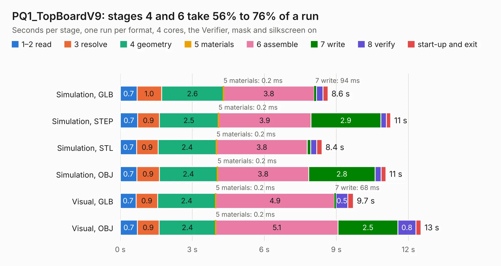

# 1749. PQ1_TopBoardV9

Board 1,749 of the 3,128 of [Corpus Testing](../Corpus-Testing.md), on [Corpus Page 17](../CorpusTestingPages/Corpus-Testing-17.md#1749-pq1_topboardv9).

| Mode and format | 1–2 read | 3 resolve | 4 geometry | 5 materials | 6 assemble | 7 write | 8 verify | start-up and exit | Total |
|---|---:|---:|---:|---:|---:|---:|---:|---:|---:|
| Simulation, GLB | 0.7 | 1.0 | 2.6 | 0.2&nbsp;ms | 3.8 | 94&nbsp;ms | 0.3 | 0.2 | 8.6 |
| Simulation, STEP | 0.7 | 0.9 | 2.5 | 0.2&nbsp;ms | 3.9 | 2.9 | 0.2 | 0.2 | 11.3 |
| Simulation, STL | 0.7 | 0.9 | 2.4 | 0.2&nbsp;ms | 3.8 | 0.1 | 0.2 | 0.2 | 8.4 |
| Simulation, OBJ | 0.7 | 0.9 | 2.4 | 0.2&nbsp;ms | 3.8 | 2.8 | 0.2 | 0.2 | 11.1 |
| Visual, GLB | 0.7 | 0.9 | 2.4 | 0.2&nbsp;ms | 4.9 | 68&nbsp;ms | 0.5 | 0.2 | 9.7 |
| Visual, OBJ | 0.7 | 0.9 | 2.4 | 0.2&nbsp;ms | 5.1 | 2.5 | 0.8 | 0.2 | 12.5 |

<table align="center"><tr><td valign="top">

| Board | Repo: [nanosatlab/pocat-hw](https://github.com/nanosatlab/pocat-hw) Board: `PQ1_TopBoardV9.kicad_pcb` |
|---|---|
| Folder | pq_topboard_lband |
| Complexity | 251&nbsp;/&nbsp;1000 (size&nbsp;136, features&nbsp;115) |
| KESE&nbsp;features | through vias, rounded, trapezoid or chamfered pads, arc tracks, filled zones, copper text, curved board outline, stack-up, dielectric εr and tanδ, mask and silkscreen colours |
| Tested | 9th November 2026 |
| Copper&nbsp;layers | 2 |
| File&nbsp;format | KiCad 10 (20260206) |
| Parts,&nbsp;tracks,&nbsp;vias | 14, 89, 50 |
| Triangles,&nbsp;simulation | 494,486 in 21 parts |
| Verifier | PASS in all six runs |

</td><td valign="top">

<table>
<tr><th>File type</th><th>File size</th><th>Peak memory used</th></tr>
<tr><th colspan="3" align="left">Simulation</th></tr>
<tr><td>GLB</td><td align="right">18&nbsp;MB</td><td align="right">397&nbsp;MB</td></tr>
<tr><td>STEP</td><td align="right">78&nbsp;MB</td><td align="right">395&nbsp;MB</td></tr>
<tr><td>STL</td><td align="right">25&nbsp;MB</td><td align="right">394&nbsp;MB</td></tr>
<tr><td>OBJ</td><td align="right">53&nbsp;MB</td><td align="right">427&nbsp;MB</td></tr>
<tr><th colspan="3" align="left">Visual</th></tr>
<tr><td>GLB</td><td align="right">17&nbsp;MB</td><td align="right">440&nbsp;MB</td></tr>
<tr><td>OBJ</td><td align="right">48&nbsp;MB</td><td align="right">446&nbsp;MB</td></tr>
</table>

</td></tr></table>

| Previous | Next |
|:---|---:|
| [1748. PQ1_TopBoard](b1748b_pocat-hw_PQ1-TopBoard.md) | [1750. PQ_MagYBoard](b1750b_pocat-hw_PQ-MagYBoard.md) |
