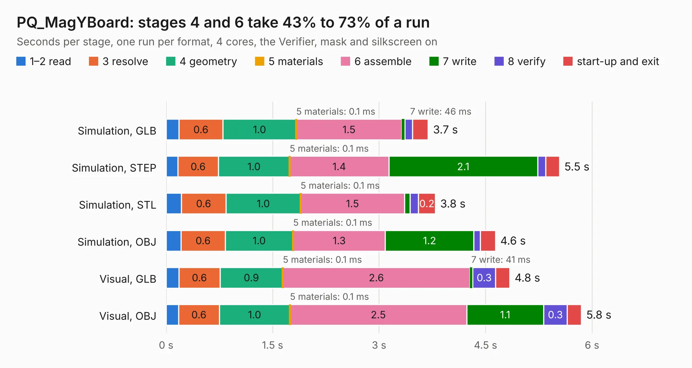

# 1750. PQ_MagYBoard

Board 1,750 of the 3,127 of [Corpus Testing](../Corpus-Testing.md), on [Corpus Page 17](../CorpusTestingPages/Corpus-Testing-17.md#1750-pq_magyboard).

| Mode and format | 1–2 read | 3 resolve | 4 geometry | 5 materials | 6 assemble | 7 write | 8 verify | start-up and exit | Total |
|---|---:|---:|---:|---:|---:|---:|---:|---:|---:|
| Simulation, GLB | 0.2 | 0.6 | 1.0 | 0.1&nbsp;ms | 1.5 | 46&nbsp;ms | 0.1 | 0.2 | 3.7 |
| Simulation, STEP | 0.2 | 0.6 | 1.0 | 0.1&nbsp;ms | 1.4 | 2.1 | 0.1 | 0.2 | 5.5 |
| Simulation, STL | 0.2 | 0.6 | 1.0 | 0.1&nbsp;ms | 1.5 | 80&nbsp;ms | 0.1 | 0.2 | 3.8 |
| Simulation, OBJ | 0.2 | 0.6 | 1.0 | 0.1&nbsp;ms | 1.3 | 1.2 | 92&nbsp;ms | 0.2 | 4.6 |
| Visual, GLB | 0.2 | 0.6 | 0.9 | 0.1&nbsp;ms | 2.6 | 41&nbsp;ms | 0.3 | 0.2 | 4.8 |
| Visual, OBJ | 0.2 | 0.6 | 1.0 | 0.1&nbsp;ms | 2.5 | 1.1 | 0.3 | 0.2 | 5.8 |

<table align="center"><tr><td valign="top">

| Board | Repo: [nanosatlab/pocat-hw](https://github.com/nanosatlab/pocat-hw) Board: `PQ_MagYBoard.kicad_pcb` |
|---|---|
| Folder | pq_ymag_board / PQ_MAGY / PQ_MagYBoard |
| Complexity | 226&nbsp;/&nbsp;1000 (size&nbsp;156, features&nbsp;70) |
| KESE&nbsp;features | through vias, rounded, trapezoid or chamfered pads, curved board outline, stack-up, dielectric εr and tanδ, mask and silkscreen colours |
| Tested | 9th November 2026 |
| Copper&nbsp;layers | 6 |
| File&nbsp;format | KiCad 10 (20260206) |
| Parts,&nbsp;tracks,&nbsp;vias | 2, 468, 5 |
| Triangles,&nbsp;simulation | 248,848 in 13 parts |
| Verifier | PASS in all six runs |

</td><td valign="top">

<table>
<tr><th>File type</th><th>File size</th><th>Peak memory used</th></tr>
<tr><th colspan="3" align="left">Simulation</th></tr>
<tr><td>GLB</td><td align="right">9.1&nbsp;MB</td><td align="right">273&nbsp;MB</td></tr>
<tr><td>STEP</td><td align="right">39&nbsp;MB</td><td align="right">289&nbsp;MB</td></tr>
<tr><td>STL</td><td align="right">12&nbsp;MB</td><td align="right">279&nbsp;MB</td></tr>
<tr><td>OBJ</td><td align="right">27&nbsp;MB</td><td align="right">278&nbsp;MB</td></tr>
<tr><th colspan="3" align="left">Visual</th></tr>
<tr><td>GLB</td><td align="right">7.7&nbsp;MB</td><td align="right">265&nbsp;MB</td></tr>
<tr><td>OBJ</td><td align="right">22&nbsp;MB</td><td align="right">253&nbsp;MB</td></tr>
</table>

</td></tr></table>

| Previous | Next |
|:---|---:|
| [1749. PQ1_TopBoardV9](b1749b_pocat-hw_PQ1-TopBoardV9.md) | [1751. Control_Boards](b1751b_open-source-rover_Control-Boards.md) |
