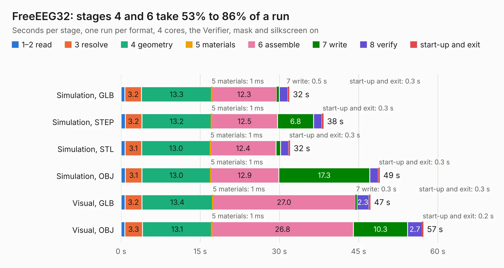

# 1751. FreeEEG32

Board 1,751 of the 3,107 of [Corpus Testing](../Corpus-Testing.md), on [Corpus Page 17](../CorpusTestingPages/Corpus-Testing-17.md#1751-freeeeg32).

| Mode and format | 1–2 read | 3 resolve | 4 geometry | 5 materials | 6 assemble | 7 write | 8 verify | start-up and exit | Total |
|---|---:|---:|---:|---:|---:|---:|---:|---:|---:|
| Simulation, GLB | 0.7 | 3.2 | 13.3 | 1&nbsp;ms | 12.3 | 0.5 | 1.6 | 0.3 | 31.9 |
| Simulation, STEP | 0.8 | 3.2 | 13.2 | 1&nbsp;ms | 12.5 | 6.8 | 1.6 | 0.3 | 38.4 |
| Simulation, STL | 0.8 | 3.1 | 13.0 | 1&nbsp;ms | 12.4 | 0.9 | 1.5 | 0.3 | 32.0 |
| Simulation, OBJ | 0.8 | 3.1 | 13.0 | 1&nbsp;ms | 12.9 | 17.3 | 1.6 | 0.3 | 49.0 |
| Visual, GLB | 0.8 | 3.2 | 13.4 | 1&nbsp;ms | 27.0 | 0.3 | 2.3 | 0.3 | 47.3 |
| Visual, OBJ | 0.7 | 3.3 | 13.1 | 1&nbsp;ms | 26.8 | 10.3 | 2.7 | 0.2 | 57.3 |

<table align="center"><tr><td valign="top">

| Board | Repo: [neuroidss/freeeeg32](https://github.com/neuroidss/freeeeg32) Board: `FreeEEG32.kicad_pcb` |
|---|---|
| Folder | KiCad |
| Complexity | 332&nbsp;/&nbsp;1000 (size&nbsp;287, features&nbsp;45) |
| KESE&nbsp;features | through vias, slotted holes, filled zones |
| Tested | 9th November 2026 |
| Copper&nbsp;layers | 4 |
| File&nbsp;format | KiCad 4 (4) |
| Parts,&nbsp;tracks,&nbsp;vias | 213, 4,412, 279 |
| Triangles,&nbsp;simulation | 2,598,444 in 378 parts |
| Verifier | PASS in all six runs |

</td><td valign="top">

<table>
<tr><th>File type</th><th>File size</th><th>Peak memory used</th></tr>
<tr><th colspan="3" align="left">Simulation</th></tr>
<tr><td>GLB</td><td align="right">93&nbsp;MB</td><td align="right">753&nbsp;MB</td></tr>
<tr><td>STEP</td><td align="right">404&nbsp;MB</td><td align="right">988&nbsp;MB</td></tr>
<tr><td>STL</td><td align="right">130&nbsp;MB</td><td align="right">768&nbsp;MB</td></tr>
<tr><td>OBJ</td><td align="right">284&nbsp;MB</td><td align="right">1.8&nbsp;GB</td></tr>
<tr><th colspan="3" align="left">Visual</th></tr>
<tr><td>GLB</td><td align="right">59&nbsp;MB</td><td align="right">1.1&nbsp;GB</td></tr>
<tr><td>OBJ</td><td align="right">183&nbsp;MB</td><td align="right">1.3&nbsp;GB</td></tr>
</table>

</td></tr></table>

| Previous | Next |
|:---|---:|
| [1750. ethersweep](b1750b_ethersweep_electronic-design-production-ethersweep405_ethersweep.md) | [1752. tmp](b1752b_freeeeg32_tmp.md) |
