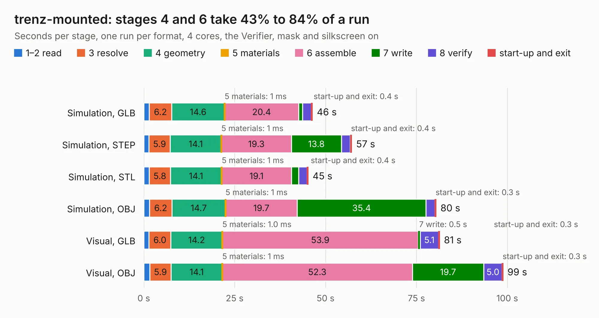

# 1751. trenz-mounted

Board 1,751 of the 3,118 of [Corpus Testing](../Corpus-Testing.md), on [Corpus Page 17](../CorpusTestingPages/Corpus-Testing-17.md#1751-trenz-mounted).

| Mode and format | 1–2 read | 3 resolve | 4 geometry | 5 materials | 6 assemble | 7 write | 8 verify | start-up and exit | Total |
|---|---:|---:|---:|---:|---:|---:|---:|---:|---:|
| Simulation, GLB | 1.5 | 6.2 | 14.6 | 1&nbsp;ms | 20.4 | 1.0 | 2.4 | 0.4 | 46.4 |
| Simulation, STEP | 1.4 | 5.9 | 14.1 | 1&nbsp;ms | 19.3 | 13.8 | 2.4 | 0.4 | 57.2 |
| Simulation, STL | 1.5 | 5.8 | 14.1 | 1&nbsp;ms | 19.1 | 2.0 | 2.3 | 0.4 | 45.3 |
| Simulation, OBJ | 1.6 | 6.2 | 14.7 | 1&nbsp;ms | 19.7 | 35.4 | 2.5 | 0.3 | 80.4 |
| Visual, GLB | 1.4 | 6.0 | 14.2 | 1.0&nbsp;ms | 53.9 | 0.5 | 5.1 | 0.3 | 81.4 |
| Visual, OBJ | 1.6 | 5.9 | 14.1 | 1&nbsp;ms | 52.3 | 19.7 | 5.0 | 0.3 | 98.9 |

<table align="center"><tr><td valign="top">

| Board | Repo: [naturalhazardscience/groundlark](https://github.com/naturalhazardscience/groundlark) Board: `trenz-mounted.kicad_pcb` |
|---|---|
| Folder | hw / groundlark-fpga-hat / boards / groundlark-daqhat-01 |
| Complexity | 417&nbsp;/&nbsp;1000 (size&nbsp;297, features&nbsp;120) |
| KESE&nbsp;features | through vias, custom pads, rounded, trapezoid or chamfered pads, filled zones, copper drawings, stack-up, dielectric εr and tanδ, copper finish, mask and silkscreen colours |
| Tested | 9th November 2026 |
| Copper&nbsp;layers | 6 |
| File&nbsp;format | KiCad 9 (20241229) |
| Parts,&nbsp;tracks,&nbsp;vias | 190, 12,366, 745 |
| Triangles,&nbsp;simulation | 5,819,912 in 381 parts |
| Verifier | PASS in all six runs |

</td><td valign="top">

<table>
<tr><th>File type</th><th>File size</th><th>Peak memory used</th></tr>
<tr><th colspan="3" align="left">Simulation</th></tr>
<tr><td>GLB</td><td align="right">195&nbsp;MB</td><td align="right">1.6&nbsp;GB</td></tr>
<tr><td>STEP</td><td align="right">676&nbsp;MB</td><td align="right">2.0&nbsp;GB</td></tr>
<tr><td>STL</td><td align="right">291&nbsp;MB</td><td align="right">1.6&nbsp;GB</td></tr>
<tr><td>OBJ</td><td align="right">625&nbsp;MB</td><td align="right">3.7&nbsp;GB</td></tr>
<tr><th colspan="3" align="left">Visual</th></tr>
<tr><td>GLB</td><td align="right">106&nbsp;MB</td><td align="right">1.8&nbsp;GB</td></tr>
<tr><td>OBJ</td><td align="right">343&nbsp;MB</td><td align="right">2.2&nbsp;GB</td></tr>
</table>

</td></tr></table>

| Previous | Next |
|:---|---:|
| [1750. stack-service-envelopes](b1750b_groundlark_stack-service-envelopes.md) | [1752. trenz_hat](b1752b_groundlark_trenz-hat.md) |
