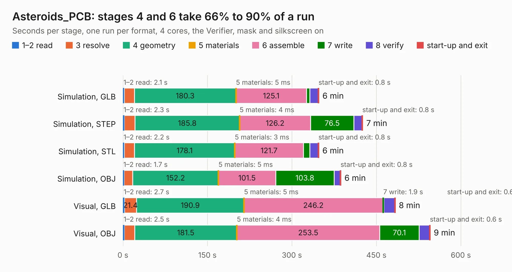

# 1752. Asteroids_PCB

Board 1,752 of the 3,103 of [Corpus Testing](../Corpus-Testing.md), on [Corpus Page 17](../CorpusTestingPages/Corpus-Testing-17.md#1752-asteroids_pcb).

| Mode and format | 1–2 read | 3 resolve | 4 geometry | 5 materials | 6 assemble | 7 write | 8 verify | start-up and exit | Total |
|---|---:|---:|---:|---:|---:|---:|---:|---:|---:|
| Simulation, GLB | 2.1 | 18.3 | 180.3 | 5&nbsp;ms | 125.1 | 6.0 | 15.1 | 0.8 | 347.7 |
| Simulation, STEP | 2.3 | 19.1 | 185.8 | 4&nbsp;ms | 126.2 | 76.5 | 15.0 | 0.8 | 425.6 |
| Simulation, STL | 2.2 | 18.3 | 178.1 | 3&nbsp;ms | 121.7 | 11.6 | 14.9 | 0.8 | 347.7 |
| Simulation, OBJ | 1.7 | 15.7 | 152.2 | 5&nbsp;ms | 101.5 | 103.8 | 11.1 | 0.8 | 386.8 |
| Visual, GLB | 2.7 | 21.4 | 190.9 | 5&nbsp;ms | 246.2 | 1.9 | 19.5 | 0.6 | 483.3 |
| Visual, OBJ | 2.5 | 18.3 | 181.5 | 4&nbsp;ms | 253.5 | 70.1 | 18.9 | 0.6 | 545.4 |

<table align="center"><tr><td valign="top">

| Board | Repo: [nmikstas/asteroids-pcb](https://github.com/nmikstas/asteroids-pcb) Board: `Asteroids_PCB.kicad_pcb` |
|---|---|
| Folder | Asteroids_PCB |
| Complexity | 286&nbsp;/&nbsp;1000 (size&nbsp;236, features&nbsp;50) |
| KESE&nbsp;features | rounded, trapezoid or chamfered pads, filled zones, copper text, curved board outline |
| Tested | 9th November 2026 to 10th November 2026 |
| Copper&nbsp;layers | 2 |
| File&nbsp;format | KiCad 5 (20171130) |
| Parts,&nbsp;tracks,&nbsp;vias | 475, 10,686, 0 |
| Triangles,&nbsp;simulation | 21,815,320 in 718 parts |
| Verifier | PASS in all six runs |
| Run&nbsp;again | Simulation, OBJ: failed in the corpus run, run again with the memory cap raised from 11 GB to 14.5 GB, and passed |

</td><td valign="top">

<table>
<tr><th>File type</th><th>File size</th><th>Peak memory used</th></tr>
<tr><th colspan="3" align="left">Simulation</th></tr>
<tr><td>GLB</td><td align="right">750&nbsp;MB</td><td align="right">5.6&nbsp;GB</td></tr>
<tr><td>STEP</td><td align="right">3.9&nbsp;GB</td><td align="right">7.2&nbsp;GB</td></tr>
<tr><td>STL</td><td align="right">1.1&nbsp;GB</td><td align="right">5.3&nbsp;GB</td></tr>
<tr><td>OBJ</td><td align="right">2.4&nbsp;GB</td><td align="right">14&nbsp;GB</td></tr>
<tr><th colspan="3" align="left">Visual</th></tr>
<tr><td>GLB</td><td align="right">349&nbsp;MB</td><td align="right">5.8&nbsp;GB</td></tr>
<tr><td>OBJ</td><td align="right">1.1&nbsp;GB</td><td align="right">6.9&nbsp;GB</td></tr>
</table>

</td></tr></table>

| Previous | Next |
|:---|---:|
| [1751. amulet_controller](b1751b_amulet-controller-kibot_amulet-controller.md) | [1753. ROM_To_2716](b1753b_asteroids-pcb_ROM-To-2716.md) |
