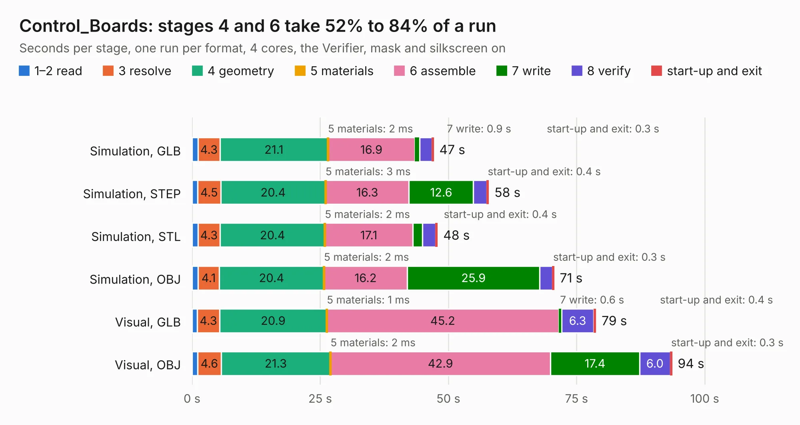

# 1754. Control_Boards

Board 1,754 of the 3,131 of [Corpus Testing](../Corpus-Testing.md), on [Corpus Page 17](../CorpusTestingPages/Corpus-Testing-17.md#1754-control_boards).

| Mode and format | 1–2 read | 3 resolve | 4 geometry | 5 materials | 6 assemble | 7 write | 8 verify | start-up and exit | Total |
|---|---:|---:|---:|---:|---:|---:|---:|---:|---:|
| Simulation, GLB | 1.2 | 4.3 | 21.1 | 2&nbsp;ms | 16.9 | 0.9 | 2.4 | 0.3 | 47.1 |
| Simulation, STEP | 1.1 | 4.5 | 20.4 | 3&nbsp;ms | 16.3 | 12.6 | 2.6 | 0.4 | 57.9 |
| Simulation, STL | 1.1 | 4.3 | 20.4 | 2&nbsp;ms | 17.1 | 1.9 | 2.5 | 0.4 | 47.9 |
| Simulation, OBJ | 1.2 | 4.1 | 20.4 | 2&nbsp;ms | 16.2 | 25.9 | 2.5 | 0.3 | 70.6 |
| Visual, GLB | 1.0 | 4.3 | 20.9 | 1&nbsp;ms | 45.2 | 0.6 | 6.3 | 0.4 | 78.8 |
| Visual, OBJ | 1.1 | 4.6 | 21.3 | 2&nbsp;ms | 42.9 | 17.4 | 6.0 | 0.3 | 93.6 |

<table align="center"><tr><td valign="top">

| Board | Repo: [nasa-jpl/open-source-rover](https://github.com/nasa-jpl/open-source-rover) Board: `Control_Boards.kicad_pcb` |
|---|---|
| Folder | electrical / pcb / control_board |
| Complexity | 241&nbsp;/&nbsp;1000 (size&nbsp;206, features&nbsp;35) |
| KESE&nbsp;features | through vias, filled zones |
| Tested | 9th November 2026 |
| Copper&nbsp;layers | 2 |
| File&nbsp;format | KiCad 10 (20260206) |
| Parts,&nbsp;tracks,&nbsp;vias | 112, 3,720, 265 |
| Triangles,&nbsp;simulation | 5,125,220 in 242 parts |
| Verifier | PASS in all six runs |

</td><td valign="top">

<table>
<tr><th>File type</th><th>File size</th><th>Peak memory used</th></tr>
<tr><th colspan="3" align="left">Simulation</th></tr>
<tr><td>GLB</td><td align="right">173&nbsp;MB</td><td align="right">1.8&nbsp;GB</td></tr>
<tr><td>STEP</td><td align="right">782&nbsp;MB</td><td align="right">2.0&nbsp;GB</td></tr>
<tr><td>STL</td><td align="right">256&nbsp;MB</td><td align="right">1.8&nbsp;GB</td></tr>
<tr><td>OBJ</td><td align="right">545&nbsp;MB</td><td align="right">3.3&nbsp;GB</td></tr>
<tr><th colspan="3" align="left">Visual</th></tr>
<tr><td>GLB</td><td align="right">123&nbsp;MB</td><td align="right">2.2&nbsp;GB</td></tr>
<tr><td>OBJ</td><td align="right">392&nbsp;MB</td><td align="right">2.7&nbsp;GB</td></tr>
</table>

</td></tr></table>

| Previous | Next |
|:---|---:|
| [1753. PQ_MagYBoard](b1753b_pocat-hw_PQ-MagYBoard.md) | [1755. groundlark-field-head](b1755b_groundlark_groundlark-field-head.md) |
