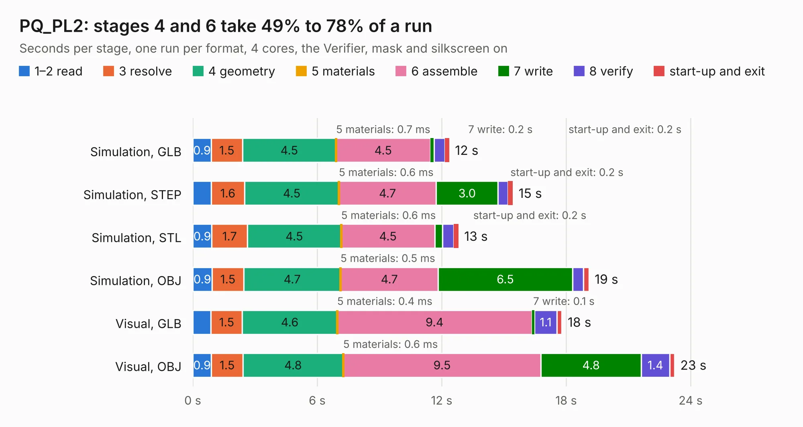

# 1755 PQ_PL2

Board 1,755 of the 3,138 of [Corpus Testing](../Corpus-Testing.md), on [Corpus Page 17](../CorpusTestingPages/Corpus-Testing-17.md#1755-pq_pl2).

| Mode and format | 1–2 read | 3 resolve | 4 geometry | 5 materials | 6 assemble | 7 write | 8 verify | start-up and exit | Total |
|---|---:|---:|---:|---:|---:|---:|---:|---:|---:|
| Simulation, GLB | 0.9 | 1.5 | 4.5 | 0.7&nbsp;ms | 4.5 | 0.2 | 0.5 | 0.2 | 12.4 |
| Simulation, STEP | 0.9 | 1.6 | 4.5 | 0.6&nbsp;ms | 4.7 | 3.0 | 0.5 | 0.2 | 15.4 |
| Simulation, STL | 0.9 | 1.7 | 4.5 | 0.6&nbsp;ms | 4.5 | 0.4 | 0.5 | 0.2 | 12.8 |
| Simulation, OBJ | 0.9 | 1.5 | 4.7 | 0.5&nbsp;ms | 4.7 | 6.5 | 0.5 | 0.3 | 19.1 |
| Visual, GLB | 0.9 | 1.5 | 4.6 | 0.4&nbsp;ms | 9.4 | 0.1 | 1.1 | 0.2 | 17.8 |
| Visual, OBJ | 0.9 | 1.5 | 4.8 | 0.6&nbsp;ms | 9.5 | 4.8 | 1.4 | 0.2 | 23.2 |

<table align="center"><tr><td valign="top">

| Board | Repo: [nanosatlab/pocat-hw](https://github.com/nanosatlab/pocat-hw) Board: `PQ_PL2.kicad_pcb` |
|---|---|
| Folder | pq_pl2 / PQ_PL2 |
| Complexity | 319&nbsp;/&nbsp;1000 (size&nbsp;189, features&nbsp;130) |
| KESE&nbsp;features | through vias, custom pads, rounded, trapezoid or chamfered pads, arc tracks, filled zones, copper drawings, curved board outline, stack-up, dielectric εr and tanδ, mask and silkscreen colours |
| Tested | 9th November 2026 |
| Copper&nbsp;layers | 4 |
| File&nbsp;format | KiCad 8 (20240108) |
| Parts,&nbsp;tracks,&nbsp;vias | 72, 364, 136 |
| Triangles,&nbsp;simulation | 1,196,648 in 104 parts |
| Verifier | PASS in all six runs |

</td><td valign="top">

<table>
<tr><th>File type</th><th>File size</th><th>Peak memory used</th></tr>
<tr><th colspan="3" align="left">Simulation</th></tr>
<tr><td>GLB</td><td align="right">42&nbsp;MB</td><td align="right">510&nbsp;MB</td></tr>
<tr><td>STEP</td><td align="right">159&nbsp;MB</td><td align="right">662&nbsp;MB</td></tr>
<tr><td>STL</td><td align="right">60&nbsp;MB</td><td align="right">510&nbsp;MB</td></tr>
<tr><td>OBJ</td><td align="right">125&nbsp;MB</td><td align="right">856&nbsp;MB</td></tr>
<tr><th colspan="3" align="left">Visual</th></tr>
<tr><td>GLB</td><td align="right">30&nbsp;MB</td><td align="right">599&nbsp;MB</td></tr>
<tr><td>OBJ</td><td align="right">90&nbsp;MB</td><td align="right">728&nbsp;MB</td></tr>
</table>

</td></tr></table>

| Previous | Next |
|:---|---:|
| [1754 PCB_P L2_PCB_2022-10-05](b1754b_pocat-hw_PCB-P-L2-PCB-2022-10-05.md) | [1756 PQ1_TopBoard](b1756b_pocat-hw_PQ1-TopBoard.md) |
