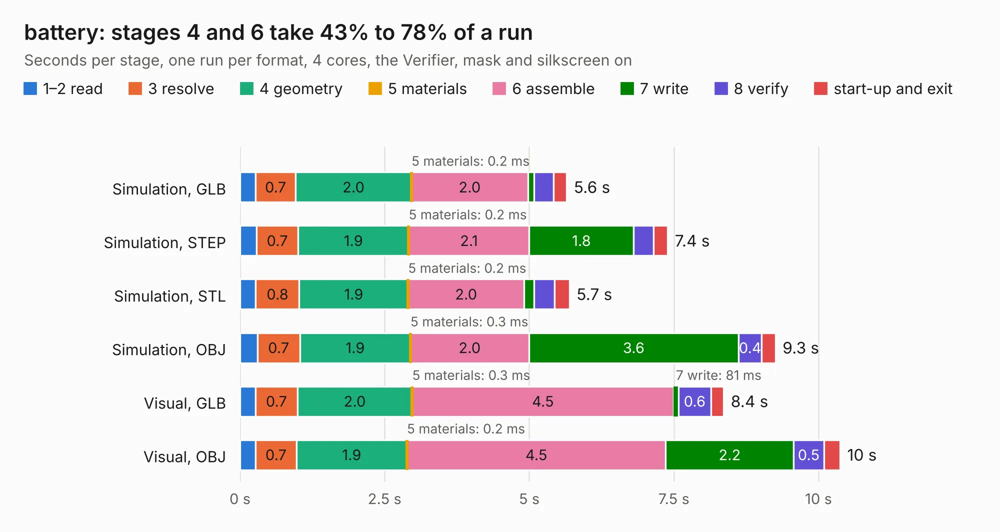

# 1759. battery

Board 1,759 of the 3,103 of [Corpus Testing](../Corpus-Testing.md), on [Corpus Page 17](../CorpusTestingPages/Corpus-Testing-17.md#1759-battery).

| Mode and format | 1–2 read | 3 resolve | 4 geometry | 5 materials | 6 assemble | 7 write | 8 verify | start-up and exit | Total |
|---|---:|---:|---:|---:|---:|---:|---:|---:|---:|
| Simulation, GLB | 0.3 | 0.7 | 2.0 | 0.2&nbsp;ms | 2.0 | 0.1 | 0.3 | 0.2 | 5.6 |
| Simulation, STEP | 0.3 | 0.7 | 1.9 | 0.2&nbsp;ms | 2.1 | 1.8 | 0.3 | 0.2 | 7.4 |
| Simulation, STL | 0.3 | 0.8 | 1.9 | 0.2&nbsp;ms | 2.0 | 0.2 | 0.3 | 0.3 | 5.7 |
| Simulation, OBJ | 0.3 | 0.7 | 1.9 | 0.3&nbsp;ms | 2.0 | 3.6 | 0.4 | 0.2 | 9.3 |
| Visual, GLB | 0.3 | 0.7 | 2.0 | 0.3&nbsp;ms | 4.5 | 81&nbsp;ms | 0.6 | 0.2 | 8.4 |
| Visual, OBJ | 0.3 | 0.7 | 1.9 | 0.2&nbsp;ms | 4.5 | 2.2 | 0.5 | 0.3 | 10.4 |

<table align="center"><tr><td valign="top">

| Board | Repo: [nzevh/barebones](https://github.com/nzevh/barebones) Board: `battery.kicad_pcb` |
|---|---|
| Folder | hardware / battery |
| Complexity | 326&nbsp;/&nbsp;1000 (size&nbsp;221, features&nbsp;105) |
| KESE&nbsp;features | through vias, rounded, trapezoid or chamfered pads, filled zones, knockout text, TrueType text, stack-up, dielectric εr and tanδ |
| Tested | 9th November 2026 |
| Copper&nbsp;layers | 4 |
| File&nbsp;format | KiCad 10 (20260206) |
| Parts,&nbsp;tracks,&nbsp;vias | 39, 348, 129 |
| Triangles,&nbsp;simulation | 658,698 in 60 parts |
| Verifier | PASS in all six runs |

</td><td valign="top">

<table>
<tr><th>File type</th><th>File size</th><th>Peak memory used</th></tr>
<tr><th colspan="3" align="left">Simulation</th></tr>
<tr><td>GLB</td><td align="right">23&nbsp;MB</td><td align="right">331&nbsp;MB</td></tr>
<tr><td>STEP</td><td align="right">80&nbsp;MB</td><td align="right">359&nbsp;MB</td></tr>
<tr><td>STL</td><td align="right">33&nbsp;MB</td><td align="right">342&nbsp;MB</td></tr>
<tr><td>OBJ</td><td align="right">66&nbsp;MB</td><td align="right">474&nbsp;MB</td></tr>
<tr><th colspan="3" align="left">Visual</th></tr>
<tr><td>GLB</td><td align="right">14&nbsp;MB</td><td align="right">377&nbsp;MB</td></tr>
<tr><td>OBJ</td><td align="right">42&nbsp;MB</td><td align="right">369&nbsp;MB</td></tr>
</table>

</td></tr></table>

| Previous | Next |
|:---|---:|
| [1758. greybadge_pcb](b1758b_greybadge25_greybadge-pcb.md) | [1760. barebones](b1760b_barebones_barebones.md) |
