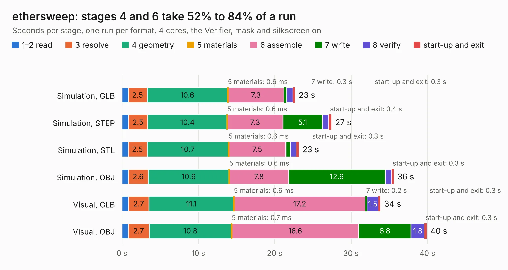

# 1759. ethersweep

Board 1,759 of the 3,116 of [Corpus Testing](../Corpus-Testing.md), on [Corpus Page 17](../CorpusTestingPages/Corpus-Testing-17.md#1759-ethersweep).

| Mode and format | 1–2 read | 3 resolve | 4 geometry | 5 materials | 6 assemble | 7 write | 8 verify | start-up and exit | Total |
|---|---:|---:|---:|---:|---:|---:|---:|---:|---:|
| Simulation, GLB | 0.8 | 2.5 | 10.6 | 0.6&nbsp;ms | 7.3 | 0.3 | 0.9 | 0.3 | 22.7 |
| Simulation, STEP | 0.8 | 2.5 | 10.4 | 0.6&nbsp;ms | 7.3 | 5.1 | 0.9 | 0.4 | 27.4 |
| Simulation, STL | 0.8 | 2.5 | 10.7 | 0.6&nbsp;ms | 7.5 | 0.6 | 0.8 | 0.3 | 23.2 |
| Simulation, OBJ | 0.8 | 2.6 | 10.6 | 0.6&nbsp;ms | 7.8 | 12.6 | 0.9 | 0.3 | 35.6 |
| Visual, GLB | 0.8 | 2.7 | 11.1 | 0.6&nbsp;ms | 17.2 | 0.2 | 1.5 | 0.3 | 33.9 |
| Visual, OBJ | 0.8 | 2.7 | 10.8 | 0.7&nbsp;ms | 16.6 | 6.8 | 1.8 | 0.3 | 39.9 |

<table align="center"><tr><td valign="top">

| Board | Repo: [Neumi/ethersweep](https://github.com/Neumi/ethersweep) Board: `ethersweep.kicad_pcb` |
|---|---|
| Folder | electronic_design / production / ethersweep405 |
| Complexity | 370&nbsp;/&nbsp;1000 (size&nbsp;255, features&nbsp;115) |
| KESE&nbsp;features | through vias, rounded, trapezoid or chamfered pads, filled zones, curved board outline, knockout text, TrueType text, stack-up, dielectric εr and tanδ |
| Tested | 9th November 2026 |
| Copper&nbsp;layers | 4 |
| File&nbsp;format | KiCad 7 (20221018) |
| Parts,&nbsp;tracks,&nbsp;vias | 104, 1,173, 151 |
| Triangles,&nbsp;simulation | 2,021,426 in 138 parts |
| Verifier | PASS in all six runs |

</td><td valign="top">

<table>
<tr><th>File type</th><th>File size</th><th>Peak memory used</th></tr>
<tr><th colspan="3" align="left">Simulation</th></tr>
<tr><td>GLB</td><td align="right">70&nbsp;MB</td><td align="right">681&nbsp;MB</td></tr>
<tr><td>STEP</td><td align="right">300&nbsp;MB</td><td align="right">775&nbsp;MB</td></tr>
<tr><td>STL</td><td align="right">101&nbsp;MB</td><td align="right">692&nbsp;MB</td></tr>
<tr><td>OBJ</td><td align="right">213&nbsp;MB</td><td align="right">1.4&nbsp;GB</td></tr>
<tr><th colspan="3" align="left">Visual</th></tr>
<tr><td>GLB</td><td align="right">40&nbsp;MB</td><td align="right">864&nbsp;MB</td></tr>
<tr><td>OBJ</td><td align="right">122&nbsp;MB</td><td align="right">946&nbsp;MB</td></tr>
</table>

</td></tr></table>

| Previous | Next |
|:---|---:|
| [1758. ethersweep](b1758b_ethersweep_electronic-design-development-ethersweep-tmc2209_ethersweep.md) | [1760. FreeEEG32](b1760b_freeeeg32_FreeEEG32.md) |
