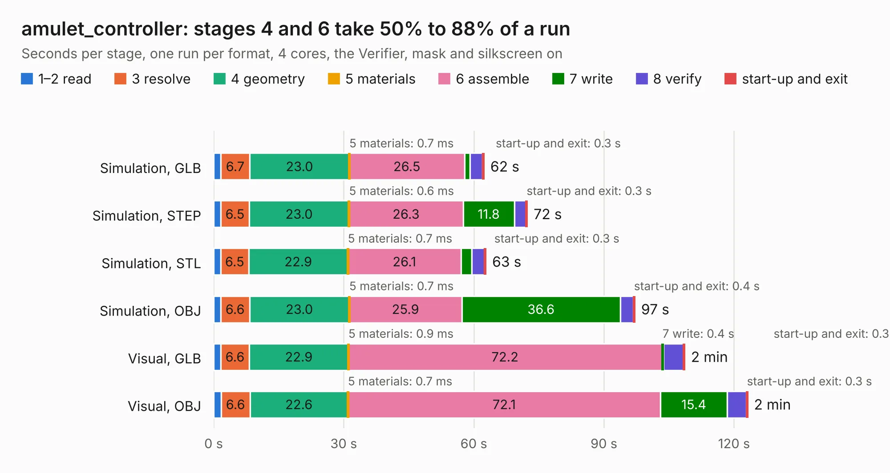

# 1760. amulet_controller

Board 1,760 of the 3,112 of [Corpus Testing](../Corpus-Testing.md), on [Corpus Page 17](../CorpusTestingPages/Corpus-Testing-17.md#1760-amulet_controller).

| Mode and format | 1–2 read | 3 resolve | 4 geometry | 5 materials | 6 assemble | 7 write | 8 verify | start-up and exit | Total |
|---|---:|---:|---:|---:|---:|---:|---:|---:|---:|
| Simulation, GLB | 1.6 | 6.7 | 23.0 | 0.7&nbsp;ms | 26.5 | 1.3 | 2.9 | 0.3 | 62.3 |
| Simulation, STEP | 1.7 | 6.5 | 23.0 | 0.6&nbsp;ms | 26.3 | 11.8 | 2.7 | 0.3 | 72.3 |
| Simulation, STL | 1.6 | 6.5 | 22.9 | 0.7&nbsp;ms | 26.1 | 2.5 | 3.0 | 0.3 | 62.8 |
| Simulation, OBJ | 1.6 | 6.6 | 23.0 | 0.7&nbsp;ms | 25.9 | 36.6 | 3.0 | 0.4 | 97.1 |
| Visual, GLB | 1.6 | 6.6 | 22.9 | 0.9&nbsp;ms | 72.2 | 0.4 | 4.6 | 0.3 | 108.6 |
| Visual, OBJ | 1.7 | 6.6 | 22.6 | 0.7&nbsp;ms | 72.1 | 15.4 | 4.4 | 0.3 | 123.1 |

<table align="center"><tr><td valign="top">

| Board | Repo: [nguyen-v/amulet_controller_kibot](https://github.com/nguyen-v/amulet_controller_kibot) Board: `amulet_controller.kicad_pcb` |
|---|---|
| Complexity | 457&nbsp;/&nbsp;1000 (size&nbsp;287, features&nbsp;170) |
| KESE&nbsp;features | through vias, slotted holes, custom pads, rounded, trapezoid or chamfered pads, arc tracks, filled zones, copper drawings, curved board outline, TrueType text, stack-up, dielectric εr and tanδ, copper finish, mask and silkscreen colours |
| Tested | 9th November 2026 |
| Copper&nbsp;layers | 6 |
| File&nbsp;format | KiCad 8 (20240108) |
| Parts,&nbsp;tracks,&nbsp;vias | 285, 1,583, 794 |
| Triangles,&nbsp;simulation | 6,621,630 in 197 parts |
| Verifier | PASS in all six runs |

</td><td valign="top">

<table>
<tr><th>File type</th><th>File size</th><th>Peak memory used</th></tr>
<tr><th colspan="3" align="left">Simulation</th></tr>
<tr><td>GLB</td><td align="right">219&nbsp;MB</td><td align="right">1.6&nbsp;GB</td></tr>
<tr><td>STEP</td><td align="right">735&nbsp;MB</td><td align="right">2.0&nbsp;GB</td></tr>
<tr><td>STL</td><td align="right">331&nbsp;MB</td><td align="right">1.5&nbsp;GB</td></tr>
<tr><td>OBJ</td><td align="right">697&nbsp;MB</td><td align="right">4.1&nbsp;GB</td></tr>
<tr><th colspan="3" align="left">Visual</th></tr>
<tr><td>GLB</td><td align="right">94&nbsp;MB</td><td align="right">1.9&nbsp;GB</td></tr>
<tr><td>OBJ</td><td align="right">299&nbsp;MB</td><td align="right">2.2&nbsp;GB</td></tr>
</table>

</td></tr></table>

| Previous | Next |
|:---|---:|
| [1759. SONATA-ONE](b1759b_sonata-pcb_SONATA-ONE.md) | [1761. Asteroids_PCB](b1761b_asteroids-pcb_Asteroids-PCB.md) |
