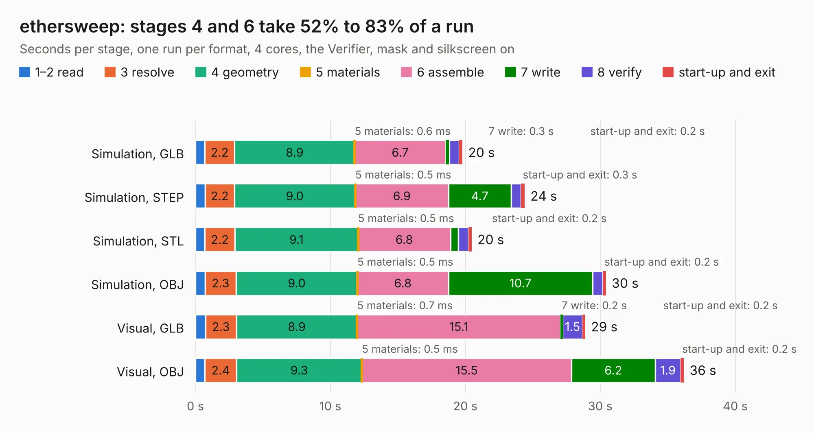

# 1760. ethersweep

Board 1,760 of the 3,120 of [Corpus Testing](../Corpus-Testing.md), on [Corpus Page 17](../CorpusTestingPages/Corpus-Testing-17.md#1760-ethersweep).

| Mode and format | 1–2 read | 3 resolve | 4 geometry | 5 materials | 6 assemble | 7 write | 8 verify | start-up and exit | Total |
|---|---:|---:|---:|---:|---:|---:|---:|---:|---:|
| Simulation, GLB | 0.7 | 2.2 | 8.9 | 0.6&nbsp;ms | 6.7 | 0.3 | 0.7 | 0.2 | 19.8 |
| Simulation, STEP | 0.7 | 2.2 | 9.0 | 0.5&nbsp;ms | 6.9 | 4.7 | 0.7 | 0.3 | 24.4 |
| Simulation, STL | 0.7 | 2.2 | 9.1 | 0.5&nbsp;ms | 6.8 | 0.6 | 0.8 | 0.2 | 20.5 |
| Simulation, OBJ | 0.7 | 2.3 | 9.0 | 0.5&nbsp;ms | 6.8 | 10.7 | 0.8 | 0.2 | 30.4 |
| Visual, GLB | 0.7 | 2.3 | 8.9 | 0.7&nbsp;ms | 15.1 | 0.2 | 1.5 | 0.2 | 28.9 |
| Visual, OBJ | 0.7 | 2.4 | 9.3 | 0.5&nbsp;ms | 15.5 | 6.2 | 1.9 | 0.2 | 36.2 |

<table align="center"><tr><td valign="top">

| Board | Repo: [Neumi/ethersweep](https://github.com/Neumi/ethersweep) Board: `ethersweep.kicad_pcb` |
|---|---|
| Folder | electronic_design / development / ethersweep406 |
| Complexity | 381&nbsp;/&nbsp;1000 (size&nbsp;256, features&nbsp;125) |
| KESE&nbsp;features | through vias, slotted holes, rounded, trapezoid or chamfered pads, filled zones, curved board outline, knockout text, TrueType text, stack-up, dielectric εr and tanδ |
| Tested | 9th November 2026 |
| Copper&nbsp;layers | 4 |
| File&nbsp;format | KiCad 7 (20221018) |
| Parts,&nbsp;tracks,&nbsp;vias | 105, 1,174, 149 |
| Triangles,&nbsp;simulation | 2,029,642 in 138 parts |
| Verifier | PASS in all six runs |

</td><td valign="top">

<table>
<tr><th>File type</th><th>File size</th><th>Peak memory used</th></tr>
<tr><th colspan="3" align="left">Simulation</th></tr>
<tr><td>GLB</td><td align="right">70&nbsp;MB</td><td align="right">655&nbsp;MB</td></tr>
<tr><td>STEP</td><td align="right">302&nbsp;MB</td><td align="right">787&nbsp;MB</td></tr>
<tr><td>STL</td><td align="right">101&nbsp;MB</td><td align="right">712&nbsp;MB</td></tr>
<tr><td>OBJ</td><td align="right">214&nbsp;MB</td><td align="right">1.4&nbsp;GB</td></tr>
<tr><th colspan="3" align="left">Visual</th></tr>
<tr><td>GLB</td><td align="right">40&nbsp;MB</td><td align="right">847&nbsp;MB</td></tr>
<tr><td>OBJ</td><td align="right">122&nbsp;MB</td><td align="right">940&nbsp;MB</td></tr>
</table>

</td></tr></table>

| Previous | Next |
|:---|---:|
| [1759. ethersweep](b1759b_ethersweep_electronic-design-development-ethersweep402_ethersweep.md) | [1761. ethersweep](b1761b_ethersweep_electronic-design-development-ethersweep407-CAN_ethersweep.md) |
