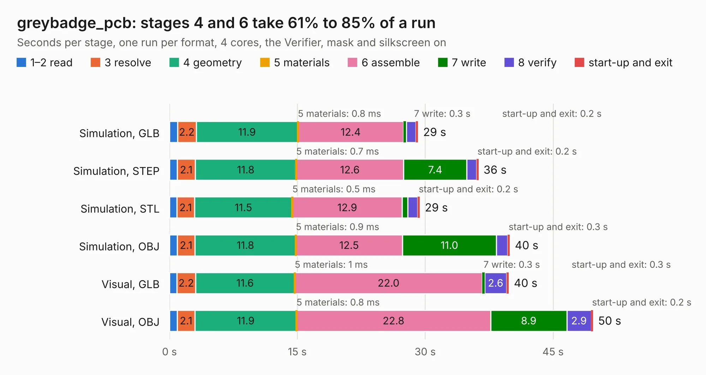

# 1761. greybadge_pcb

Board 1,761 of the 3,106 of [Corpus Testing](../Corpus-Testing.md), on [Corpus Page 17](../CorpusTestingPages/Corpus-Testing-17.md#1761-greybadge_pcb).

| Mode and format | 1–2 read | 3 resolve | 4 geometry | 5 materials | 6 assemble | 7 write | 8 verify | start-up and exit | Total |
|---|---:|---:|---:|---:|---:|---:|---:|---:|---:|
| Simulation, GLB | 0.9 | 2.2 | 11.9 | 0.8&nbsp;ms | 12.4 | 0.3 | 1.1 | 0.2 | 29.2 |
| Simulation, STEP | 0.9 | 2.1 | 11.8 | 0.7&nbsp;ms | 12.6 | 7.4 | 1.1 | 0.2 | 36.3 |
| Simulation, STL | 0.9 | 2.1 | 11.5 | 0.5&nbsp;ms | 12.9 | 0.6 | 1.2 | 0.2 | 29.4 |
| Simulation, OBJ | 0.9 | 2.1 | 11.8 | 0.9&nbsp;ms | 12.5 | 11.0 | 1.3 | 0.3 | 39.9 |
| Visual, GLB | 0.9 | 2.2 | 11.6 | 1&nbsp;ms | 22.0 | 0.3 | 2.6 | 0.3 | 39.8 |
| Visual, OBJ | 0.9 | 2.1 | 11.9 | 0.8&nbsp;ms | 22.8 | 8.9 | 2.9 | 0.2 | 49.7 |

<table align="center"><tr><td valign="top">

| Board | Repo: [NUSGreyhats/greybadge25](https://github.com/NUSGreyhats/greybadge25) Board: `greybadge_pcb.kicad_pcb` |
|---|---|
| Folder | hardware / greybadge_pcb |
| Complexity | 386&nbsp;/&nbsp;1000 (size&nbsp;251, features&nbsp;135) |
| KESE&nbsp;features | through vias, slotted holes, custom pads, rounded, trapezoid or chamfered pads, arc tracks, filled zones, copper drawings, curved board outline, knockout text, TrueType text |
| Tested | 9th November 2026 |
| Copper&nbsp;layers | 2 |
| File&nbsp;format | KiCad 9 (20241229) |
| Parts,&nbsp;tracks,&nbsp;vias | 135, 1,721, 176 |
| Triangles,&nbsp;simulation | 2,062,768 in 300 parts |
| Verifier | PASS in all six runs |

</td><td valign="top">

<table>
<tr><th>File type</th><th>File size</th><th>Peak memory used</th></tr>
<tr><th colspan="3" align="left">Simulation</th></tr>
<tr><td>GLB</td><td align="right">72&nbsp;MB</td><td align="right">814&nbsp;MB</td></tr>
<tr><td>STEP</td><td align="right">442&nbsp;MB</td><td align="right">1.0&nbsp;GB</td></tr>
<tr><td>STL</td><td align="right">103&nbsp;MB</td><td align="right">832&nbsp;MB</td></tr>
<tr><td>OBJ</td><td align="right">220&nbsp;MB</td><td align="right">1.4&nbsp;GB</td></tr>
<tr><th colspan="3" align="left">Visual</th></tr>
<tr><td>GLB</td><td align="right">60&nbsp;MB</td><td align="right">1.1&nbsp;GB</td></tr>
<tr><td>OBJ</td><td align="right">184&nbsp;MB</td><td align="right">1.2&nbsp;GB</td></tr>
</table>

</td></tr></table>

| Previous | Next |
|:---|---:|
| [1760. hvboard](b1760b_ibxII-hardware_hvboard.md) | [1762. battery](b1762b_barebones_battery.md) |
