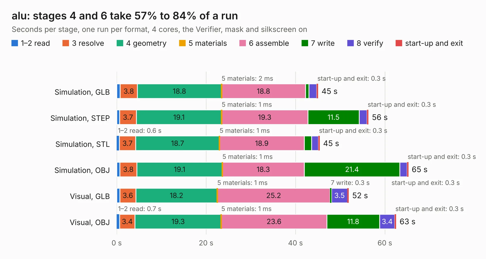

# 1762. alu

Board 1,762 of the 3,110 of [Corpus Testing](../Corpus-Testing.md), on [Corpus Page 17](../CorpusTestingPages/Corpus-Testing-17.md#1762-alu).

| Mode and format | 1–2 read | 3 resolve | 4 geometry | 5 materials | 6 assemble | 7 write | 8 verify | start-up and exit | Total |
|---|---:|---:|---:|---:|---:|---:|---:|---:|---:|
| Simulation, GLB | 0.8 | 3.8 | 18.8 | 2&nbsp;ms | 18.8 | 0.8 | 1.8 | 0.3 | 45.1 |
| Simulation, STEP | 0.7 | 3.7 | 19.1 | 1&nbsp;ms | 19.3 | 11.5 | 1.7 | 0.3 | 56.3 |
| Simulation, STL | 0.6 | 3.7 | 18.7 | 1&nbsp;ms | 18.9 | 1.7 | 1.5 | 0.3 | 45.4 |
| Simulation, OBJ | 0.7 | 3.8 | 19.1 | 1&nbsp;ms | 18.3 | 21.4 | 1.6 | 0.3 | 65.2 |
| Visual, GLB | 0.7 | 3.6 | 18.2 | 1&nbsp;ms | 25.2 | 0.3 | 3.5 | 0.3 | 51.9 |
| Visual, OBJ | 0.7 | 3.4 | 19.3 | 1&nbsp;ms | 23.6 | 11.8 | 3.4 | 0.3 | 62.5 |

<table align="center"><tr><td valign="top">

| Board | Repo: [Noah1989/74cpu](https://github.com/Noah1989/74cpu) Board: `alu.kicad_pcb` |
|---|---|
| Complexity | 205&nbsp;/&nbsp;1000 (size&nbsp;190, features&nbsp;15) |
| KESE&nbsp;features | through vias |
| Tested | 9th November 2026 |
| Copper&nbsp;layers | 2 |
| File&nbsp;format | KiCad 4 (4) |
| Parts,&nbsp;tracks,&nbsp;vias | 280, 688, 86 |
| Triangles,&nbsp;simulation | 4,036,698 in 159 parts |
| Verifier | PASS in all six runs |

</td><td valign="top">

<table>
<tr><th>File type</th><th>File size</th><th>Peak memory used</th></tr>
<tr><th colspan="3" align="left">Simulation</th></tr>
<tr><td>GLB</td><td align="right">135&nbsp;MB</td><td align="right">1.1&nbsp;GB</td></tr>
<tr><td>STEP</td><td align="right">547&nbsp;MB</td><td align="right">1.6&nbsp;GB</td></tr>
<tr><td>STL</td><td align="right">202&nbsp;MB</td><td align="right">1.1&nbsp;GB</td></tr>
<tr><td>OBJ</td><td align="right">424&nbsp;MB</td><td align="right">2.6&nbsp;GB</td></tr>
<tr><th colspan="3" align="left">Visual</th></tr>
<tr><td>GLB</td><td align="right">75&nbsp;MB</td><td align="right">1.3&nbsp;GB</td></tr>
<tr><td>OBJ</td><td align="right">234&nbsp;MB</td><td align="right">1.6&nbsp;GB</td></tr>
</table>

</td></tr></table>

| Previous | Next |
|:---|---:|
| [1761. quantum_arcade_pcb](b1761b_quantum-arcade-pcb_quantum-arcade-pcb.md) | [1763. adcboard](b1763b_ibxII-hardware_adcboard.md) |
