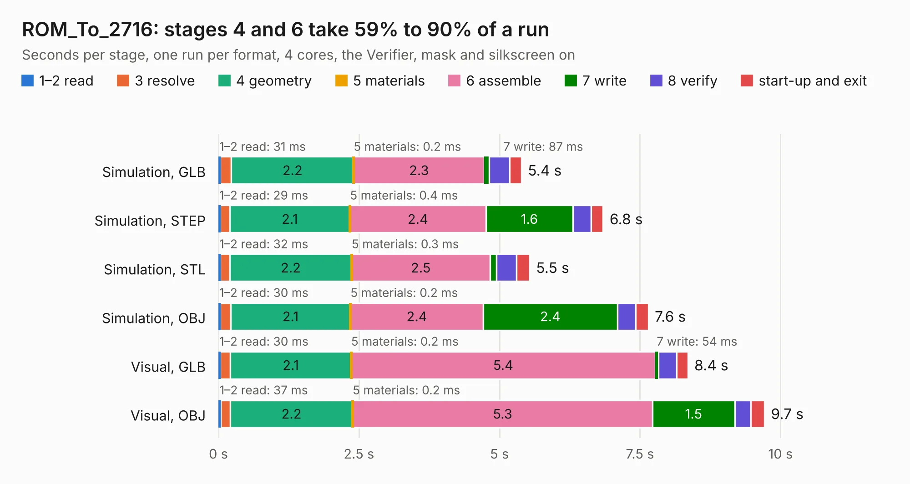

# 1762. ROM_To_2716

Board 1,762 of the 3,112 of [Corpus Testing](../Corpus-Testing.md), on [Corpus Page 17](../CorpusTestingPages/Corpus-Testing-17.md#1762-rom_to_2716).

| Mode and format | 1–2 read | 3 resolve | 4 geometry | 5 materials | 6 assemble | 7 write | 8 verify | start-up and exit | Total |
|---|---:|---:|---:|---:|---:|---:|---:|---:|---:|
| Simulation, GLB | 31&nbsp;ms | 0.2 | 2.2 | 0.2&nbsp;ms | 2.3 | 87&nbsp;ms | 0.4 | 0.2 | 5.4 |
| Simulation, STEP | 29&nbsp;ms | 0.2 | 2.1 | 0.4&nbsp;ms | 2.4 | 1.6 | 0.3 | 0.2 | 6.8 |
| Simulation, STL | 32&nbsp;ms | 0.2 | 2.2 | 0.3&nbsp;ms | 2.5 | 0.1 | 0.4 | 0.2 | 5.5 |
| Simulation, OBJ | 30&nbsp;ms | 0.2 | 2.1 | 0.2&nbsp;ms | 2.4 | 2.4 | 0.3 | 0.2 | 7.6 |
| Visual, GLB | 30&nbsp;ms | 0.2 | 2.1 | 0.2&nbsp;ms | 5.4 | 54&nbsp;ms | 0.3 | 0.2 | 8.4 |
| Visual, OBJ | 37&nbsp;ms | 0.2 | 2.2 | 0.2&nbsp;ms | 5.3 | 1.5 | 0.3 | 0.2 | 9.7 |

<table align="center"><tr><td valign="top">

| Board | Repo: [nmikstas/asteroids-pcb](https://github.com/nmikstas/asteroids-pcb) Board: `ROM_To_2716.kicad_pcb` |
|---|---|
| Folder | ROM_to_2716 |
| Complexity | 106&nbsp;/&nbsp;1000 (size&nbsp;86, features&nbsp;20) |
| KESE&nbsp;features | filled zones |
| Tested | 9th November 2026 |
| Copper&nbsp;layers | 2 |
| File&nbsp;format | KiCad 5 (20171130) |
| Parts,&nbsp;tracks,&nbsp;vias | 2, 32, 0 |
| Triangles,&nbsp;simulation | 398,426 in 28 parts |
| Verifier | PASS in all six runs |

</td><td valign="top">

<table>
<tr><th>File type</th><th>File size</th><th>Peak memory used</th></tr>
<tr><th colspan="3" align="left">Simulation</th></tr>
<tr><td>GLB</td><td align="right">15&nbsp;MB</td><td align="right">260&nbsp;MB</td></tr>
<tr><td>STEP</td><td align="right">92&nbsp;MB</td><td align="right">288&nbsp;MB</td></tr>
<tr><td>STL</td><td align="right">20&nbsp;MB</td><td align="right">241&nbsp;MB</td></tr>
<tr><td>OBJ</td><td align="right">43&nbsp;MB</td><td align="right">322&nbsp;MB</td></tr>
<tr><th colspan="3" align="left">Visual</th></tr>
<tr><td>GLB</td><td align="right">8.9&nbsp;MB</td><td align="right">245&nbsp;MB</td></tr>
<tr><td>OBJ</td><td align="right">26&nbsp;MB</td><td align="right">247&nbsp;MB</td></tr>
</table>

</td></tr></table>

| Previous | Next |
|:---|---:|
| [1761. Asteroids_PCB](b1761b_asteroids-pcb_Asteroids-PCB.md) | [1763. quantum_arcade_pcb](b1763b_quantum-arcade-pcb_quantum-arcade-pcb.md) |
