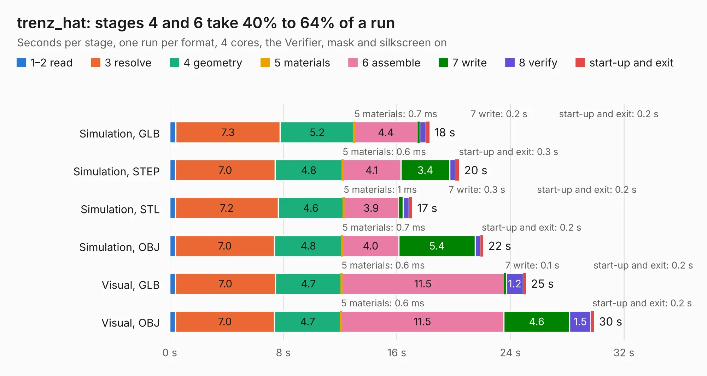

# 1762. trenz_hat

Board 1,762 of the 3,131 of [Corpus Testing](../Corpus-Testing.md), on [Corpus Page 17](../CorpusTestingPages/Corpus-Testing-17.md#1762-trenz_hat).

| Mode and format | 1–2 read | 3 resolve | 4 geometry | 5 materials | 6 assemble | 7 write | 8 verify | start-up and exit | Total |
|---|---:|---:|---:|---:|---:|---:|---:|---:|---:|
| Simulation, GLB | 0.4 | 7.3 | 5.2 | 0.7&nbsp;ms | 4.4 | 0.2 | 0.4 | 0.2 | 18.3 |
| Simulation, STEP | 0.4 | 7.0 | 4.8 | 0.6&nbsp;ms | 4.1 | 3.4 | 0.4 | 0.3 | 20.4 |
| Simulation, STL | 0.4 | 7.2 | 4.6 | 1&nbsp;ms | 3.9 | 0.3 | 0.4 | 0.2 | 17.1 |
| Simulation, OBJ | 0.4 | 7.0 | 4.8 | 0.7&nbsp;ms | 4.0 | 5.4 | 0.4 | 0.2 | 22.1 |
| Visual, GLB | 0.4 | 7.0 | 4.7 | 0.6&nbsp;ms | 11.5 | 0.1 | 1.2 | 0.2 | 25.1 |
| Visual, OBJ | 0.4 | 7.0 | 4.7 | 0.6&nbsp;ms | 11.5 | 4.6 | 1.5 | 0.2 | 29.9 |

<table align="center"><tr><td valign="top">

| Board | Repo: [naturalhazardscience/groundlark](https://github.com/naturalhazardscience/groundlark) Board: `trenz_hat.kicad_pcb` |
|---|---|
| Folder | hw / groundlark-fpga-hat / layout / trenz_hat |
| Complexity | 199&nbsp;/&nbsp;1000 (size&nbsp;114, features&nbsp;85) |
| KESE&nbsp;features | custom pads, rounded, trapezoid or chamfered pads, copper drawings, stack-up, dielectric εr and tanδ, copper finish, mask and silkscreen colours |
| Tested | 9th November 2026 |
| Copper&nbsp;layers | 2 |
| File&nbsp;format | KiCad 9 (20241229) |
| Parts,&nbsp;tracks,&nbsp;vias | 190, 0, 0 |
| Triangles,&nbsp;simulation | 1,028,724 in 290 parts |
| Note | mostly unrouted |
| Verifier | PASS in all six runs |

</td><td valign="top">

<table>
<tr><th>File type</th><th>File size</th><th>Peak memory used</th></tr>
<tr><th colspan="3" align="left">Simulation</th></tr>
<tr><td>GLB</td><td align="right">36&nbsp;MB</td><td align="right">496&nbsp;MB</td></tr>
<tr><td>STEP</td><td align="right">145&nbsp;MB</td><td align="right">605&nbsp;MB</td></tr>
<tr><td>STL</td><td align="right">51&nbsp;MB</td><td align="right">498&nbsp;MB</td></tr>
<tr><td>OBJ</td><td align="right">107&nbsp;MB</td><td align="right">719&nbsp;MB</td></tr>
<tr><th colspan="3" align="left">Visual</th></tr>
<tr><td>GLB</td><td align="right">30&nbsp;MB</td><td align="right">630&nbsp;MB</td></tr>
<tr><td>OBJ</td><td align="right">89&nbsp;MB</td><td align="right">781&nbsp;MB</td></tr>
</table>

</td></tr></table>

| Previous | Next |
|:---|---:|
| [1761. trenz-mounted](b1761b_groundlark_trenz-mounted.md) | [1763. raspberrypi_hat](b1763b_groundlark_raspberrypi-hat.md) |
