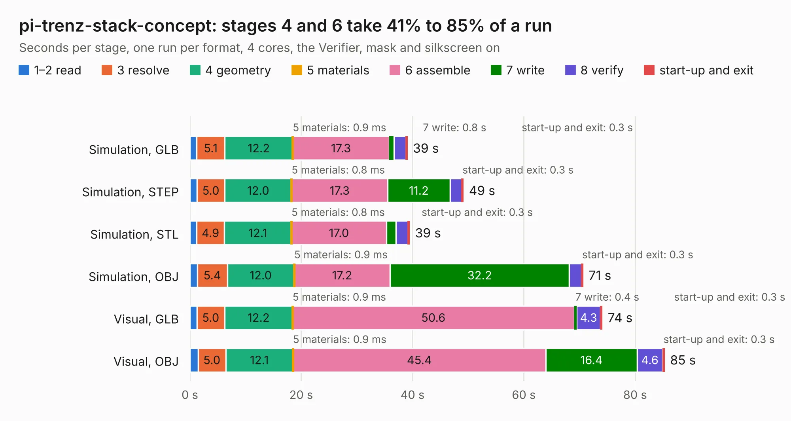

# 1763 pi-trenz-stack-concept

Board 1,763 of the 3,138 of [Corpus Testing](../Corpus-Testing.md), on [Corpus Page 17](../CorpusTestingPages/Corpus-Testing-17.md#1763-pi-trenz-stack-concept).

| Mode and format | 1–2 read | 3 resolve | 4 geometry | 5 materials | 6 assemble | 7 write | 8 verify | start-up and exit | Total |
|---|---:|---:|---:|---:|---:|---:|---:|---:|---:|
| Simulation, GLB | 1.2 | 5.1 | 12.2 | 0.9&nbsp;ms | 17.3 | 0.8 | 2.1 | 0.3 | 39.1 |
| Simulation, STEP | 1.3 | 5.0 | 12.0 | 0.8&nbsp;ms | 17.3 | 11.2 | 2.1 | 0.3 | 49.1 |
| Simulation, STL | 1.2 | 4.9 | 12.1 | 0.8&nbsp;ms | 17.0 | 1.7 | 2.1 | 0.3 | 39.5 |
| Simulation, OBJ | 1.3 | 5.4 | 12.0 | 0.9&nbsp;ms | 17.2 | 32.2 | 2.1 | 0.3 | 70.6 |
| Visual, GLB | 1.3 | 5.0 | 12.2 | 0.9&nbsp;ms | 50.6 | 0.4 | 4.3 | 0.3 | 74.1 |
| Visual, OBJ | 1.5 | 5.0 | 12.1 | 0.9&nbsp;ms | 45.4 | 16.4 | 4.6 | 0.3 | 85.3 |

<table align="center"><tr><td valign="top">

| Board | Repo: [naturalhazardscience/groundlark](https://github.com/naturalhazardscience/groundlark) Board: `pi-trenz-stack-concept.kicad_pcb` |
|---|---|
| Folder | hw / groundlark-fpga-hat / boards / groundlark-daqhat-01 |
| Complexity | 417&nbsp;/&nbsp;1000 (size&nbsp;297, features&nbsp;120) |
| KESE&nbsp;features | through vias, custom pads, rounded, trapezoid or chamfered pads, filled zones, copper drawings, stack-up, dielectric εr and tanδ, copper finish, mask and silkscreen colours |
| Tested | 9th November 2026 |
| Copper&nbsp;layers | 6 |
| File&nbsp;format | KiCad 9 (20241229) |
| Parts,&nbsp;tracks,&nbsp;vias | 190, 12,366, 745 |
| Triangles,&nbsp;simulation | 5,819,912 in 381 parts |
| Verifier | PASS in all six runs |

</td><td valign="top">

<table>
<tr><th>File type</th><th>File size</th><th>Peak memory used</th></tr>
<tr><th colspan="3" align="left">Simulation</th></tr>
<tr><td>GLB</td><td align="right">195&nbsp;MB</td><td align="right">1.6&nbsp;GB</td></tr>
<tr><td>STEP</td><td align="right">676&nbsp;MB</td><td align="right">1.9&nbsp;GB</td></tr>
<tr><td>STL</td><td align="right">291&nbsp;MB</td><td align="right">1.7&nbsp;GB</td></tr>
<tr><td>OBJ</td><td align="right">625&nbsp;MB</td><td align="right">3.7&nbsp;GB</td></tr>
<tr><th colspan="3" align="left">Visual</th></tr>
<tr><td>GLB</td><td align="right">106&nbsp;MB</td><td align="right">2.2&nbsp;GB</td></tr>
<tr><td>OBJ</td><td align="right">343&nbsp;MB</td><td align="right">2.3&nbsp;GB</td></tr>
</table>

</td></tr></table>

| Previous | Next |
|:---|---:|
| [1762 groundlark-daqhat-01](b1762b_groundlark_groundlark-daqhat-01.md) | [1764 stack-exploded](b1764b_groundlark_stack-exploded.md) |
