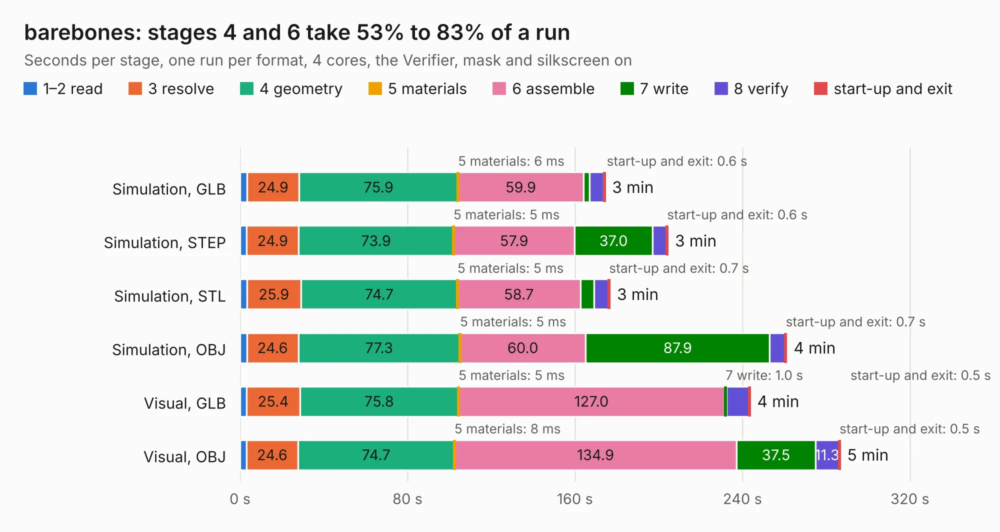

# 1764. barebones

Board 1,764 of the 3,107 of [Corpus Testing](../Corpus-Testing.md), on [Corpus Page 17](../CorpusTestingPages/Corpus-Testing-17.md#1764-barebones).

| Mode and format | 1–2 read | 3 resolve | 4 geometry | 5 materials | 6 assemble | 7 write | 8 verify | start-up and exit | Total |
|---|---:|---:|---:|---:|---:|---:|---:|---:|---:|
| Simulation, GLB | 3.3 | 24.9 | 75.9 | 6&nbsp;ms | 59.9 | 3.0 | 6.7 | 0.6 | 174.3 |
| Simulation, STEP | 3.2 | 24.9 | 73.9 | 5&nbsp;ms | 57.9 | 37.0 | 6.8 | 0.6 | 204.3 |
| Simulation, STL | 3.2 | 25.9 | 74.7 | 5&nbsp;ms | 58.7 | 6.5 | 6.9 | 0.7 | 176.6 |
| Simulation, OBJ | 3.3 | 24.6 | 77.3 | 5&nbsp;ms | 60.0 | 87.9 | 7.3 | 0.7 | 261.0 |
| Visual, GLB | 3.1 | 25.4 | 75.8 | 5&nbsp;ms | 127.0 | 1.0 | 10.7 | 0.5 | 243.6 |
| Visual, OBJ | 3.1 | 24.6 | 74.7 | 8&nbsp;ms | 134.9 | 37.5 | 11.3 | 0.5 | 286.6 |

<table align="center"><tr><td valign="top">

| Board | Repo: [nzevh/barebones](https://github.com/nzevh/barebones) Board: `barebones.kicad_pcb` |
|---|---|
| Folder | hardware / motherboard |
| Complexity | 651&nbsp;/&nbsp;1000 (size&nbsp;341, features&nbsp;310) |
| KESE&nbsp;features | through vias, blind and buried vias, microvias, covered, plugged, capped or filled vias, slotted holes, custom pads, rounded, trapezoid or chamfered pads, arc tracks, filled zones, copper drawings, knockout text, TrueType text, hatched fills, stack-up, dielectric εr and tanδ, copper finish, mask and silkscreen colours |
| Tested | 9th November 2026 |
| Copper&nbsp;layers | 8 |
| File&nbsp;format | KiCad 10 (20260206) |
| Parts,&nbsp;tracks,&nbsp;vias | 1,031, 2,098, 1,881 |
| Triangles,&nbsp;simulation | 12,973,364 in 1327 parts |
| Verifier | PASS in all six runs |

</td><td valign="top">

<table>
<tr><th>File type</th><th>File size</th><th>Peak memory used</th></tr>
<tr><th colspan="3" align="left">Simulation</th></tr>
<tr><td>GLB</td><td align="right">442&nbsp;MB</td><td align="right">3.0&nbsp;GB</td></tr>
<tr><td>STEP</td><td align="right">2.0&nbsp;GB</td><td align="right">4.2&nbsp;GB</td></tr>
<tr><td>STL</td><td align="right">649&nbsp;MB</td><td align="right">3.0&nbsp;GB</td></tr>
<tr><td>OBJ</td><td align="right">1.4&nbsp;GB</td><td align="right">8.3&nbsp;GB</td></tr>
<tr><th colspan="3" align="left">Visual</th></tr>
<tr><td>GLB</td><td align="right">196&nbsp;MB</td><td align="right">3.3&nbsp;GB</td></tr>
<tr><td>OBJ</td><td align="right">632&nbsp;MB</td><td align="right">4.2&nbsp;GB</td></tr>
</table>

</td></tr></table>

| Previous | Next |
|:---|---:|
| [1763. battery](b1763b_barebones_battery.md) | [1765. m3](b1765b_rocket-flight-computer_m3-design-assembly-review_m3.md) |
