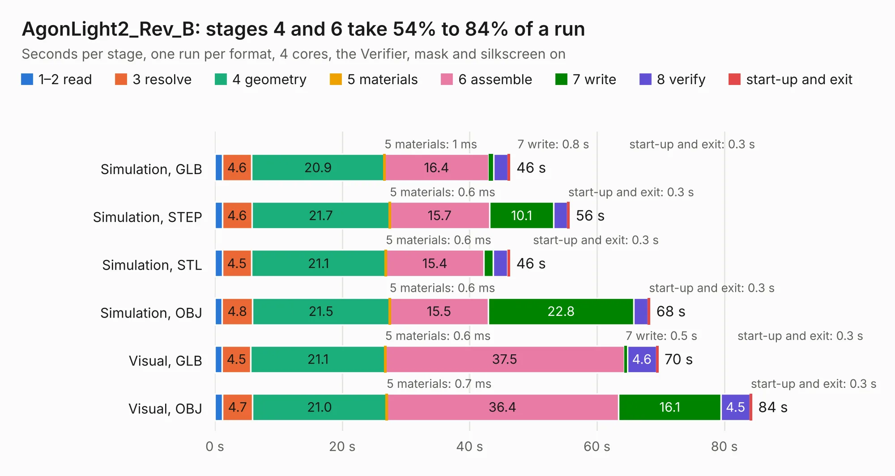

# 1765. AgonLight2_Rev_B

Board 1,765 of the 3,101 of [Corpus Testing](../Corpus-Testing.md), on [Corpus Page 17](../CorpusTestingPages/Corpus-Testing-17.md#1765-agonlight2_rev_b).

| Mode and format | 1–2 read | 3 resolve | 4 geometry | 5 materials | 6 assemble | 7 write | 8 verify | start-up and exit | Total |
|---|---:|---:|---:|---:|---:|---:|---:|---:|---:|
| Simulation, GLB | 1.2 | 4.6 | 20.9 | 1&nbsp;ms | 16.4 | 0.8 | 2.3 | 0.3 | 46.3 |
| Simulation, STEP | 1.2 | 4.6 | 21.7 | 0.6&nbsp;ms | 15.7 | 10.1 | 2.1 | 0.3 | 55.6 |
| Simulation, STL | 1.2 | 4.5 | 21.1 | 0.6&nbsp;ms | 15.4 | 1.5 | 2.3 | 0.3 | 46.3 |
| Simulation, OBJ | 1.1 | 4.8 | 21.5 | 0.6&nbsp;ms | 15.5 | 22.8 | 2.3 | 0.3 | 68.3 |
| Visual, GLB | 1.1 | 4.5 | 21.1 | 0.6&nbsp;ms | 37.5 | 0.5 | 4.6 | 0.3 | 69.6 |
| Visual, OBJ | 1.2 | 4.7 | 21.0 | 0.7&nbsp;ms | 36.4 | 16.1 | 4.5 | 0.3 | 84.3 |

<table align="center"><tr><td valign="top">

| Board | Repo: [OLIMEX/AgonLight2](https://github.com/OLIMEX/AgonLight2) Board: `AgonLight2_Rev_B.kicad_pcb` |
|---|---|
| Folder | HARDWARE / AgonLight2_Rev_B |
| Complexity | 313&nbsp;/&nbsp;1000 (size&nbsp;268, features&nbsp;45) |
| KESE&nbsp;features | through vias, slotted holes, filled zones |
| Tested | 9th November 2026 |
| Copper&nbsp;layers | 4 |
| File&nbsp;format | KiCad 5 (20171130) |
| Parts,&nbsp;tracks,&nbsp;vias | 229, 2,796, 400 |
| Triangles,&nbsp;simulation | 3,844,256 in 225 parts |
| Verifier | PASS in all six runs |

</td><td valign="top">

<table>
<tr><th>File type</th><th>File size</th><th>Peak memory used</th></tr>
<tr><th colspan="3" align="left">Simulation</th></tr>
<tr><td>GLB</td><td align="right">135&nbsp;MB</td><td align="right">1.4&nbsp;GB</td></tr>
<tr><td>STEP</td><td align="right">596&nbsp;MB</td><td align="right">1.6&nbsp;GB</td></tr>
<tr><td>STL</td><td align="right">192&nbsp;MB</td><td align="right">1.3&nbsp;GB</td></tr>
<tr><td>OBJ</td><td align="right">416&nbsp;MB</td><td align="right">2.6&nbsp;GB</td></tr>
<tr><th colspan="3" align="left">Visual</th></tr>
<tr><td>GLB</td><td align="right">94&nbsp;MB</td><td align="right">1.4&nbsp;GB</td></tr>
<tr><td>OBJ</td><td align="right">294&nbsp;MB</td><td align="right">2.0&nbsp;GB</td></tr>
</table>

</td></tr></table>

| Previous | Next |
|:---|---:|
| [1764. AgonLight2_Rev_A](b1764b_AgonLight2_AgonLight2-Rev-A.md) | [1766. AgonLight2-HvIO_Rev_A](b1766b_AgonLight2-HvIO_AgonLight2-HvIO-Rev-A.md) |
