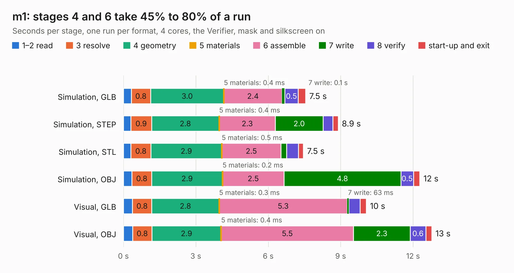

# 1765. m1

Board 1,765 of the 3,106 of [Corpus Testing](../Corpus-Testing.md), on [Corpus Page 17](../CorpusTestingPages/Corpus-Testing-17.md#1765-m1).

| Mode and format | 1–2 read | 3 resolve | 4 geometry | 5 materials | 6 assemble | 7 write | 8 verify | start-up and exit | Total |
|---|---:|---:|---:|---:|---:|---:|---:|---:|---:|
| Simulation, GLB | 0.3 | 0.8 | 3.0 | 0.4&nbsp;ms | 2.4 | 0.1 | 0.5 | 0.3 | 7.5 |
| Simulation, STEP | 0.3 | 0.9 | 2.8 | 0.4&nbsp;ms | 2.3 | 2.0 | 0.4 | 0.2 | 8.9 |
| Simulation, STL | 0.3 | 0.8 | 2.9 | 0.5&nbsp;ms | 2.5 | 0.2 | 0.5 | 0.2 | 7.5 |
| Simulation, OBJ | 0.4 | 0.8 | 2.9 | 0.2&nbsp;ms | 2.5 | 4.8 | 0.5 | 0.3 | 12.3 |
| Visual, GLB | 0.4 | 0.8 | 2.8 | 0.3&nbsp;ms | 5.3 | 63&nbsp;ms | 0.5 | 0.3 | 10.1 |
| Visual, OBJ | 0.4 | 0.8 | 2.9 | 0.4&nbsp;ms | 5.5 | 2.3 | 0.6 | 0.2 | 12.8 |

<table align="center"><tr><td valign="top">

| Board | Repo: [oak-wjr/rocket-flight-computer](https://github.com/oak-wjr/rocket-flight-computer) Board: `m1.kicad_pcb` |
|---|---|
| Folder | reference / m1_power_actuator |
| Complexity | 212&nbsp;/&nbsp;1000 (size&nbsp;167, features&nbsp;45) |
| KESE&nbsp;features | through vias, filled zones, curved board outline |
| Tested | 9th November 2026 |
| Copper&nbsp;layers | 4 |
| File&nbsp;format | KiCad 10 (20260206) |
| Parts,&nbsp;tracks,&nbsp;vias | 36, 84, 76 |
| Triangles,&nbsp;simulation | 778,592 in 40 parts |
| Verifier | PASS in all six runs |

</td><td valign="top">

<table>
<tr><th>File type</th><th>File size</th><th>Peak memory used</th></tr>
<tr><th colspan="3" align="left">Simulation</th></tr>
<tr><td>GLB</td><td align="right">27&nbsp;MB</td><td align="right">359&nbsp;MB</td></tr>
<tr><td>STEP</td><td align="right">82&nbsp;MB</td><td align="right">406&nbsp;MB</td></tr>
<tr><td>STL</td><td align="right">39&nbsp;MB</td><td align="right">352&nbsp;MB</td></tr>
<tr><td>OBJ</td><td align="right">78&nbsp;MB</td><td align="right">551&nbsp;MB</td></tr>
<tr><th colspan="3" align="left">Visual</th></tr>
<tr><td>GLB</td><td align="right">15&nbsp;MB</td><td align="right">410&nbsp;MB</td></tr>
<tr><td>OBJ</td><td align="right">45&nbsp;MB</td><td align="right">415&nbsp;MB</td></tr>
</table>

</td></tr></table>

| Previous | Next |
|:---|---:|
| [1764. m3](b1764b_rocket-flight-computer_m3-design-assembly-review_m3.md) | [1766. m3](b1766b_rocket-flight-computer_reference-m3-assy-r1_m3.md) |
