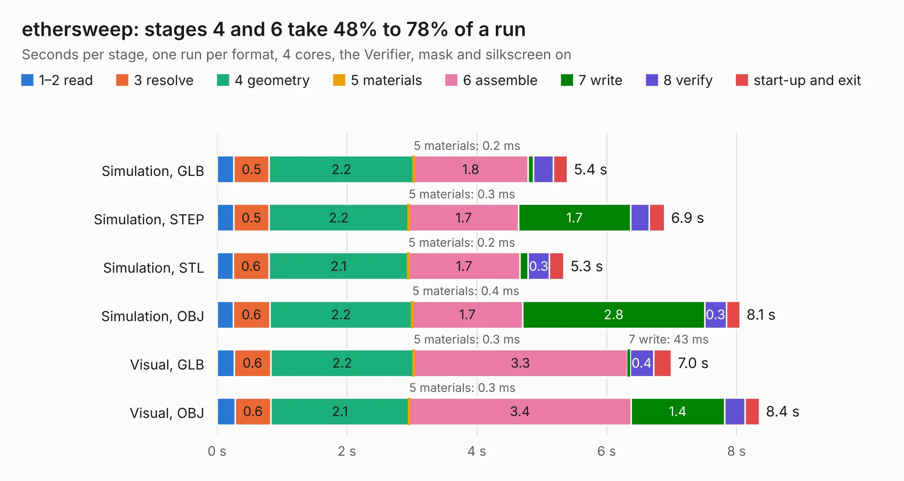

# 1766. ethersweep

Board 1,766 of the 3,128 of [Corpus Testing](../Corpus-Testing.md), on [Corpus Page 17](../CorpusTestingPages/Corpus-Testing-17.md#1766-ethersweep).

| Mode and format | 1–2 read | 3 resolve | 4 geometry | 5 materials | 6 assemble | 7 write | 8 verify | start-up and exit | Total |
|---|---:|---:|---:|---:|---:|---:|---:|---:|---:|
| Simulation, GLB | 0.3 | 0.5 | 2.2 | 0.2&nbsp;ms | 1.8 | 85&nbsp;ms | 0.3 | 0.2 | 5.4 |
| Simulation, STEP | 0.3 | 0.5 | 2.2 | 0.3&nbsp;ms | 1.7 | 1.7 | 0.3 | 0.2 | 6.9 |
| Simulation, STL | 0.2 | 0.6 | 2.1 | 0.2&nbsp;ms | 1.7 | 0.1 | 0.3 | 0.2 | 5.3 |
| Simulation, OBJ | 0.3 | 0.6 | 2.2 | 0.4&nbsp;ms | 1.7 | 2.8 | 0.3 | 0.2 | 8.1 |
| Visual, GLB | 0.3 | 0.6 | 2.2 | 0.3&nbsp;ms | 3.3 | 43&nbsp;ms | 0.4 | 0.3 | 7.0 |
| Visual, OBJ | 0.3 | 0.6 | 2.1 | 0.3&nbsp;ms | 3.4 | 1.4 | 0.3 | 0.2 | 8.4 |

<table align="center"><tr><td valign="top">

| Board | Repo: [Neumi/ethersweep](https://github.com/Neumi/ethersweep) Board: `ethersweep.kicad_pcb` |
|---|---|
| Folder | electronic_design / development / ethersweep407_CAN |
| Complexity | 295&nbsp;/&nbsp;1000 (size&nbsp;155, features&nbsp;140) |
| KESE&nbsp;features | through vias, custom pads, rounded, trapezoid or chamfered pads, filled zones, copper drawings, curved board outline, knockout text, TrueType text, stack-up, dielectric εr and tanδ |
| Tested | 9th November 2026 |
| Copper&nbsp;layers | 4 |
| File&nbsp;format | KiCad 7 (20221018) |
| Parts,&nbsp;tracks,&nbsp;vias | 24, 154, 13 |
| Triangles,&nbsp;simulation | 503,738 in 44 parts |
| Verifier | PASS in all six runs |

</td><td valign="top">

<table>
<tr><th>File type</th><th>File size</th><th>Peak memory used</th></tr>
<tr><th colspan="3" align="left">Simulation</th></tr>
<tr><td>GLB</td><td align="right">17&nbsp;MB</td><td align="right">274&nbsp;MB</td></tr>
<tr><td>STEP</td><td align="right">67&nbsp;MB</td><td align="right">308&nbsp;MB</td></tr>
<tr><td>STL</td><td align="right">25&nbsp;MB</td><td align="right">278&nbsp;MB</td></tr>
<tr><td>OBJ</td><td align="right">51&nbsp;MB</td><td align="right">383&nbsp;MB</td></tr>
<tr><th colspan="3" align="left">Visual</th></tr>
<tr><td>GLB</td><td align="right">8.8&nbsp;MB</td><td align="right">276&nbsp;MB</td></tr>
<tr><td>OBJ</td><td align="right">26&nbsp;MB</td><td align="right">275&nbsp;MB</td></tr>
</table>

</td></tr></table>

| Previous | Next |
|:---|---:|
| [1765. ethersweep](b1765b_ethersweep_electronic-design-development-ethersweep406_ethersweep.md) | [1767. ethersweep](b1767b_ethersweep_electronic-design-development-ethersweep-tmc2209_ethersweep.md) |
