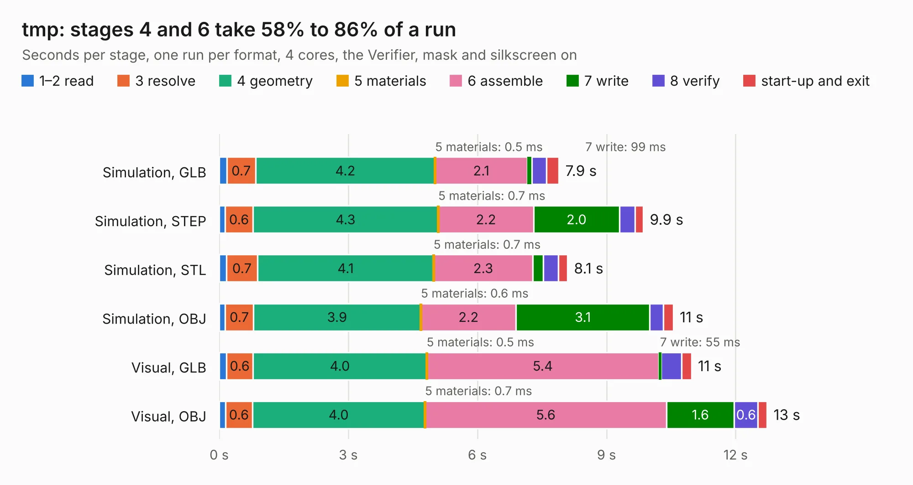

# 1766. tmp

Board 1,766 of the 3,121 of [Corpus Testing](../Corpus-Testing.md), on [Corpus Page 17](../CorpusTestingPages/Corpus-Testing-17.md#1766-tmp).

| Mode and format | 1–2 read | 3 resolve | 4 geometry | 5 materials | 6 assemble | 7 write | 8 verify | start-up and exit | Total |
|---|---:|---:|---:|---:|---:|---:|---:|---:|---:|
| Simulation, GLB | 0.2 | 0.7 | 4.2 | 0.5&nbsp;ms | 2.1 | 99&nbsp;ms | 0.3 | 0.3 | 7.9 |
| Simulation, STEP | 0.1 | 0.6 | 4.3 | 0.7&nbsp;ms | 2.2 | 2.0 | 0.4 | 0.2 | 9.9 |
| Simulation, STL | 0.2 | 0.7 | 4.1 | 0.7&nbsp;ms | 2.3 | 0.2 | 0.3 | 0.2 | 8.1 |
| Simulation, OBJ | 0.1 | 0.7 | 3.9 | 0.6&nbsp;ms | 2.2 | 3.1 | 0.3 | 0.2 | 10.5 |
| Visual, GLB | 0.2 | 0.6 | 4.0 | 0.5&nbsp;ms | 5.4 | 55&nbsp;ms | 0.5 | 0.2 | 11.0 |
| Visual, OBJ | 0.2 | 0.6 | 4.0 | 0.7&nbsp;ms | 5.6 | 1.6 | 0.6 | 0.2 | 12.7 |

<table align="center"><tr><td valign="top">

| Board | Repo: [neuroidss/freeeeg32](https://github.com/neuroidss/freeeeg32) Board: `tmp.kicad_pcb` |
|---|---|
| Folder | KiCad |
| Complexity | 209&nbsp;/&nbsp;1000 (size&nbsp;209, features&nbsp;0) |
| Tested | 9th November 2026 |
| Copper&nbsp;layers | 2 |
| File&nbsp;format | KiCad 4 (4) |
| Parts,&nbsp;tracks,&nbsp;vias | 57, 360, 0 |
| Triangles,&nbsp;simulation | 756,624 in 90 parts |
| Verifier | PASS in all six runs |

</td><td valign="top">

<table>
<tr><th>File type</th><th>File size</th><th>Peak memory used</th></tr>
<tr><th colspan="3" align="left">Simulation</th></tr>
<tr><td>GLB</td><td align="right">27&nbsp;MB</td><td align="right">376&nbsp;MB</td></tr>
<tr><td>STEP</td><td align="right">121&nbsp;MB</td><td align="right">442&nbsp;MB</td></tr>
<tr><td>STL</td><td align="right">38&nbsp;MB</td><td align="right">382&nbsp;MB</td></tr>
<tr><td>OBJ</td><td align="right">78&nbsp;MB</td><td align="right">551&nbsp;MB</td></tr>
<tr><th colspan="3" align="left">Visual</th></tr>
<tr><td>GLB</td><td align="right">14&nbsp;MB</td><td align="right">414&nbsp;MB</td></tr>
<tr><td>OBJ</td><td align="right">42&nbsp;MB</td><td align="right">418&nbsp;MB</td></tr>
</table>

</td></tr></table>

| Previous | Next |
|:---|---:|
| [1765. FreeEEG32](b1765b_freeeeg32_FreeEEG32.md) | [1767. nu8051-ufo-target-board](b1767b_chipwhisperer-target-cw308t_nu8051-ufo-target-board.md) |
