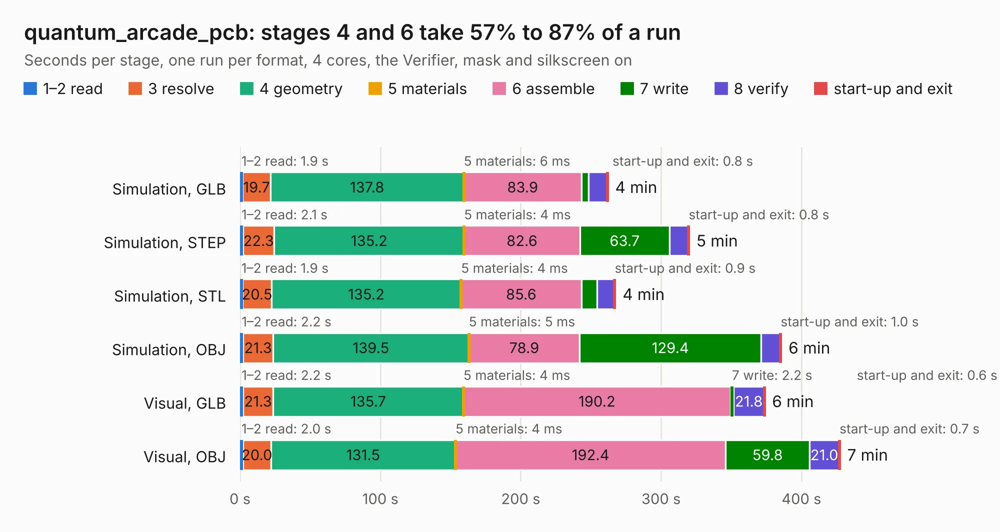

# 1767. quantum_arcade_pcb

Board 1,767 of the 3,116 of [Corpus Testing](../Corpus-Testing.md), on [Corpus Page 17](../CorpusTestingPages/Corpus-Testing-17.md#1767-quantum_arcade_pcb).

| Mode and format | 1–2 read | 3 resolve | 4 geometry | 5 materials | 6 assemble | 7 write | 8 verify | start-up and exit | Total |
|---|---:|---:|---:|---:|---:|---:|---:|---:|---:|
| Simulation, GLB | 1.9 | 19.7 | 137.8 | 6&nbsp;ms | 83.9 | 5.0 | 13.1 | 0.8 | 262.2 |
| Simulation, STEP | 2.1 | 22.3 | 135.2 | 4&nbsp;ms | 82.6 | 63.7 | 13.4 | 0.8 | 320.0 |
| Simulation, STL | 1.9 | 20.5 | 135.2 | 4&nbsp;ms | 85.6 | 11.1 | 12.2 | 0.9 | 267.5 |
| Simulation, OBJ | 2.2 | 21.3 | 139.5 | 5&nbsp;ms | 78.9 | 129.4 | 13.5 | 1.0 | 385.7 |
| Visual, GLB | 2.2 | 21.3 | 135.7 | 4&nbsp;ms | 190.2 | 2.2 | 21.8 | 0.6 | 374.0 |
| Visual, OBJ | 2.0 | 20.0 | 131.5 | 4&nbsp;ms | 192.4 | 59.8 | 21.0 | 0.7 | 427.5 |

<table align="center"><tr><td valign="top">

| Board | Repo: [nmikstas/quantum_arcade_pcb](https://github.com/nmikstas/quantum_arcade_pcb) Board: `quantum_arcade_pcb.kicad_pcb` |
|---|---|
| Folder | quantum_arcade_pcb |
| Complexity | 297&nbsp;/&nbsp;1000 (size&nbsp;242, features&nbsp;55) |
| KESE&nbsp;features | through vias, filled zones, copper text, curved board outline |
| Tested | 9th November 2026 to 10th November 2026 |
| Copper&nbsp;layers | 2 |
| File&nbsp;format | KiCad 5 (20171130) |
| Parts,&nbsp;tracks,&nbsp;vias | 482, 13,501, 809 |
| Triangles,&nbsp;simulation | 18,765,660 in 702 parts |
| Verifier | PASS in all six runs |
| Run&nbsp;again | Simulation, OBJ: failed in the corpus run, run again with the memory cap raised from 11 GB to 14.5 GB, and passed |

</td><td valign="top">

<table>
<tr><th>File type</th><th>File size</th><th>Peak memory used</th></tr>
<tr><th colspan="3" align="left">Simulation</th></tr>
<tr><td>GLB</td><td align="right">643&nbsp;MB</td><td align="right">4.8&nbsp;GB</td></tr>
<tr><td>STEP</td><td align="right">3.3&nbsp;GB</td><td align="right">6.0&nbsp;GB</td></tr>
<tr><td>STL</td><td align="right">938&nbsp;MB</td><td align="right">5.0&nbsp;GB</td></tr>
<tr><td>OBJ</td><td align="right">2.1&nbsp;GB</td><td align="right">12&nbsp;GB</td></tr>
<tr><th colspan="3" align="left">Visual</th></tr>
<tr><td>GLB</td><td align="right">350&nbsp;MB</td><td align="right">5.6&nbsp;GB</td></tr>
<tr><td>OBJ</td><td align="right">1.1&nbsp;GB</td><td align="right">7.4&nbsp;GB</td></tr>
</table>

</td></tr></table>

| Previous | Next |
|:---|---:|
| [1766. ROM_To_2716](b1766b_asteroids-pcb_ROM-To-2716.md) | [1768. alu](b1768b_74cpu_alu.md) |
