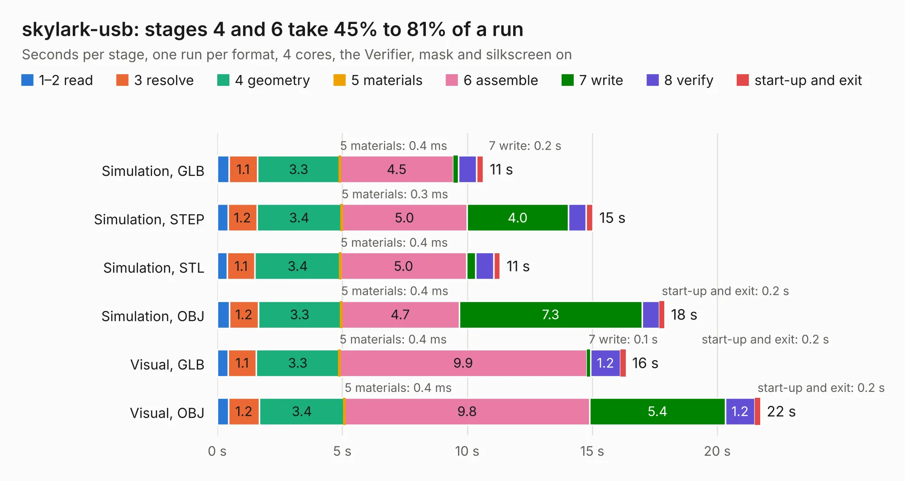

# 1769. skylark-usb

Board 1,769 of the 3,138 of [Corpus Testing](../Corpus-Testing.md), on [Corpus Page 17](../CorpusTestingPages/Corpus-Testing-17.md#1769-skylark-usb).

| Mode and format | 1–2 read | 3 resolve | 4 geometry | 5 materials | 6 assemble | 7 write | 8 verify | start-up and exit | Total |
|---|---:|---:|---:|---:|---:|---:|---:|---:|---:|
| Simulation, GLB | 0.5 | 1.1 | 3.3 | 0.4&nbsp;ms | 4.5 | 0.2 | 0.7 | 0.3 | 10.6 |
| Simulation, STEP | 0.4 | 1.2 | 3.4 | 0.3&nbsp;ms | 5.0 | 4.0 | 0.7 | 0.3 | 15.0 |
| Simulation, STL | 0.4 | 1.1 | 3.4 | 0.4&nbsp;ms | 5.0 | 0.4 | 0.7 | 0.3 | 11.3 |
| Simulation, OBJ | 0.5 | 1.2 | 3.3 | 0.4&nbsp;ms | 4.7 | 7.3 | 0.7 | 0.2 | 17.9 |
| Visual, GLB | 0.4 | 1.1 | 3.3 | 0.4&nbsp;ms | 9.9 | 0.1 | 1.2 | 0.2 | 16.3 |
| Visual, OBJ | 0.4 | 1.2 | 3.4 | 0.4&nbsp;ms | 9.8 | 5.4 | 1.2 | 0.2 | 21.7 |

<table align="center"><tr><td valign="top">

| Board | Repo: [naturalhazardscience/groundlark](https://github.com/naturalhazardscience/groundlark) Board: `skylark-usb.kicad_pcb` |
|---|---|
| Folder | hw / skylark-usb / boards / skylark-usb |
| Complexity | 350&nbsp;/&nbsp;1000 (size&nbsp;245, features&nbsp;105) |
| KESE&nbsp;features | through vias, slotted holes, rounded, trapezoid or chamfered pads, filled zones, stack-up, dielectric εr and tanδ, copper finish, mask and silkscreen colours |
| Tested | 9th November 2026 |
| Copper&nbsp;layers | 4 |
| File&nbsp;format | KiCad 9 (20241229) |
| Parts,&nbsp;tracks,&nbsp;vias | 121, 1,037, 159 |
| Triangles,&nbsp;simulation | 1,271,024 in 109 parts |
| Verifier | PASS in all six runs |

</td><td valign="top">

<table>
<tr><th>File type</th><th>File size</th><th>Peak memory used</th></tr>
<tr><th colspan="3" align="left">Simulation</th></tr>
<tr><td>GLB</td><td align="right">43&nbsp;MB</td><td align="right">524&nbsp;MB</td></tr>
<tr><td>STEP</td><td align="right">175&nbsp;MB</td><td align="right">671&nbsp;MB</td></tr>
<tr><td>STL</td><td align="right">64&nbsp;MB</td><td align="right">530&nbsp;MB</td></tr>
<tr><td>OBJ</td><td align="right">130&nbsp;MB</td><td align="right">861&nbsp;MB</td></tr>
<tr><th colspan="3" align="left">Visual</th></tr>
<tr><td>GLB</td><td align="right">30&nbsp;MB</td><td align="right">735&nbsp;MB</td></tr>
<tr><td>OBJ</td><td align="right">93&nbsp;MB</td><td align="right">725&nbsp;MB</td></tr>
</table>

</td></tr></table>

| Previous | Next |
|:---|---:|
| [1768. raspberrypi_hat](b1768b_groundlark_raspberrypi-hat.md) | [1770. skylark](b1770b_groundlark_skylark.md) |
