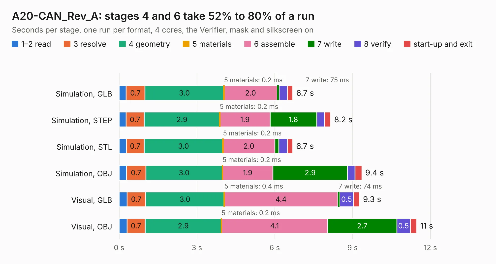

# 1770. A20-CAN_Rev_A

Board 1,770 of the 3,109 of [Corpus Testing](../Corpus-Testing.md), on [Corpus Page 17](../CorpusTestingPages/Corpus-Testing-17.md#1770-a20-can_rev_a).

| Mode and format | 1–2 read | 3 resolve | 4 geometry | 5 materials | 6 assemble | 7 write | 8 verify | start-up and exit | Total |
|---|---:|---:|---:|---:|---:|---:|---:|---:|---:|
| Simulation, GLB | 0.3 | 0.7 | 3.0 | 0.2&nbsp;ms | 2.0 | 75&nbsp;ms | 0.3 | 0.2 | 6.7 |
| Simulation, STEP | 0.3 | 0.7 | 2.9 | 0.2&nbsp;ms | 1.9 | 1.8 | 0.3 | 0.2 | 8.2 |
| Simulation, STL | 0.3 | 0.7 | 3.0 | 0.2&nbsp;ms | 2.0 | 0.2 | 0.3 | 0.2 | 6.7 |
| Simulation, OBJ | 0.3 | 0.7 | 3.0 | 0.2&nbsp;ms | 1.9 | 2.9 | 0.3 | 0.3 | 9.4 |
| Visual, GLB | 0.3 | 0.7 | 3.0 | 0.4&nbsp;ms | 4.4 | 74&nbsp;ms | 0.5 | 0.2 | 9.3 |
| Visual, OBJ | 0.3 | 0.7 | 2.9 | 0.2&nbsp;ms | 4.1 | 2.7 | 0.5 | 0.2 | 11.5 |

<table align="center"><tr><td valign="top">

| Board | Repo: [OLIMEX/A20-CAN](https://github.com/OLIMEX/A20-CAN) Board: `A20-CAN_Rev_A.kicad_pcb` |
|---|---|
| Complexity | 192&nbsp;/&nbsp;1000 (size&nbsp;157, features&nbsp;35) |
| KESE&nbsp;features | through vias, filled zones |
| Tested | 9th November 2026 |
| Copper&nbsp;layers | 2 |
| File&nbsp;format | KiCad 4 (4) |
| Parts,&nbsp;tracks,&nbsp;vias | 18, 411, 117 |
| Triangles,&nbsp;simulation | 492,504 in 27 parts |
| Verifier | PASS in all six runs |

</td><td valign="top">

<table>
<tr><th>File type</th><th>File size</th><th>Peak memory used</th></tr>
<tr><th colspan="3" align="left">Simulation</th></tr>
<tr><td>GLB</td><td align="right">17&nbsp;MB</td><td align="right">318&nbsp;MB</td></tr>
<tr><td>STEP</td><td align="right">87&nbsp;MB</td><td align="right">389&nbsp;MB</td></tr>
<tr><td>STL</td><td align="right">25&nbsp;MB</td><td align="right">337&nbsp;MB</td></tr>
<tr><td>OBJ</td><td align="right">51&nbsp;MB</td><td align="right">392&nbsp;MB</td></tr>
<tr><th colspan="3" align="left">Visual</th></tr>
<tr><td>GLB</td><td align="right">16&nbsp;MB</td><td align="right">407&nbsp;MB</td></tr>
<tr><td>OBJ</td><td align="right">46&nbsp;MB</td><td align="right">396&nbsp;MB</td></tr>
</table>

</td></tr></table>

| Previous | Next |
|:---|---:|
| [1769. m3](b1769b_rocket-flight-computer_reference-m3-assy-r1_m3.md) | [1771. A20-CAN-ISO_Rev_B](b1771b_A20-CAN-ISO_A20-CAN-ISO-Rev-B.md) |
