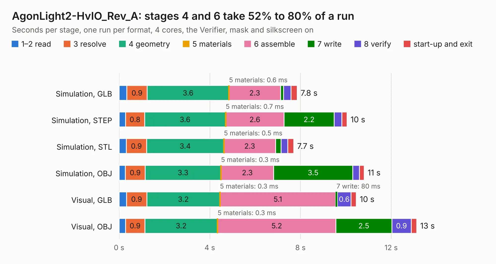

# 1770. AgonLight2-HvIO_Rev_A

Board 1,770 of the 3,105 of [Corpus Testing](../Corpus-Testing.md), on [Corpus Page 17](../CorpusTestingPages/Corpus-Testing-17.md#1770-agonlight2-hvio_rev_a).

| Mode and format | 1–2 read | 3 resolve | 4 geometry | 5 materials | 6 assemble | 7 write | 8 verify | start-up and exit | Total |
|---|---:|---:|---:|---:|---:|---:|---:|---:|---:|
| Simulation, GLB | 0.3 | 0.9 | 3.6 | 0.6&nbsp;ms | 2.3 | 0.1 | 0.3 | 0.3 | 7.8 |
| Simulation, STEP | 0.3 | 0.8 | 3.6 | 0.7&nbsp;ms | 2.6 | 2.2 | 0.3 | 0.2 | 10.1 |
| Simulation, STL | 0.3 | 0.9 | 3.4 | 0.5&nbsp;ms | 2.3 | 0.2 | 0.3 | 0.3 | 7.7 |
| Simulation, OBJ | 0.3 | 0.9 | 3.3 | 0.3&nbsp;ms | 2.3 | 3.5 | 0.3 | 0.2 | 10.8 |
| Visual, GLB | 0.3 | 0.9 | 3.2 | 0.3&nbsp;ms | 5.1 | 80&nbsp;ms | 0.6 | 0.2 | 10.5 |
| Visual, OBJ | 0.3 | 0.9 | 3.2 | 0.3&nbsp;ms | 5.2 | 2.5 | 0.9 | 0.2 | 13.1 |

<table align="center"><tr><td valign="top">

| Board | Repo: [OLIMEX/AgonLight2-HvIO](https://github.com/OLIMEX/AgonLight2-HvIO) Board: `AgonLight2-HvIO_Rev_A.kicad_pcb` |
|---|---|
| Folder | HARDWARE / AgonLight2-HvIO_Rev_A |
| Complexity | 267&nbsp;/&nbsp;1000 (size&nbsp;177, features&nbsp;90) |
| KESE&nbsp;features | through vias, filled zones, copper text, knockout text, stack-up, dielectric εr and tanδ |
| Tested | 9th November 2026 |
| Copper&nbsp;layers | 2 |
| File&nbsp;format | KiCad 7 (20221018) |
| Parts,&nbsp;tracks,&nbsp;vias | 62, 586, 180 |
| Triangles,&nbsp;simulation | 770,540 in 91 parts |
| Verifier | PASS in all six runs |

</td><td valign="top">

<table>
<tr><th>File type</th><th>File size</th><th>Peak memory used</th></tr>
<tr><th colspan="3" align="left">Simulation</th></tr>
<tr><td>GLB</td><td align="right">27&nbsp;MB</td><td align="right">423&nbsp;MB</td></tr>
<tr><td>STEP</td><td align="right">131&nbsp;MB</td><td align="right">482&nbsp;MB</td></tr>
<tr><td>STL</td><td align="right">39&nbsp;MB</td><td align="right">444&nbsp;MB</td></tr>
<tr><td>OBJ</td><td align="right">80&nbsp;MB</td><td align="right">584&nbsp;MB</td></tr>
<tr><th colspan="3" align="left">Visual</th></tr>
<tr><td>GLB</td><td align="right">21&nbsp;MB</td><td align="right">503&nbsp;MB</td></tr>
<tr><td>OBJ</td><td align="right">62&nbsp;MB</td><td align="right">537&nbsp;MB</td></tr>
</table>

</td></tr></table>

| Previous | Next |
|:---|---:|
| [1769. AgonLight2_Rev_B](b1769b_AgonLight2_AgonLight2-Rev-B.md) | [1771. AgonLight2-HvIO_Rev_A1](b1771b_AgonLight2-HvIO_AgonLight2-HvIO-Rev-A1.md) |
