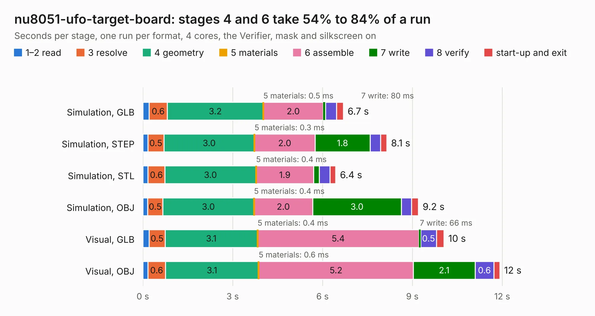

# 1770. nu8051-ufo-target-board

Board 1,770 of the 3,124 of [Corpus Testing](../Corpus-Testing.md), on [Corpus Page 17](../CorpusTestingPages/Corpus-Testing-17.md#1770-nu8051-ufo-target-board).

| Mode and format | 1–2 read | 3 resolve | 4 geometry | 5 materials | 6 assemble | 7 write | 8 verify | start-up and exit | Total |
|---|---:|---:|---:|---:|---:|---:|---:|---:|---:|
| Simulation, GLB | 0.2 | 0.6 | 3.2 | 0.5&nbsp;ms | 2.0 | 80&nbsp;ms | 0.4 | 0.2 | 6.7 |
| Simulation, STEP | 0.2 | 0.5 | 3.0 | 0.3&nbsp;ms | 2.0 | 1.8 | 0.4 | 0.2 | 8.1 |
| Simulation, STL | 0.2 | 0.6 | 3.0 | 0.4&nbsp;ms | 1.9 | 0.2 | 0.4 | 0.2 | 6.4 |
| Simulation, OBJ | 0.2 | 0.5 | 3.0 | 0.4&nbsp;ms | 2.0 | 3.0 | 0.3 | 0.2 | 9.2 |
| Visual, GLB | 0.2 | 0.5 | 3.1 | 0.4&nbsp;ms | 5.4 | 66&nbsp;ms | 0.5 | 0.3 | 10.1 |
| Visual, OBJ | 0.2 | 0.6 | 3.1 | 0.6&nbsp;ms | 5.2 | 2.1 | 0.6 | 0.2 | 11.9 |

<table align="center"><tr><td valign="top">

| Board | Repo: [newaetech/chipwhisperer-target-cw308t](https://github.com/newaetech/chipwhisperer-target-cw308t) Board: `nu8051-ufo-target-board.kicad_pcb` |
|---|---|
| Folder | CW308T_NU8051_AT20 / kicad_src |
| Complexity | 241&nbsp;/&nbsp;1000 (size&nbsp;141, features&nbsp;100) |
| KESE&nbsp;features | through vias, custom pads, rounded, trapezoid or chamfered pads, filled zones, copper drawings, stack-up, dielectric εr and tanδ |
| Tested | 9th November 2026 |
| Copper&nbsp;layers | 2 |
| File&nbsp;format | KiCad 7 (20221018) |
| Parts,&nbsp;tracks,&nbsp;vias | 9, 181, 86 |
| Triangles,&nbsp;simulation | 612,998 in 55 parts |
| Verifier | PASS in all six runs |

</td><td valign="top">

<table>
<tr><th>File type</th><th>File size</th><th>Peak memory used</th></tr>
<tr><th colspan="3" align="left">Simulation</th></tr>
<tr><td>GLB</td><td align="right">21&nbsp;MB</td><td align="right">340&nbsp;MB</td></tr>
<tr><td>STEP</td><td align="right">96&nbsp;MB</td><td align="right">391&nbsp;MB</td></tr>
<tr><td>STL</td><td align="right">31&nbsp;MB</td><td align="right">338&nbsp;MB</td></tr>
<tr><td>OBJ</td><td align="right">62&nbsp;MB</td><td align="right">444&nbsp;MB</td></tr>
<tr><th colspan="3" align="left">Visual</th></tr>
<tr><td>GLB</td><td align="right">15&nbsp;MB</td><td align="right">398&nbsp;MB</td></tr>
<tr><td>OBJ</td><td align="right">44&nbsp;MB</td><td align="right">392&nbsp;MB</td></tr>
</table>

</td></tr></table>

| Previous | Next |
|:---|---:|
| [1769. tmp](b1769b_freeeeg32_tmp.md) | [1771. SONATA-ONE](b1771b_sonata-pcb_SONATA-ONE.md) |
