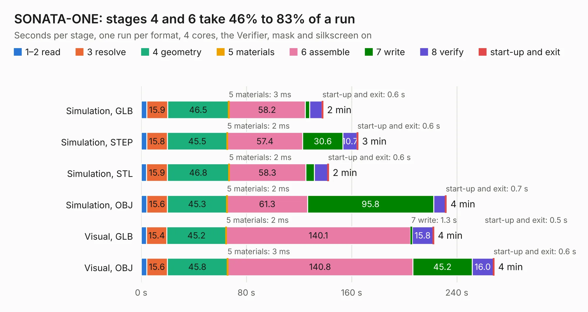

# 1771. SONATA-ONE

Board 1,771 of the 3,124 of [Corpus Testing](../Corpus-Testing.md), on [Corpus Page 17](../CorpusTestingPages/Corpus-Testing-17.md#1771-sonata-one).

| Mode and format | 1–2 read | 3 resolve | 4 geometry | 5 materials | 6 assemble | 7 write | 8 verify | start-up and exit | Total |
|---|---:|---:|---:|---:|---:|---:|---:|---:|---:|
| Simulation, GLB | 4.2 | 15.9 | 46.5 | 3&nbsp;ms | 58.2 | 3.3 | 9.4 | 0.6 | 138.2 |
| Simulation, STEP | 4.2 | 15.8 | 45.5 | 2&nbsp;ms | 57.4 | 30.6 | 10.7 | 0.6 | 164.8 |
| Simulation, STL | 4.1 | 15.9 | 46.8 | 2&nbsp;ms | 58.3 | 6.6 | 10.2 | 0.6 | 142.4 |
| Simulation, OBJ | 4.3 | 15.6 | 45.3 | 2&nbsp;ms | 61.3 | 95.8 | 9.0 | 0.7 | 232.0 |
| Visual, GLB | 4.1 | 15.4 | 45.2 | 2&nbsp;ms | 140.1 | 1.3 | 15.8 | 0.5 | 222.4 |
| Visual, OBJ | 4.2 | 15.6 | 45.8 | 3&nbsp;ms | 140.8 | 45.2 | 16.0 | 0.6 | 268.2 |

<table align="center"><tr><td valign="top">

| Board | Repo: [newaetech/sonata-pcb](https://github.com/newaetech/sonata-pcb) Board: `SONATA-ONE.kicad_pcb` |
|---|---|
| Folder | sonata-one / sonata_kicad_project |
| Complexity | 487&nbsp;/&nbsp;1000 (size&nbsp;327, features&nbsp;160) |
| KESE&nbsp;features | through vias, slotted holes, rounded, trapezoid or chamfered pads, arc tracks, filled zones, copper drawings, copper text, curved board outline, knockout text, TrueType text, stack-up, dielectric εr and tanδ |
| Tested | 9th November 2026 |
| Copper&nbsp;layers | 8 |
| File&nbsp;format | KiCad 8 (20240108) |
| Parts,&nbsp;tracks,&nbsp;vias | 468, 12,952, 1,328 |
| Triangles,&nbsp;simulation | 14,886,156 in 664 parts |
| Verifier | PASS in all six runs |

</td><td valign="top">

<table>
<tr><th>File type</th><th>File size</th><th>Peak memory used</th></tr>
<tr><th colspan="3" align="left">Simulation</th></tr>
<tr><td>GLB</td><td align="right">495&nbsp;MB</td><td align="right">3.2&nbsp;GB</td></tr>
<tr><td>STEP</td><td align="right">1.8&nbsp;GB</td><td align="right">4.4&nbsp;GB</td></tr>
<tr><td>STL</td><td align="right">744&nbsp;MB</td><td align="right">3.3&nbsp;GB</td></tr>
<tr><td>OBJ</td><td align="right">1.7&nbsp;GB</td><td align="right">9.4&nbsp;GB</td></tr>
<tr><th colspan="3" align="left">Visual</th></tr>
<tr><td>GLB</td><td align="right">262&nbsp;MB</td><td align="right">4.2&nbsp;GB</td></tr>
<tr><td>OBJ</td><td align="right">881&nbsp;MB</td><td align="right">5.8&nbsp;GB</td></tr>
</table>

</td></tr></table>

| Previous | Next |
|:---|---:|
| [1770. nu8051-ufo-target-board](b1770b_chipwhisperer-target-cw308t_nu8051-ufo-target-board.md) | [1772. amulet_controller](b1772b_amulet-controller-kibot_amulet-controller.md) |
