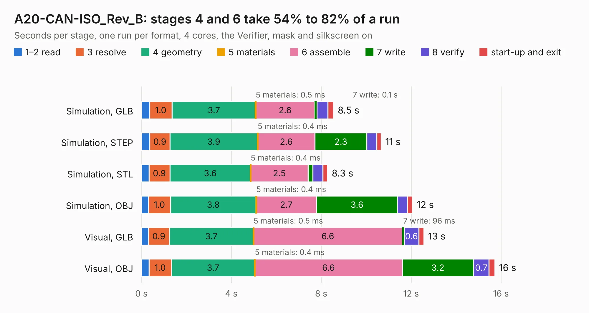

# 1773. A20-CAN-ISO_Rev_B

Board 1,773 of the 3,111 of [Corpus Testing](../Corpus-Testing.md), on [Corpus Page 17](../CorpusTestingPages/Corpus-Testing-17.md#1773-a20-can-iso_rev_b).

| Mode and format | 1–2 read | 3 resolve | 4 geometry | 5 materials | 6 assemble | 7 write | 8 verify | start-up and exit | Total |
|---|---:|---:|---:|---:|---:|---:|---:|---:|---:|
| Simulation, GLB | 0.4 | 1.0 | 3.7 | 0.5&nbsp;ms | 2.6 | 0.1 | 0.5 | 0.3 | 8.5 |
| Simulation, STEP | 0.4 | 0.9 | 3.9 | 0.4&nbsp;ms | 2.6 | 2.3 | 0.4 | 0.2 | 10.7 |
| Simulation, STL | 0.3 | 0.9 | 3.6 | 0.4&nbsp;ms | 2.5 | 0.2 | 0.4 | 0.2 | 8.3 |
| Simulation, OBJ | 0.3 | 1.0 | 3.8 | 0.4&nbsp;ms | 2.7 | 3.6 | 0.4 | 0.2 | 12.1 |
| Visual, GLB | 0.3 | 0.9 | 3.7 | 0.5&nbsp;ms | 6.6 | 96&nbsp;ms | 0.6 | 0.2 | 12.6 |
| Visual, OBJ | 0.3 | 1.0 | 3.7 | 0.4&nbsp;ms | 6.6 | 3.2 | 0.7 | 0.3 | 15.7 |

<table align="center"><tr><td valign="top">

| Board | Repo: [OLIMEX/A20-CAN-ISO](https://github.com/OLIMEX/A20-CAN-ISO) Board: `A20-CAN-ISO_Rev_B.kicad_pcb` |
|---|---|
| Folder | HARDWARE / A20-CAN-ISO-Rev_B |
| Complexity | 206&nbsp;/&nbsp;1000 (size&nbsp;171, features&nbsp;35) |
| KESE&nbsp;features | through vias, filled zones |
| Tested | 9th November 2026 |
| Copper&nbsp;layers | 2 |
| File&nbsp;format | KiCad 5 (20171130) |
| Parts,&nbsp;tracks,&nbsp;vias | 28, 758, 184 |
| Triangles,&nbsp;simulation | 702,972 in 130 parts |
| Verifier | PASS in all six runs |

</td><td valign="top">

<table>
<tr><th>File type</th><th>File size</th><th>Peak memory used</th></tr>
<tr><th colspan="3" align="left">Simulation</th></tr>
<tr><td>GLB</td><td align="right">25&nbsp;MB</td><td align="right">417&nbsp;MB</td></tr>
<tr><td>STEP</td><td align="right">111&nbsp;MB</td><td align="right">477&nbsp;MB</td></tr>
<tr><td>STL</td><td align="right">35&nbsp;MB</td><td align="right">433&nbsp;MB</td></tr>
<tr><td>OBJ</td><td align="right">72&nbsp;MB</td><td align="right">530&nbsp;MB</td></tr>
<tr><th colspan="3" align="left">Visual</th></tr>
<tr><td>GLB</td><td align="right">22&nbsp;MB</td><td align="right">527&nbsp;MB</td></tr>
<tr><td>OBJ</td><td align="right">64&nbsp;MB</td><td align="right">539&nbsp;MB</td></tr>
</table>

</td></tr></table>

| Previous | Next |
|:---|---:|
| [1772. A20-CAN_Rev_A](b1772b_A20-CAN_A20-CAN-Rev-A.md) | [1774. AgonLight2_Rev_A](b1774b_AgonLight2_AgonLight2-Rev-A.md) |
