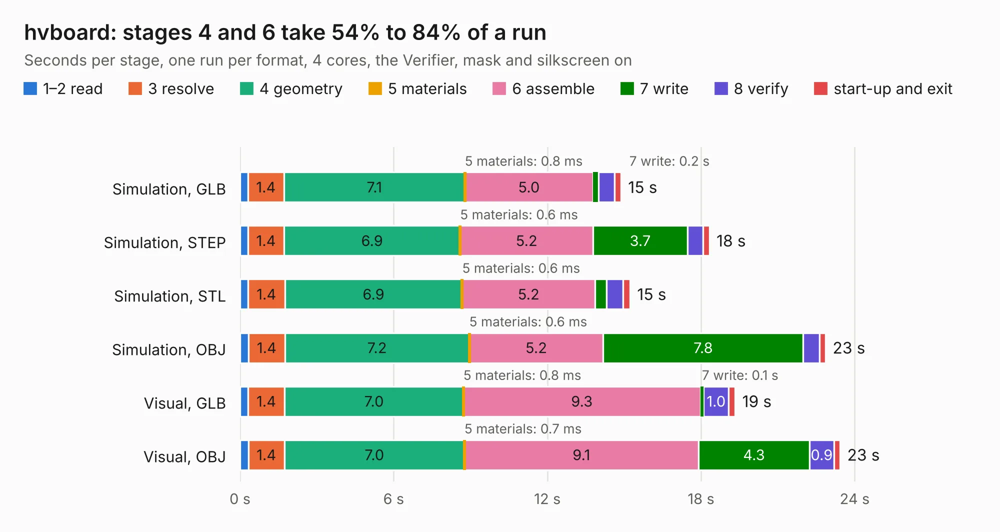

# 1774. hvboard

Board 1,774 of the 3,120 of [Corpus Testing](../Corpus-Testing.md), on [Corpus Page 17](../CorpusTestingPages/Corpus-Testing-17.md#1774-hvboard).

| Mode and format | 1–2 read | 3 resolve | 4 geometry | 5 materials | 6 assemble | 7 write | 8 verify | start-up and exit | Total |
|---|---:|---:|---:|---:|---:|---:|---:|---:|---:|
| Simulation, GLB | 0.3 | 1.4 | 7.1 | 0.8&nbsp;ms | 5.0 | 0.2 | 0.6 | 0.2 | 14.9 |
| Simulation, STEP | 0.3 | 1.4 | 6.9 | 0.6&nbsp;ms | 5.2 | 3.7 | 0.6 | 0.2 | 18.3 |
| Simulation, STL | 0.3 | 1.4 | 6.9 | 0.6&nbsp;ms | 5.2 | 0.4 | 0.6 | 0.3 | 15.2 |
| Simulation, OBJ | 0.3 | 1.4 | 7.2 | 0.6&nbsp;ms | 5.2 | 7.8 | 0.6 | 0.2 | 22.9 |
| Visual, GLB | 0.3 | 1.4 | 7.0 | 0.8&nbsp;ms | 9.3 | 0.1 | 1.0 | 0.2 | 19.3 |
| Visual, OBJ | 0.3 | 1.4 | 7.0 | 0.7&nbsp;ms | 9.1 | 4.3 | 0.9 | 0.2 | 23.4 |

<table align="center"><tr><td valign="top">

| Board | Repo: [nuclearfutureslab/ibxII-hardware](https://github.com/nuclearfutureslab/ibxII-hardware) Board: `hvboard.kicad_pcb` |
|---|---|
| Folder | hvboard |
| Complexity | 205&nbsp;/&nbsp;1000 (size&nbsp;160, features&nbsp;45) |
| KESE&nbsp;features | through vias, rounded, trapezoid or chamfered pads, filled zones |
| Tested | 9th November 2026 |
| Copper&nbsp;layers | 2 |
| File&nbsp;format | KiCad 5 (20171130) |
| Parts,&nbsp;tracks,&nbsp;vias | 50, 447, 5 |
| Triangles,&nbsp;simulation | 1,305,990 in 75 parts |
| Verifier | PASS in all six runs |

</td><td valign="top">

<table>
<tr><th>File type</th><th>File size</th><th>Peak memory used</th></tr>
<tr><th colspan="3" align="left">Simulation</th></tr>
<tr><td>GLB</td><td align="right">45&nbsp;MB</td><td align="right">532&nbsp;MB</td></tr>
<tr><td>STEP</td><td align="right">226&nbsp;MB</td><td align="right">593&nbsp;MB</td></tr>
<tr><td>STL</td><td align="right">65&nbsp;MB</td><td align="right">522&nbsp;MB</td></tr>
<tr><td>OBJ</td><td align="right">135&nbsp;MB</td><td align="right">901&nbsp;MB</td></tr>
<tr><th colspan="3" align="left">Visual</th></tr>
<tr><td>GLB</td><td align="right">26&nbsp;MB</td><td align="right">578&nbsp;MB</td></tr>
<tr><td>OBJ</td><td align="right">76&nbsp;MB</td><td align="right">578&nbsp;MB</td></tr>
</table>

</td></tr></table>

| Previous | Next |
|:---|---:|
| [1773. adcboard](b1773b_ibxII-hardware_adcboard.md) | [1775. greybadge_pcb](b1775b_greybadge25_greybadge-pcb.md) |
